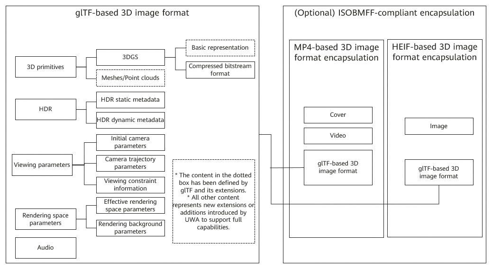
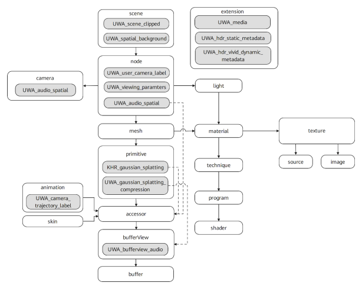
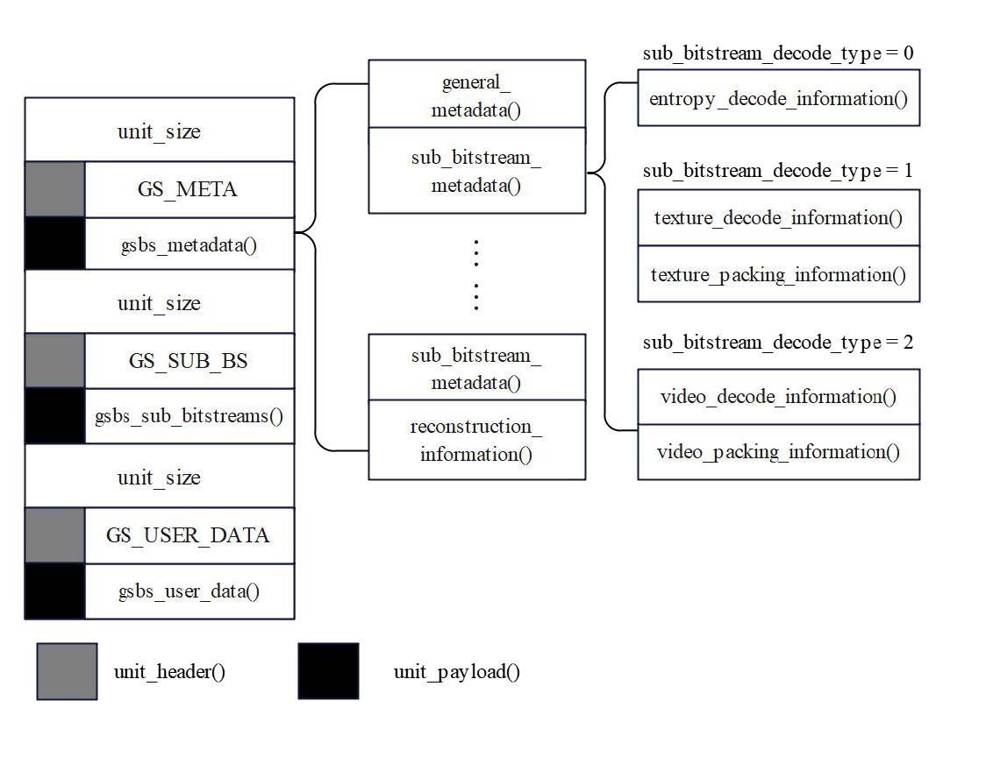
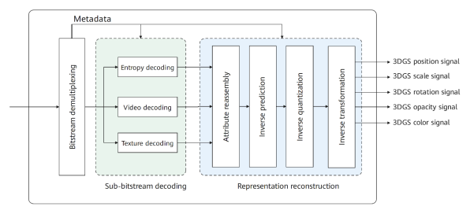
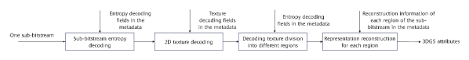
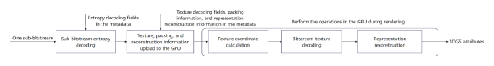
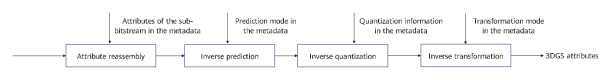
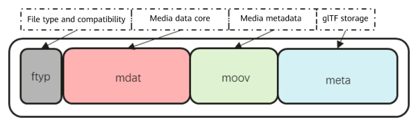
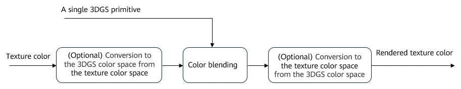

**Six Degrees of Freedom (6DoF)** \
**Interactive 3D Image Format**

（Version NO. 1.0）

Release Time

2026-05-28

UHD World Association (UWA)

T/UWA 050-2026

## Contents

- [Introduction](#introduction)
- [1 Scope](#1-scope)
- [2 Normative References](#2-normative-references)
- [3 Terms and Definitions](#3-terms-and-definitions)
- [4 Acronyms and Abbreviations](#4-acronyms-and-abbreviations)
- [5 Symbols and Operators](#5-symbols-and-operators)
  - [5.1 Overview](#51-overview)
  - [5.2 Arithmetic Operators](#52-arithmetic-operators)
  - [5.3 Logical Operators](#53-logical-operators)
  - [5.4 Relational Operators](#54-relational-operators)
  - [5.5 Bitwise Operators](#55-bitwise-operators)
  - [5.6 Assignment](#56-assignment)
  - [5.7 Mathematical Functions](#57-mathematical-functions)
  - [5.8 Structural Relationship Operator](#58-structural-relationship-operator)
  - [5.9 Bitstream Syntax Description](#59-bitstream-syntax-description)
  - [5.10 Functions](#510-functions)
  - [5.11 Descriptors](#511-descriptors)
  - [5.12 Reserved, Forbidden, and Marker Bit](#512-reserved-forbidden-and-marker-bit)
- [6 Framework of the 6DoF Interactive 3D Image Format](#6-framework-of-the-6dof-interactive-3d-image-format)
- [7 Storage of glTF-based 3D Image Format](#7-storage-of-gltf-based-3d-image-format)
  - [7.1 Overview](#71-overview)
  - [7.2 3D Primitives](#72-3d-primitives)
  - [7.3 HDR](#73-hdr)
  - [7.4 Viewing Information Parameters](#74-viewing-information-parameters)
  - [7.5 Audio](#75-audio)
  - [7.6 Rendering Space Parameters](#76-rendering-space-parameters)
- [8 3DGS Compression Format and Decoding](#8-3dgs-compression-format-and-decoding)
  - [8.1 Overview](#81-overview)
  - [8.2 EGSC Compression Format and Decoding](#82-egsc-compression-format-and-decoding)
- [9 ISOBMFF-based 3D Image Format Encapsulation](#9-isobmff-based-3d-image-format-encapsulation)
  - [9.1 Overview](#91-overview)
  - [9.2 Specifications for ISOBMFF-based glTF Encapsulation](#92-specifications-for-isobmff-based-gltf-encapsulation)
  - [9.3 Examples of MP4-based 3D Image Format Encapsulation](#93-examples-of-mp4-based-3d-image-format-encapsulation)
  - [9.4 Examples of HEIF-based 3D Image Format Encapsulation](#94-examples-of-heif-based-3d-image-format-encapsulation)
- [Annex A (Normative) Profiles](#annex-a-normative-profiles)
  - [A.1 Overview](#a1-overview)
  - [A.2 Profiles](#a2-profiles)
- [Annex B (Informative) Recommended HDR Rendering Parameters for 3DGS](#annex-b-informative-recommended-hdr-rendering-parameters-for-3dgs)
  - [B.1 Recommended Scheme for 3DGS HDR/SDR Rendering Selection](#b1-recommended-scheme-for-3dgs-hdrsdr-rendering-selection)
  - [B.2 Recommended Scheme for Blending Rendering of 3DGS](#b2-recommended-scheme-for-blending-rendering-of-3dgs)
  - [B.3 Recommended HDR Metadata Camera Parameters for 3DGS](#b3-recommended-hdr-metadata-camera-parameters-for-3dgs)
- [References](#references)

# Introduction

This document is developed by UHD World Association.

The issuer of this document draws attention to the fact that compliance with this document may involve the use of the following 13 patents related to 3D image format technologies, as specified in chapters 5, 6, 7, 8, and 9:

202511233833.7 Method and apparatus for transmitting and rendering of three-dimensional scene data; PCT/CN2025/133667 Method and apparatus for encoding and decoding scene data; PCT/CN2025/133665 Method and apparatus for encoding and decoding scene data; PCT/CN2025/133582 Encoding method, decoding method, and related apparatus for three-dimensional scene data; 202511599336.9 Encoding method, decoding method, apparatus, and system for three-dimensional data; 202511157272.7 Method, apparatus, device, and system for encapsulating and decapsulating three-dimensional scene data; 202510777034.X Data encapsulation method, data retrieval method, and device; PCT/CN2025/133186 Method and apparatus for processing three-dimensional scene data; 202510089693.4 Encoding method, decoding method, and related apparatus for a 3DGS model; CN202511585759.5 Method for encapsulating three-dimensional data and related products; CN202610024968.0 Data encapsulation method, data rendering method, and related products; CN202610363961.1 Data encapsulation method and related products; 2025111685227 Method, system, medium, device, and program product for presenting three-dimensional Gaussian data.

The issuer of this document takes no position concerning the authenticity, validity, or scope of the patents.

The patent holders have confirmed to the issuer of this document their willingness to negotiate licenses under the patents with any applicant on reasonable and non-discriminatory terms and conditions. The patent holders' declaration has been duly filed with the issuer of this document. Relevant information can be obtained through the following means.

| Patentee                                     | Address                                                                                                  |
| -------------------------------------------- | -------------------------------------------------------------------------------------------------------- |
| Huawei Technologies Co., Ltd.                | Huawei Industrial Base, Bantian, Longgang, Shenzhen, People's Republic of China                          |
| Xiaohongshu Technology Co., Ltd.             | China Overseas International Center, 5 Anding Rd, Chaoyang District, Beijing, People's Republic of China |
| Malanshan Audio & Video Laboratory (MLS Lab) | Building B, Malanshan Creative Center, No. 6 Wenchuang Road, Changsha, Hunan, People's Republic of China |

Contact: Gao Yanxuan

Address: China Electronics Standardization Institute, No. 1 Andingmen East Street, Dongcheng District, Beijing, People's Republic of China

Postal code: 100007

Tel: +86-13683269839; +86-10-64102619

Fax: +86-10-84029217

Please note that in addition to the above patents, some content in this document may still involve patents. The issuer of this document is not responsible for identifying these patents.

**Six Degrees of Freedom (6DoF) Interactive 3D Image Format**

# 1 Scope

This document specifies a 6DoF interactive 3D image format, including glTF-based 3D image format storage, 3DGS compression and decoding, and ISOBMFF-based 3D image format encapsulation.

This document applies to use cases involving the capture and reconstruction, storage, editing, and transmission of 6DoF interactive 3D images.

# 2 Normative References

The following documents are normatively referenced in the text and constitute indispensable provisions of this document. For dated references, only the edition cited applies. For undated references, the latest edition of the referenced document (including any amendments) applies.

GB/T 46269.1-2025 High dynamic range (HDR) video technology — Part 1: Metadata and processing

ISO/IEC 12113:2022 Information technology — Runtime 3D asset delivery format — Khronos glTF™ 2.0

ISO/IEC 14496-10 Information technology — Coding of audio-visual objects — Part 10: Advanced Video Coding

ISO/IEC 14496-12 Information technology — Coding of audio-visual objects — Part 12: ISO base media file format

ISO/IEC 14496-14 Information technology — Coding of audio-visual objects — Part 14: MP4 file format

ISO/IEC 23008-2 Information technology — High efficiency coding and media delivery in heterogeneous environments — Part 2: High efficiency video coding

ISO/IEC 23008-12 Information technology — MPEG systems technologies — Part 12: Image File Format

ISO/IEC 23090-3 Information technology — Coded representation of immersive media — Part 3: Versatile video coding

ISO/IEC 23090-14:2023 Information technology — Coded representation of immersive media—Part 14: Scene description

ITU-R BT.709-6 Parameter values for the HDTV standards for production and international programme exchange

ITU-R BT.1886 Reference electro-optical transfer function for flat panel displays used in HDTV studio production

ITU-R BT.2020-1 Parameter values for ultra-high definition television systems for production and international programme exchange

ITU-R BT.2100-3 Image parameter values for high dynamic range television for use in production and international programme exchange

CIE 1931 standard colorimetric system

SMPTE ST.2084 High Dynamic Range Electro-Optical Transfer Function of Mastering Reference Displays

Khronos, KHR_animation_pointer, ISO/IEC 12113:2022 Khronos glTF 2.0 extension

[https://github.com/KhronosGroup/glTF/tree/main/extensions/2.0/Khronos/KHR_animation_pointer](https://github.com/KhronosGroup/glTF/tree/main/extensions/2.0/Khronos/KHR_animation_pointer)

Khronos, KHR_gaussian_splatting, ISO/IEC 12113:2022 Khronos glTF 2.0 extension

[https://github.com/KhronosGroup/glTF/tree/main/extensions/2.0/Khronos/KHR_gaussian_splatting](https://github.com/KhronosGroup/glTF/tree/main/extensions/2.0/Khronos/KHR_animation_pointer)

# 3 Terms and Definitions

The following terms and definitions are applicable to this document:

**3.1 mesh**

A polygonal geometric structure composed of vertices, edges, and faces, where triangular or polygonal faces are formed by connecting vertices.

**Note:** It is used to represent a complete 3D object.

**3.2 point cloud**

A collection of discrete 3D coordinate points in 3D space used to represent an object or a scene.

**Note:** It may be used to represent a complete 3D object.

**3.3 primitive**

A fundamental unit of a 3D model in the glTF specification.

**Note:** It completely defines the rendering parameters and data reference rules for a single geometric object by binding vertex attributes, index data, rendering mode, and material through key-value pairs.

**3.4**

**3D Gaussian splatting**

A technique that represents the geometry and appearance of a three-dimensional scene using a set of parameterized 3D Gaussian primitives.

**Note:** It is a neural 3D reconstruction method that enables high-fidelity, real-time free-viewpoint scene reconstruction and view synthesis.

**3.5 glTF**

An abbreviation of graphics library transmission format, which is an open standard for the exchange and transmission of 3D assets and developed by the Khronos Group for rendering engines.

**Note:** Using JSON as its core structure, it defines the hierarchy, geometry, materials, animations, cameras, and other essential elements of a 3D scene, enabling efficient loading and distribution of 3D content for Web rendering, AR/VR, 3D visualization, and related applications.

**3.6 attribute**

Vertex attribute data defined in glTF.

**Note:** Attributes include **"NORMAL"**, **"POSITION"**, **"TEXCOORD\_0"**, **"TANGENT"**, **"COLOR\_0"**, **"WEIGHTS\_0"**, etc. The corresponding data types, layouts, and value ranges can be obtained through the associated accessor.

**3.7 extension**

A standardized extension mechanism provided by the glTF specification for introducing additional functionality without modifying the core specification.

**3.8 accessor**

A unit that defines the type and description of data stored in a buffer in glTF.

**Note:** An accessor references the binary data source through a bufferView and specifies parsing parameters such as the data type and element count.

**3.9 bufferView**

A standardized reference and structural description of a segment of binary data within a buffer in the glTF specification, defining the byte offset, byte length, and byte stride of the target data segment.

**3.10 HDR Vivid metadata**

Data that describes the key information and features required during video or image processing.

Source: GB/T 46269.1-2025.

**3.11 color space**

A defined and ordered range or system for representing and reproducing colors, consisting of a color gamut and a transfer function.

**Note 1**: The color gamut defines how a device interprets and reproduces colors using specified components (such as red, green, and blue in sRGB) within a defined gamut boundary, ensuring consistent viewing and editing across devices such as displays, printers, and cameras.

**Note 2**: The transfer function defines how a display converts colors from the linear domain to the nonlinear domain to match the characteristics of human visual perception.

# 4 Acronyms and Abbreviations

The following acronyms and abbreviations are applicable to this document:

3DGS 3D Gaussian splatting

DoF degree of freedom

HDR high dynamic range

HEIF high efficiency image file format

ISOBMFF ISO base media file format

SH spherical harmonic

URI uniform resource identifier

# 5 Symbols and Operators

## 5.1 Overview

The mathematical operators and their precedence used in this document conform to those of the C programming language. However, integer division and arithmetic shift operations are specifically defined. Unless otherwise specified, numbering and counting shall start from 0.

## 5.2 Arithmetic Operators

Table 1 describes the arithmetic operators.

**Table 1 Arithmetic operators**

| Arithmetic Operator               | Definition                                                                                                                                       |
| --------------------------------- | ------------------------------------------------------------------------------------------------------------------------------------------------ |
| +                                 | Addition.                                                                                                                                        |
| -                                 | Subtraction (binary operator) or negation (unary prefix operator).                                                                               |
| ×                                 | Multiplication.                                                                                                                                  |
| $a^{b}$                           | Exponentiation, representing *a* raised to the power of *b*; may also denote a superscript.                                                      |
| /                                 | Integer division, with the result truncated toward zero. For example, 7/4 and −7/−4 are truncated to 1, while −7/4 and 7/−4 are truncated to −1. |
| ÷                                 | Division, without truncation or rounding.                                                                                                        |
| $\frac{a}{b}$                     | Division, without truncation or rounding.                                                                                                        |
| $\sum_{i=a}^{b}{f\left(i\right)}$ | Summation of f(i) over all integer values of argument *i* from *a* to *b*, inclusive.                                                            |
| a % b                             | Modulo operation, yielding the remainder when *a* is divided by *b*, where both *a* and *b* are positive integers.                               |
| $\lfloor.\rfloor$                 | Floor function.                                                                                                                                  |

## 5.3 Logical Operators

Table 2 describes the logical operators.

**Table 2 Logical operators**

| Logical Operator | Definition                                 |
| ---------------- | ------------------------------------------ |
| *a* && *b*       | Logical AND operation between *a* and *b*. |
| *a* \|\| *b*     | Logical OR operation between *a* and *b*.  |
| !                | Logical NOT operation.                     |

## 5.4 Relational Operators

Table 3 describes the relational operators.

**Table 3 Relational operators**

| Relational Operator | Definition                |
| ------------------- | ------------------------- |
| >                   | Greater than.             |
| >=                  | Greater than or equal to. |
| <                   | Less than.                |
| <=                  | Less than or equal to.    |
| ==                  | Equal to.                 |
| !=                  | Not equal to.             |

## 5.5 Bitwise Operators

Table 4 describes the bitwise operators.

**Table 4 Bitwise operators**

| Bitwise Operator | Definition                                                                               |
| ---------------- | ---------------------------------------------------------------------------------------- |
| &                | AND                                                                                      |
| \|               | OR                                                                                       |
| ~                | NOT                                                                                      |
| *a* >> *b*       | Arithmetic right shift of *a* by *b* bits (two's complement, defined only when *b* > 0). |
| *a* << *b*       | Arithmetic left shift of *a* by *b* bits (two's complement, defined only when *b* > 0).  |

## 5.6 Assignment

Table 5 describes the assignment operators.

**Table 5 Assignment operators**

| Assignment Operator | Definition                                                                                                                               |
| ------------------- | ---------------------------------------------------------------------------------------------------------------------------------------- |
| =                   | Assignment.                                                                                                                              |
| ++                  | Increment; *x*++ is equivalent to *x*= *x* + 1. When it is used as an array index, the variable value is evaluated before incrementing.  |
| ––                  | Decrement; *x*–– is equivalent to *x* = *x* – 1. When it is used as an array index, the variable value is evaluated before decrementing. |
| +=                  | Addition assignment; for example, *x* += 3 is equivalent to *x* = *x* + 3, and *x* += (–3) is equivalent to *x* = *x* + (–3).            |
| -=                  | Subtraction assignment; for example, *x* –= 3 is equivalent to *x* = *x* – 3, and *x* –= (–3) is equivalent to *x* = *x* – (–3).         |

## 5.7 Mathematical Functions

The mathematical functions are defined in formulas (1) to (10).

$\mathrm{Abs}(x) = \begin{cases} x, & x \ge 0 \\ -x, & x < 0 \end{cases}$                                                                     (1)

where:

*x*: argument.

$\mathrm{Floor}(x) = \lfloor x \rfloor$                                                                                 (2)

where:

*x*: argument.

$\mathrm{Clip3}(i, j, x) = \begin{cases} i, & x < i \\ j, & x > j \\ x, & \text{otherwise} \end{cases}$                                                               (3)

where:

*x*: argument;

*i*: lower bound;

*j*: upper bound.

$\mathrm{Median}(x, y, z) = x + y + z - \mathrm{Min}(x, \mathrm{Min}(y, z)) - \mathrm{Max}(x, \mathrm{Max}(y, z))$         (4)

where:

*x*: argument;

*y*: argument;

*z*: argument.

$\mathrm{Min}(x, y) = \begin{cases} x, & x \le y \\ y, & x > y \end{cases}$                                                                       (5)

where:

*x*: argument;

*y*: argument.

$\mathrm{Max}(x, y) = \begin{cases} x, & x \ge y \\ y, & x < y \end{cases}$                                                                       (6)

where:

*x*: argument;

*y*: argument.

$\mathrm{Sign}(x) = \begin{cases} 1, & x \ge 0 \\ -1, & x < 0 \end{cases}$                                                                   (7)

where:

*x*: argument.

$\mathrm{Log}(x) = \log_2 x$                                                                (8)

where:

*x*: argument.

$\mathrm{Ln}(x) = \log_e x$                                                                (9)

where:

*x*: argument;

*e*: the base of the natural logarithm (approximately 2.718281828...).

$\mathrm{pow}(x, y) = x^y$                                                                (10)

where:

*x*: argument;

*y*: argument.

## 5.8 Structural Relationship Operator

Table 6 describes the structural relationship operator.

**Table 6 Structural relationship operator**

| Structural Relationship Operator | Definition                                                                                   |
| -------------------------------- | -------------------------------------------------------------------------------------------- |
| ->                               | For example, *a*->*b* indicates that *a* is a structure and *b* is a member variable of *a*. |

## 5.9 Bitstream Syntax Description

The bitstream syntax is described in a manner similar to the C language. Syntax elements in the bitstream are denoted in **boldface**. Each syntax element is described by its name (a group of lowercase letters separated by underscores), syntax, and semantics. The values of syntax elements appearing in syntax tables and the text are represented in regular typeface.

In some cases, values of other variables derived from syntax elements may be used in the syntax tables. Such variables are identified in the syntax tables or the text by names consisting of lowercase letters separated by underscores or by a combination of lowercase and uppercase letters. Variables whose names begin with an uppercase letter are used for decoding the current and related syntax structures and may also be used for decoding subsequent syntax structures. Variables whose names begin with a lowercase letter are used only within the current and related syntax structures.

The association of mnemonic names and values is specified in the text. In some cases, mnemonic names for syntax element values or variable values are used interchangeably.

Hexadecimal notation, indicated by prefixing the hexadecimal number by '0x', may be used when the number of bits is an integer multiple of 4. For example, '0x1a' represents a bit string '0001 1010'.

In conditional statements, the value **0** represents false, and any non-zero value represents true.

The syntax tables describe a superset of the bitstream syntax that conforms to this document. Additional constraints on the syntax are specified in the relevant clauses.

Table 7 provides examples of pseudocode used to describe the syntax. It always means to read one data element from the bitstream whenever syntax elements are there.

**Table 7 Examples of pseudocode**

| Pseudocode                                                                                                                                                                                                                                   |
| -------------------------------------------------------------------------------------------------------------------------------------------------------------------------------------------------------------------------------------------- |
| /* A statement can be a syntax element with associated descriptor or can be an expression used to specify its existence, type, and value, as in the following examples: */                                                                   |
| syntax_element                                                                                                                                                                                                                               |
| conditioning statement                                                                                                                                                                                                                       |
|                                                                                                                                                                                                                                              |
| /* A group of statements enclosed in braces is a compound statement, which is functionally treated as a single statement. */                                                                                                                 |
| {                                                                                                                                                                                                                                            |
| &nbsp;&nbsp;&nbsp;&nbsp;statement                                                                                                                                                                                                            |
| &nbsp;&nbsp;&nbsp;&nbsp;...                                                                                                                                                                                                                  |
| }                                                                                                                                                                                                                                            |
|                                                                                                                                                                                                                                              |
| /* A while statement tests whether the condition is true. If true, the loop body runs repeatedly until the condition is not true. */                                                                                                         |
| while (condition)                                                                                                                                                                                                                            |
| &nbsp;&nbsp;&nbsp;&nbsp;statement                                                                                                                                                                                                            |
|                                                                                                                                                                                                                                              |
| /* A do...while statement runs the loop body once, and then tests whether the condition is true. If true, the loop body runs repeatedly until the condition is not true. */                                                                  |
| do                                                                                                                                                                                                                                           |
| &nbsp;&nbsp;&nbsp;&nbsp;statement                                                                                                                                                                                                            |
| while (condition)                                                                                                                                                                                                                            |
|                                                                                                                                                                                                                                              |
| /* An if...else statement first tests the condition. If true, the primary statement is executed. Otherwise, the alternative statement is executed. If the alternative statement does not need to be executed, you can skip the else part. */ |
| if (condition)                                                                                                                                                                                                                               |
| &nbsp;&nbsp;&nbsp;&nbsp;primary statement                                                                                                                                                                                                    |
| else                                                                                                                                                                                                                                         |
| &nbsp;&nbsp;&nbsp;&nbsp;alternative statement                                                                                                                                                                                                |
|                                                                                                                                                                                                                                              |
| /* A for statement first executes the initial statement, then tests the condition. If the condition is true, the primary and                                                                                                                 |
| subsequent statements run repeatedly until the condition is not true. */                                                                                                                                                                     |
| for (initial statement; condition; subsequent statement)                                                                                                                                                                                     |
| &nbsp;&nbsp;&nbsp;&nbsp;primary statement                                                                                                                                                                                                    |

The parsing and decoding processes are described in text and pseudocode similar to the C language.

## 5.10 Functions

### 5.10.1 next_start_code()

Searches for the next start code in the bitstream and sets the bitstream pointer to the first bit of the start code prefix. The function definition shall comply with Table 8.

**Table 8 Definition of the next_start_code function**

| Function Definition                                                                               | Descriptor |
| ------------------------------------------------------------------------------------------------- | ---------- |
| next_start_code( ) {                                                                              |            |
| &nbsp;&nbsp;&nbsp;&nbsp;stuffing_bit                                                              | ' 1'       |
| &nbsp;&nbsp;&nbsp;&nbsp;while (! byte_aligned( ))                                                 |            |
| &nbsp;&nbsp;&nbsp;&nbsp;&nbsp;&nbsp;&nbsp;&nbsp;stuffing_bit                                      | '0'        |
| &nbsp;&nbsp;&nbsp;&nbsp;while (next_bits(24) != '0000 0000 0000 0000 0000 0001')                  |            |
| &nbsp;&nbsp;&nbsp;&nbsp;&nbsp;&nbsp;&nbsp;&nbsp;stuffing_byte                                     | '00000000' |
| }                                                                                                 |            |
| stuffing_byte shall appear after the picture header and before the start code of the first slice. |            |

### 5.10.2 byte_aligned()

Returns true if the current position of the bitstream is byte-aligned; otherwise, returns false.

### 5.10.3 read_bits(n)

Returns the next *n* bits in the bitstream, with the most significant bit (MSB) first, and advances the bitstream pointer by *n* bit positions. If *n* is equal to **0**, it returns **0** and does not advance the bitstream pointer.

## 5.11 Descriptors

Descriptors specify the parsing process of different syntax elements, as shown in Table 9.

**Table 9 Descriptors**

| Descriptor | Description                                                                                                                                                                                                                                                                      |
| ---------- | -------------------------------------------------------------------------------------------------------------------------------------------------------------------------------------------------------------------------------------------------------------------------------- |
| b(8)       | Byte having any value. The parsing process is specified by the return value of the function read_bits(8).                                                                                                                                                                        |
| f(n)       | Fixed-pattern bit string using *n* bits. The parsing process is specified by the return value of the function read_bits(n).                                                                                                                                                      |
| r(n)       | *n* bits '0'. The parsing process is specified by the return value of the function read_bits(n).                                                                                                                                                                                 |
| u(n)       | Unsigned integer using *n* bits. In the syntax tables, if *n* is **"v"**, the number of bits is determined by the values of other syntax elements. The parsing process is specified by the return value of the function read_bits(n) interpreted as a binary with the MSB first. |
| i(n)       | Signed integer using *n* bits.                                                                                                                                                                                                                                                   |
| st(n)      | *n* UTF-8 formatted characters.                                                                                                                                                                                                                                                  |
| fp(n)      | Floating-point number using *n* bits, where *n* can be 16 or 32.                                                                                                                                                                                                                 |
| ur(64)     | Two 32-bit unsigned numbers, **val1** and **val2**, are used. The value of the variable is given by **val1**/**val2**.                                                                                                                                                           |
| ir(64)     | A 32-bit signed number **val1** and a 32-bit unsigned number **val2** are used. The value of the variable is given by **val1**/**val2**.                                                                                                                                         |

## 5.12 Reserved, Forbidden, and Marker Bit

In the bitstream syntax defined in this document, the values of some syntax elements are marked as "reserved" or "forbidden."

The term "reserved" defines some particular syntax element values for future extensions of this document. These values shall not appear in bitstreams conforming to this document.

The term "forbidden" defines some particular syntax element values that shall not appear in bitstreams conforming to this document.

The term "marker_bit" specifies a bit with value **1**.

The term "reserved_bits" in bitstreams indicates that some syntax elements are reserved for future extensions of this document. The decoding process shall ignore these bits.

# 6 Framework of the 6DoF Interactive 3D Image Format

This document defines a 6DoF interactive 3D image format, including a 3D image format based on glTF and an ISOBMFF encapsulating the glTF-based 3D image format. The glTF storage can be used either as a standalone format or as an entity encapsulated within MP4 or HEIF container formats. Figure 1 illustrates the framework of the 6DoF interactive 3D image format.

**Figure 1 Framework of the 6DoF interactive 3D image format**

When glTF is used as the 3D image format, the format shall comply with the specifications in chapter 7 of this document and ISO/IEC 12113:2022. The glTF can store:

- (a) 3D primitives: supporting the storage of 3DGS, meshes, and point clouds;
- (b) HDR metadata extension information;
- (c) Viewing information parameters: including initial camera parameters, camera trajectory parameters, and viewing constraints;
- (d) Audio data;
- (e) Rendering space parameters.

3DGS data can be stored in two ways: (1) Using glTF to directly store 3DGS basic representation; (2) Using glTF to store 3DGS compressed bitstream format, where the content of the compressed bitstream format shall comply with the specifications in chapter 8 of this document.

Chapter 9 of this document defines the specifications for encapsulating 3D image files based on ISOBMFF, including MP4 and HEIF.

# 7 Storage of glTF-based 3D Image Format

## 7.1 Overview

The storage of glTF-based 3D image format comprises 3D primitives, HDR metadata extensions, viewing information parameters, audio, and rendering space parameters, which complies with the ISO/IEC 12113:2022 specification. Figure 2 shows the overall structure. The 3D image format stored in glTF specified in this document can be used as a standalone format during transmission and sharing.

3D primitives are stored under the **meshes/primitive** field in glTF, supporting the representation of 3D primitives such as meshes and point clouds, and are extended to support the storage of 3DGS data. The basic representation of 3DGS complies with the definition of **KHR\_gaussian\_splatting**, and the 3DGS compressed bitstream can be stored through extension fields. This document supports the **UWA\_gaussian\_splatting\_compression\_EGSC** extension.

HDR metadata extensions are stored in glTF, where a new extension **UWA\_hdr\_static\_metadata** supports the storage of HDR static metadata, and another new extension **UWA\_hdr\_vivid\_dynamic\_metadata** supports the storage of HDR dynamic metadata.

Viewing information parameters include initial camera parameters, camera trajectory parameters, and viewing constraints. Among these, the initial camera parameters are stored under the **nodes** and **cameras** fields in glTF, with an extension **UWA\_user\_camera\_label** added to store viewing camera labels. The camera trajectory parameters are stored under the **animation** field in glTF, with an extension **UWA\_camera\_trajectory\_label** added to store camera trajectory labels. The viewing constraints are stored under the **nodes** field in glTF through a new extension **UWA\_viewing\_constraints**.

Audio is stored in glTF. It supports the storage of audio feature descriptions (such as sound source features, listener information, and sound effect information) and audio media asset descriptions (such as sound source types, playback control, and associations with media tracks). The **UWA\_bufferview\_audio** extension is added to describe the audio buffer view.

Rendering space parameters are stored under the **scene** field in glTF. The **UWA\_scene\_clipped** extension is added to store the effective rendering space parameters, and the **UWA\_spatial\_background** extension is added to store the rendering background parameters.

**Figure 2 Storage of glTF-based 3D image format**

## 7.2 3D Primitives

### 7.2.1 3DGS

#### 7.2.1.1 Overview

3DGS data is located under the **primitives** field in glTF. This section explains how to store 3DGS using glTF, including:

- (a) 3DGS attributes;
- (b) Using glTF to store 3DGS basic representation;
- (c) Using glTF to store 3DGS compressed bitstream format.

#### 7.2.1.2 3DGS Attributes

3DGS consists of multiple Gaussian ellipsoids. Each Gaussian ellipsoid has the following attributes: position, opacity, scale, rotation, and spherical harmonic (SH) coefficients, as described in Table 10.

**Table 10 3DGS attribute dimensions and data types**

| 3DGS Attribute                             | Dimension | Data Type |
| ------------------------------------------ | --------- | --------- |
| Position                                   | 3         | float32   |
| Opacity                                    | 1         | float32   |
| Scale                                      | 3         | float32   |
| Rotation                                   | 4         | float32   |
| SPHERICAL_HARMONICS_DEGREE_0_COEFFICIENT_0 | 3         | float32   |
| SPHERICAL_HARMONICS_DEGREE_ℓ_COEFFICIENT_n | 3         | float32   |
| colorSpace                                 | 1         | string    |

**Position**: defines the coordinates (x, y, z) of the center point of the Gaussian distribution in 3D space, which determines the position of the Gaussian ellipsoid in the scene.

**Opacity**: controls the transparency of the Gaussian ellipsoid (ranging from 0 to 1), where **0** represents fully transparent and **1** represents fully opaque. It is used to determine the contribution weight during the alpha blending of multiple Gaussian ellipsoids.

**Scale**: defines the scaling coefficients of the Gaussian distribution along the three axes, controlling the size of the Gaussian ellipsoid.

**Rotation**: uses a quaternion to represent the direction of Gaussian distribution, which controls the orientation of the Gaussian ellipsoid.

**SPHERICAL\_HARMONICS\_DEGREE\_0\_COEFFICIENT\_0:** SH coefficient at degree 0.

**SPHERICAL\_HARMONICS\_DEGREE\_ℓ\_COEFFICIENT\_n**: coefficient of the *n*th component of the SH coefficient at degree ℓ, which records the color variation of the Gaussian ellipsoid under different illumination directions and viewing angles.

**colorSpace**: defines the color attributes of 3D scene primitives, including the color gamut and transfer function.

#### 7.2.1.3 Using glTF to Store 3DGS Basic Representation

The storage of the 3DGS basic representation complies with the definition of the **KHR\_gaussian\_splatting** extension of Khronos glTF 2.0, which is located under the **mesh.primitives** field.

**KHR\_gaussian\_splatting.colorSpace** is a field that supports the 3DGS color space. The **UWA\_gaussian\_splatting\_wide\_gamut\_color** field is added to extend the wide color gamut options of the **colorSpace** attribute. The values of the extended **colorSpace** attribute can be **BT.2020-ITU**, **BT.2020-linear**, **BT.2100-PQ**, **BT.2100-HLG**, and **Display-P3**.

If the value is **BT.2020-ITU**, the color gamut defined in ITU-R BT.2020 is used, and the nonlinear domain colors encoded using the transfer function defined in ITU-R BT.1886 are used.

If the value is **BT.2020-linear**, the color gamut defined in ITU-R BT.2020 is used, and the linear domain colors that are not encoded are used.

If the value is **BT.2100-PQ**, the color gamut defined in ITU-R BT.2100 is used, and the nonlinear domain colors encoded using the transfer function defined in SMPTE ST.2084 are used.

If the value is **BT.2100-HLG**, the color gamut defined in ITU-R BT. 2100 is used, and the nonlinear domain colors encoded using the transfer function defined in ITU-R BT. 2100 are used.

If the value is **Display-P3**, the color gamut and transfer function defined in Display-P3 are used.

When 3DGS elements in different color spaces need to be blended for rendering, the recommended rendering solution is described in annex B.2.

#### 7.2.1.4 Using glTF to Store 3DGS Compressed Bitstreams

##### 7.2.1.4.1 Overview

Storing 3DGS compressed bitstreams in glTF involves storing their format fields and semantics, as well as the decoding process.

glTF supports various standard codec solutions through extensions. This document supports the efficient Gaussian splatting codec (EGSC).

##### 7.2.1.4.2 Format Fields and Semantics of 3DGS Compressed Bitstreams Stored in glTF

The **UWA\_gaussian\_splatting\_compression\_EGSC** extension is used to store data of 3DGS bitstreams compressed using the EGSC solution in glTF. For details about the bitstream format, see section 8.2.3. For details about the decoding method, see section 8.2.6.

The **UWA\_gaussian\_splatting\_compression\_EGSC** extension depends on the **KHR\_gaussian\_splatting** extension and is located under **primitives.KHR\_gaussian\_splatting.extensions**, as shown in Table 11. The **bufferView** field complies with section 5.11 in ISO/IEC 12113:2022.

**Table 11 Format fields of 3DGS compressed bitstreams stored in glTF**

| Definition                                                                                                                                                       | Descriptor |
| ---------------------------------------------------------------------------------------------------------------------------------------------------------------- | ---------- |
| meshes{                                                                                                                                                          |            |
| &nbsp;&nbsp;&nbsp;&nbsp;primitives{                                                                                                                              |            |
| &nbsp;&nbsp;&nbsp;&nbsp;&nbsp;&nbsp;&nbsp;&nbsp;mode                                                                                                             | i(32)      |
| &nbsp;&nbsp;&nbsp;&nbsp;&nbsp;&nbsp;&nbsp;&nbsp;attributes{                                                                                                      |            |
| &nbsp;&nbsp;&nbsp;&nbsp;&nbsp;&nbsp;&nbsp;&nbsp;&nbsp;&nbsp;&nbsp;&nbsp;POSITION                                                                                 | i(32)      |
| &nbsp;&nbsp;&nbsp;&nbsp;&nbsp;&nbsp;&nbsp;&nbsp;&nbsp;&nbsp;&nbsp;&nbsp;COLOR_0                                                                                  | i(32)      |
| &nbsp;&nbsp;&nbsp;&nbsp;&nbsp;&nbsp;&nbsp;&nbsp;&nbsp;&nbsp;&nbsp;&nbsp;KHR_gaussian_splatting:OPACITY                                                           | i(32)      |
| &nbsp;&nbsp;&nbsp;&nbsp;&nbsp;&nbsp;&nbsp;&nbsp;&nbsp;&nbsp;&nbsp;&nbsp;KHR_gaussian_splatting:SCALE                                                             | i(32)      |
| &nbsp;&nbsp;&nbsp;&nbsp;&nbsp;&nbsp;&nbsp;&nbsp;&nbsp;&nbsp;&nbsp;&nbsp;KHR_gaussian_splatting:ROTATION                                                          | i(32)      |
| &nbsp;&nbsp;&nbsp;&nbsp;&nbsp;&nbsp;&nbsp;&nbsp;&nbsp;&nbsp;&nbsp;&nbsp;KHR_gaussian_splatting:SH_DEGREE_0_COEF_0                                                | i(32)      |
| &nbsp;&nbsp;&nbsp;&nbsp;&nbsp;&nbsp;&nbsp;&nbsp;&nbsp;&nbsp;&nbsp;&nbsp;KHR_gaussian_splatting:SH_DEGREE_1_COEF_0                                                | i(32)      |
| &nbsp;&nbsp;&nbsp;&nbsp;&nbsp;&nbsp;&nbsp;&nbsp;&nbsp;&nbsp;&nbsp;&nbsp;KHR_gaussian_splatting:SH_DEGREE_1_COEF_1                                                | i(32)      |
| &nbsp;&nbsp;&nbsp;&nbsp;&nbsp;&nbsp;&nbsp;&nbsp;&nbsp;&nbsp;&nbsp;&nbsp;KHR_gaussian_splatting:SH_DEGREE_1_COEF_2                                                | i(32)      |
| &nbsp;&nbsp;&nbsp;&nbsp;&nbsp;&nbsp;&nbsp;&nbsp;&nbsp;&nbsp;&nbsp;&nbsp;KHR_gaussian_splatting:SH_DEGREE_2_COEF_0                                                | i(32)      |
| &nbsp;&nbsp;&nbsp;&nbsp;&nbsp;&nbsp;&nbsp;&nbsp;&nbsp;&nbsp;&nbsp;&nbsp;KHR_gaussian_splatting:SH_DEGREE_2_COEF_1                                                | i(32)      |
| &nbsp;&nbsp;&nbsp;&nbsp;&nbsp;&nbsp;&nbsp;&nbsp;&nbsp;&nbsp;&nbsp;&nbsp;KHR_gaussian_splatting:SH_DEGREE_2_COEF_2                                                | i(32)      |
| &nbsp;&nbsp;&nbsp;&nbsp;&nbsp;&nbsp;&nbsp;&nbsp;&nbsp;&nbsp;&nbsp;&nbsp;KHR_gaussian_splatting:SH_DEGREE_2_COEF_3                                                | i(32)      |
| &nbsp;&nbsp;&nbsp;&nbsp;&nbsp;&nbsp;&nbsp;&nbsp;&nbsp;&nbsp;&nbsp;&nbsp;KHR_gaussian_splatting:SH_DEGREE_2_COEF_4                                                | i(32)      |
| &nbsp;&nbsp;&nbsp;&nbsp;&nbsp;&nbsp;&nbsp;&nbsp;&nbsp;&nbsp;&nbsp;&nbsp;KHR_gaussian_splatting:SH_DEGREE_3_COEF_0                                                | i(32)      |
| &nbsp;&nbsp;&nbsp;&nbsp;&nbsp;&nbsp;&nbsp;&nbsp;&nbsp;&nbsp;&nbsp;&nbsp;KHR_gaussian_splatting:SH_DEGREE_3_COEF_1                                                | i(32)      |
| &nbsp;&nbsp;&nbsp;&nbsp;&nbsp;&nbsp;&nbsp;&nbsp;&nbsp;&nbsp;&nbsp;&nbsp;KHR_gaussian_splatting:SH_DEGREE_3_COEF_2                                                | i(32)      |
| &nbsp;&nbsp;&nbsp;&nbsp;&nbsp;&nbsp;&nbsp;&nbsp;&nbsp;&nbsp;&nbsp;&nbsp;KHR_gaussian_splatting:SH_DEGREE_3_COEF_3                                                | i(32)      |
| &nbsp;&nbsp;&nbsp;&nbsp;&nbsp;&nbsp;&nbsp;&nbsp;&nbsp;&nbsp;&nbsp;&nbsp;KHR_gaussian_splatting:SH_DEGREE_3_COEF_4                                                | i(32)      |
| &nbsp;&nbsp;&nbsp;&nbsp;&nbsp;&nbsp;&nbsp;&nbsp;&nbsp;&nbsp;&nbsp;&nbsp;KHR_gaussian_splatting:SH_DEGREE_3_COEF_5                                                | i(32)      |
| &nbsp;&nbsp;&nbsp;&nbsp;&nbsp;&nbsp;&nbsp;&nbsp;&nbsp;&nbsp;&nbsp;&nbsp;KHR_gaussian_splatting:SH_DEGREE_3_COEF_6                                                | i(32)      |
| &nbsp;&nbsp;&nbsp;&nbsp;&nbsp;&nbsp;&nbsp;&nbsp;}                                                                                                                |            |
| &nbsp;&nbsp;&nbsp;&nbsp;&nbsp;&nbsp;&nbsp;&nbsp;extensions{                                                                                                      |            |
| &nbsp;&nbsp;&nbsp;&nbsp;&nbsp;&nbsp;&nbsp;&nbsp;&nbsp;&nbsp;&nbsp;&nbsp;KHR_gaussian_splatting{                                                                  |            |
| &nbsp;&nbsp;&nbsp;&nbsp;&nbsp;&nbsp;&nbsp;&nbsp;&nbsp;&nbsp;&nbsp;&nbsp;&nbsp;&nbsp;&nbsp;&nbsp;kernel                                                           | st(n)      |
| &nbsp;&nbsp;&nbsp;&nbsp;&nbsp;&nbsp;&nbsp;&nbsp;&nbsp;&nbsp;&nbsp;&nbsp;&nbsp;&nbsp;&nbsp;&nbsp;colorSpace                                                       | st(n)      |
| &nbsp;&nbsp;&nbsp;&nbsp;&nbsp;&nbsp;&nbsp;&nbsp;&nbsp;&nbsp;&nbsp;&nbsp;&nbsp;&nbsp;&nbsp;&nbsp;sortingMethod                                                    | st(n)      |
| &nbsp;&nbsp;&nbsp;&nbsp;&nbsp;&nbsp;&nbsp;&nbsp;&nbsp;&nbsp;&nbsp;&nbsp;&nbsp;&nbsp;&nbsp;&nbsp;projection                                                       | st(n)      |
| &nbsp;&nbsp;&nbsp;&nbsp;&nbsp;&nbsp;&nbsp;&nbsp;&nbsp;&nbsp;&nbsp;&nbsp;&nbsp;&nbsp;&nbsp;&nbsp;extensions{                                                      |            |
| &nbsp;&nbsp;&nbsp;&nbsp;&nbsp;&nbsp;&nbsp;&nbsp;&nbsp;&nbsp;&nbsp;&nbsp;&nbsp;&nbsp;&nbsp;&nbsp;&nbsp;&nbsp;&nbsp;&nbsp;UWA_gaussian_splatting_compression_EGSC{ |            |
| &nbsp;&nbsp;&nbsp;&nbsp;&nbsp;&nbsp;&nbsp;&nbsp;&nbsp;&nbsp;&nbsp;&nbsp;&nbsp;&nbsp;&nbsp;&nbsp;&nbsp;&nbsp;&nbsp;&nbsp;&nbsp;&nbsp;&nbsp;&nbsp;bufferView       | i(32)      |
| &nbsp;&nbsp;&nbsp;&nbsp;&nbsp;&nbsp;&nbsp;&nbsp;&nbsp;&nbsp;&nbsp;&nbsp;&nbsp;&nbsp;&nbsp;&nbsp;&nbsp;&nbsp;&nbsp;&nbsp;}                                        |            |
| &nbsp;&nbsp;&nbsp;&nbsp;&nbsp;&nbsp;&nbsp;&nbsp;&nbsp;&nbsp;&nbsp;&nbsp;&nbsp;&nbsp;&nbsp;&nbsp;}                                                                |            |
| &nbsp;&nbsp;&nbsp;&nbsp;&nbsp;&nbsp;&nbsp;&nbsp;&nbsp;&nbsp;&nbsp;&nbsp;}                                                                                        |            |
| &nbsp;&nbsp;&nbsp;&nbsp;&nbsp;&nbsp;&nbsp;&nbsp;}                                                                                                                |            |
| &nbsp;&nbsp;&nbsp;&nbsp;}                                                                                                                                        |            |
| }                                                                                                                                                                |            |

##### 7.2.1.4.3 Decoding 3DGS Compressed Bitstreams Stored in glTF

The procedure for decoding 3DGS compressed bitstreams is as follows:

- (a) Identify the **UWA\_gaussian\_splatting\_compression\_EGSC** field to determine whether 3DGS compressed bitstreams exist.
- (b) Parse the 3DGS compressed data in the extension. Obtain the 3DGS compressed data from **bufferView**, and parse the position index fields (**buffer**, **byteLength**, and **byteOffset**) of the compressed bitstream data in **bufferView** to obtain all compressed data.
- (c) Decode the 3DGS compressed data according to the decoding method in section 8.2.6 to obtain the decoded data.

### 7.2.2 Mesh/Point Cloud

It shall comply with section 5.23 in ISO/IEC 12113:2022.

## 7.3 HDR

### 7.3.1 Overview

HDR metadata attributes, including static and dynamic metadata, are defined in GB/T 46269.1-2025.

Annex B.1 recommends solutions for performing HDR or SDR rendering on 3DGS based on the HDR metadata in the glTF file.

Annex B.3 recommends solutions for determining the rendering viewpoint based on the HDR metadata.

### 7.3.2 HDR Static Metadata Attributes

Table 12 describes the HDR static metadata attributes.

**Table 12 Dimensions and data types of HDR static metadata attributes**

| HDR Static Metadata Attribute   | Dimension | Data Type |
| ------------------------------- | --------- | --------- |
| display_primaries_x_0           | 1         | u(16)     |
| display_primaries_y_0           | 1         | u(16)     |
| display_primaries_x_1           | 1         | u(16)     |
| display_primaries_y_1           | 1         | u(16)     |
| display_primaries_x_2           | 1         | u(16)     |
| display_primaries_y_2           | 1         | u(16)     |
| white_point_x                   | 1         | u(16)     |
| white_point_y                   | 1         | u(16)     |
| max_display_mastering_luminance | 1         | u(16)     |
| min_display_mastering_luminance | 1         | u(16)     |
| max_content_light_level         | 1         | u(16)     |
| max_picture_average_light_level | 1         | u(16)     |

**display\_primaries\_x\_0**: the x coordinate of the green primary of the display device, which is defined in the CIE 1931 XYZ standard chromaticity system.

**display\_primaries\_y\_0**: the y coordinate of the green primary of the display device, which is defined in the CIE 1931 XYZ standard chromaticity system.

**display\_primaries\_x\_1**: the x coordinate of the blue primary of the display device, which is defined in the CIE 1931 XYZ standard chromaticity system.

**display\_primaries\_y\_1**: the y coordinate of the blue primary of the display device, which is defined in the CIE 1931 XYZ standard chromaticity system.

**display\_primaries\_x\_2**: the x coordinate of the red primary of the display device, which is defined in the CIE 1931 XYZ standard chromaticity system.

**display\_primaries\_y\_2**: the y coordinate of the red primary of the display device, which is defined in the CIE 1931 XYZ standard chromaticity system.

**white\_point\_x**: the normalized chromaticity x coordinate of the white point of the mastering display, which is defined in the CIE 1931 standard.

**white\_point\_y**: the normalized chromaticity y coordinate of the white point of the mastering display, which is defined in the CIE 1931 standard.

**max\_display\_mastering\_luminance**: the maximum display luminance of the display device. The value ranges from 1 cd/m2 to 65535 cd/m2 in the unit of 1 cd/m2.

**min\_display\_mastering\_luminance**: the minimum display luminance of the display device. The value ranges from 0.0001 cd/m2 to 6.5535 cd/m2 in the unit of 0.0001 cd/m2.

**max\_content\_light\_level:** the maximum content light level (MaxCLL). The value ranges from 1 cd/m2 to 65535 cd/m2 in the unit of 1 cd/m2.

**max\_picture\_average\_light\_level**: the maximum frame average light level (MaxFALL). The value ranges from 1 cd/m2 to 65535 cd/m2 in the unit of 1 cd/m2.

### 7.3.3 HDR Dynamic Metadata Attributes

The HDR dynamic metadata is defined in GB/T 46269.1-2025.

### 7.3.4 HDR Static Metadata Extension

The **UWA\_hdr\_static\_metadata** extension is used to store HDR static metadata attributes, which complies with the ISO/IEC 12113:2022 specification. It is stored in the **extensions** field of glTF, as shown in Table 13.

**Table 13 glTF fields for storing static metadata**

| Definition                                                                                                                                         | Descriptor |
| -------------------------------------------------------------------------------------------------------------------------------------------------- | ---------- |
| {                                                                                                                                                  |            |
| &nbsp;&nbsp;&nbsp;&nbsp;extensions {                                                                                                               |            |
| &nbsp;&nbsp;&nbsp;&nbsp;&nbsp;&nbsp;&nbsp;&nbsp;UWA_hdr_static_metadata {                                                                          |            |
| &nbsp;&nbsp;&nbsp;&nbsp;&nbsp;&nbsp;&nbsp;&nbsp;&nbsp;&nbsp;&nbsp;&nbsp;data                                                                       |            |
| &nbsp;&nbsp;&nbsp;&nbsp;&nbsp;&nbsp;&nbsp;&nbsp;}                                                                                                  |            |
| &nbsp;&nbsp;&nbsp;&nbsp;}                                                                                                                          |            |
| }                                                                                                                                                  |            |
| **UWA\_hdr\_static\_metadata.data** is an array field used for HDR static metadata. This field complies with the ISO/IEC 12113:2022 specification. |            |

The **UWA\_hdr\_static\_metadata.data** array can contain one or more groups of HDR static metadata. Each list member corresponds to a group of HDR static metadata, as described in Table 14.

**Table 14 glTF fields for storing static metadata**

| Definition                                              | Descriptor |
| ------------------------------------------------------- | ---------- |
| {                                                       |            |
| &nbsp;&nbsp;&nbsp;&nbsp;display_primaries_x_0           | u(16)      |
| &nbsp;&nbsp;&nbsp;&nbsp;display_primaries_y_0           | u(16)      |
| &nbsp;&nbsp;&nbsp;&nbsp;display_primaries_x_1           | u(16)      |
| &nbsp;&nbsp;&nbsp;&nbsp;display_primaries_y_1           | u(16)      |
| &nbsp;&nbsp;&nbsp;&nbsp;display_primaries_x_2           | u(16)      |
| &nbsp;&nbsp;&nbsp;&nbsp;display_primaries_y_2           | u(16)      |
| &nbsp;&nbsp;&nbsp;&nbsp;white_point_x                   | u(16)      |
| &nbsp;&nbsp;&nbsp;&nbsp;white_point_y                   | u(16)      |
| &nbsp;&nbsp;&nbsp;&nbsp;max_display_mastering_luminance | u(16)      |
| &nbsp;&nbsp;&nbsp;&nbsp;min_display_mastering_luminance | u(16)      |
| &nbsp;&nbsp;&nbsp;&nbsp;max_content_light_level         | u(16)      |
| &nbsp;&nbsp;&nbsp;&nbsp;max_picture_average_light_level | u(16)      |
| }                                                       |            |

### 7.3.5 HDR Dynamic Metadata Extension

The **UWA\_hdr\_vivid\_dynamic\_metadata** extension is used to store HDR Vivid dynamic metadata attributes, which complies with the ISO/IEC 12113:2022 specification. It is stored in the **extensions** field of glTF, as shown in Table 15.

**Table 15 glTF fields for storing HDR dynamic metadata**

| Definition                                                                                                                                                        | Descriptor |
| ----------------------------------------------------------------------------------------------------------------------------------------------------------------- | ---------- |
| {                                                                                                                                                                 |            |
| &nbsp;&nbsp;&nbsp;&nbsp;extensions {                                                                                                                              |            |
| &nbsp;&nbsp;&nbsp;&nbsp;&nbsp;&nbsp;&nbsp;&nbsp;UWA_hdr_static_metadata {                                                                                         |            |
| &nbsp;&nbsp;&nbsp;&nbsp;&nbsp;&nbsp;&nbsp;&nbsp;&nbsp;&nbsp;&nbsp;&nbsp;......                                                                                    |            |
| &nbsp;&nbsp;&nbsp;&nbsp;&nbsp;&nbsp;&nbsp;&nbsp;},                                                                                                                |            |
| &nbsp;&nbsp;&nbsp;&nbsp;&nbsp;&nbsp;&nbsp;&nbsp;UWA_hdr_vivid_dynamic_metadata {                                                                                  |            |
| &nbsp;&nbsp;&nbsp;&nbsp;&nbsp;&nbsp;&nbsp;&nbsp;&nbsp;&nbsp;&nbsp;&nbsp;data                                                                                      |            |
| &nbsp;&nbsp;&nbsp;&nbsp;&nbsp;&nbsp;&nbsp;&nbsp;}                                                                                                                 |            |
| &nbsp;&nbsp;&nbsp;&nbsp;}                                                                                                                                         |            |
| }                                                                                                                                                                 |            |
| **UWA\_hdr\_vivid\_dynamic\_metadata.data** is an array field used for HDR Vivid dynamic metadata. This field complies with the ISO/IEC 12113:2022 specification. |            |

The **UWA\_hdr\_vivid\_dynamic\_metadata.data** array can contain one or more groups of HDR Vivid dynamic metadata. Each list member corresponds to a group of HDR dynamic metadata, as shown in Table 16 and Table 17.

**Table 16 glTF fields for storing HDR dynamic metadata**

| Definition                             | Descriptor |
| -------------------------------------- | ---------- |
| {                                      |            |
| &nbsp;&nbsp;&nbsp;&nbsp;bufferView     | i(32)      |
| &nbsp;&nbsp;&nbsp;&nbsp;staticMetadata | i(32)      |
| &nbsp;&nbsp;&nbsp;&nbsp;camera         | i(32)      |
| &nbsp;&nbsp;&nbsp;&nbsp;rotation       | array      |
| &nbsp;&nbsp;&nbsp;&nbsp;translation    | array      |
| }                                      |            |

**Table 17 Definition of the UWA_hdr_vivid_dynamic_metadata extension**

| Name                                                                                                                                                            | Type    | Default | Required | Description                                                                                                                                                                                |
| --------------------------------------------------------------------------------------------------------------------------------------------------------------- | ------- | ------- | -------- | ------------------------------------------------------------------------------------------------------------------------------------------------------------------------------------------ |
| bufferView                                                                                                                                                      | integer | N/A     | Yes      | The value points to a data block in **bufferViews**, indicating a reference to a specific segment in the buffer. The start position and range are marked by **offset** and **byteLength**. |
| staticMetadata                                                                                                                                                  | integer | N/A     | Yes      | The index value points to the associated static metadata within the HDR static metadata extension array.                                                                                   |
| camera                                                                                                                                                          | integer | N/A     | No       | The index value points to the associated camera intrinsic parameters within the **camera** field.                                                                                          |
| rotation                                                                                                                                                        | array   | N/A     | Yes      | The quaternion of the rotation component in the camera extrinsic parameters associated with the HDR dynamic metadata.                                                                      |
| translation                                                                                                                                                     | array   | N/A     | Yes      | The x, y, and z components of the translation component in the camera extrinsic parameters associated with the HDR dynamic metadata.                                                       |
| The data block to which **bufferView** points is the HDR Vivid dynamic metadata paragraph in the saved binary file. Its definition complies with section 7.3.3. |         |         |          |                                                                                                                                                                                            |

## 7.4 Viewing Information Parameters

### 7.4.1 Initial Camera Parameters

#### 7.4.1.1 Overview

Camera parameters include intrinsic and extrinsic parameters, which are used to accurately reconstruct the position, orientation, and field of view (FOV) of the camera during the 3D scene rendering process.

- (a) Camera intrinsic parameters: aspect ratio and FOV of a perspective projection camera; horizontal half-width and vertical half-height of an orthogonal projection camera, etc.
- (b) Camera extrinsic parameters: camera pose for users viewing 3D images, including the camera's center coordinates and the orientation of the camera's optical axis.

The storage of camera intrinsic parameters complies with section 5.12 in ISO/IEC 12113:2022.

The storage of camera extrinsic parameters complies with section 5.17 in ISO/IEC 12113:2022.

#### 7.4.1.2 Viewing Camera Label Extension

The **nodes** field of glTF can store one or more camera parameters. The **UWA\_user\_camera\_label** extension is added to indicate the label information of each camera node, including:

- (a) Camera type parameter: specifies whether a camera is the viewing camera. A viewing camera refers to a camera node whose information can be used to set the initial viewpoint for viewing or interaction, serving real-time browsing and interactive scene presentation.
- (b) Recommended display devices: identifies the recommended display devices for the corresponding camera.

The **UWA\_user\_camera\_label** extension is located under the **nodes.extensions** field, as shown in Table 18. This extension is used to provide informative hints related to viewing and presentation. You can choose whether to use this extension during loading and parsing, without affecting the correct loading and basic display of the asset.

**Table 18 Definition of the UWA_user_camera_label extension**

| Definition                                              | Descriptor |
| ------------------------------------------------------- | ---------- |
| extensions {                                            |            |
| &nbsp;&nbsp;&nbsp;&nbsp;UWA_user_camera_label{          |            |
| &nbsp;&nbsp;&nbsp;&nbsp;&nbsp;&nbsp;&nbsp;&nbsp;default | boolean    |
| &nbsp;&nbsp;&nbsp;&nbsp;&nbsp;&nbsp;&nbsp;&nbsp;devices | array      |
| &nbsp;&nbsp;&nbsp;&nbsp;}                               |            |
| }                                                       |            |

The definitions of the **default** and **devices** fields are shown in Table 19.

**Table 19 Definition of fields in the UWA_user_camera_label extension**

| Name    | Type    | Default | Required | Description                                                                                                                                                                                                                                                                                                                                                                       |
| ------- | ------- | ------- | -------- | --------------------------------------------------------------------------------------------------------------------------------------------------------------------------------------------------------------------------------------------------------------------------------------------------------------------------------------------------------------------------------- |
| default | boolean | N/A     | No       | The value specifies whether the camera node is a viewing camera. Valid values are as follows: **true**: The camera node is a viewing camera, and its camera parameters meet the requirements of the initial camera parameters. **false**: The camera node is not a viewing camera, and its camera parameters do not meet the requirements of the initial camera parameters. |
| devices | array   | N/A     | No       | The value identifies one or more recommended display devices for the camera node. Valid values are as follows: **"phone"**: mobile devices. **"hmd"**: head-mounted displays. **"tablet"**: tablet devices. **"tv"**: television or large-screen display devices. **"pc"**: desktop or laptop computers.                                                           |

The **UWA\_user\_camera\_label** extension is declared in the **extensionsUsed** list, as shown in Table 20.

**Table 20 Declaration of the UWA_user_camera_label extension in the extensionsUsed list**

| Definition                                    | Descriptor |
| --------------------------------------------- | ---------- |
| extensionsUsed{                               |            |
| &nbsp;&nbsp;&nbsp;&nbsp;UWA_user_camera_label |            |
| }                                             |            |

### 7.4.2 Camera Trajectory Parameters

#### 7.4.2.1 Overview

Camera trajectory parameters provide a unified and reproducible description of camera motion to support a consistent dynamic viewing experience across different playback environments. The camera trajectory is used to describe the temporal variation of the camera, including changes in both camera pose and camera intrinsic parameters.

The aforementioned camera trajectory parameters may include the captured trajectories of the corresponding reconstructed cameras, as well as processed, planned, or calculated non-captured trajectories, including:

- (a) Camera extrinsic parameters (pose): camera's center coordinates and orientation at each point in time during the motion.
- (b) Camera intrinsic parameters: FOV of the camera at each point in time during the motion.

#### 7.4.2.2 Camera Trajectory Intrinsic Parameter Extension

The storage of camera trajectory intrinsic parameters complies with the definitions of the **animations** field in section 5.5 of ISO/IEC 12113:2022 and the **KHR\_animation\_pointer** extension of Khronos glTF 2.0. This extension field is located under the **animations.channels.target** field.

#### 7.4.2.3 Camera Trajectory Extrinsic Parameters

The storage of camera trajectory extrinsic parameters complies with section 5.5 in ISO/IEC 12113:2022.

#### 7.4.2.4 Camera Trajectory Label Extension

The **UWA\_camera\_trajectory\_label** extension is used to indicate the label information of each camera trajectory parameter set, including:

- (a) Camera trajectory type: identifies the type of the corresponding camera trajectory.
- (b) Recommended display devices: identifies the recommended display devices for the corresponding camera trajectory.

The camera trajectory types are as follows:

- (a) Captured trajectory: the original camera acquisition trajectory information from the 3DGS training process, serving as the input viewpoints for 3DGS training.
- (b) Processed trajectory: non-captured camera trajectory obtained through processing, planning, or calculation.

The **UWA\_camera\_trajectory\_label** extension is located under the **animations.extensions** field, as shown in Table 21. This extension is used to provide informative hints related to viewing and presentation during loading and parsing. You can choose whether to use this extension, without affecting the correct loading and basic display of the asset.

**Table 21 Definition of the UWA_camera_trajectory_label extension**

| Definition                                              | Descriptor |
| ------------------------------------------------------- | ---------- |
| extensions {                                            |            |
| &nbsp;&nbsp;&nbsp;&nbsp;UWA_camera_trajectory_label {   |            |
| &nbsp;&nbsp;&nbsp;&nbsp;&nbsp;&nbsp;&nbsp;&nbsp;type    | st(n)      |
| &nbsp;&nbsp;&nbsp;&nbsp;&nbsp;&nbsp;&nbsp;&nbsp;devices | array      |
| &nbsp;&nbsp;&nbsp;&nbsp;}                               |            |
| }                                                       |            |

The **type** and **devices** fields are described in Table 22.

**Table 22 Definition of fields in the UWA_camera_trajectory_label extension**

| Name    | Type   | Default | Required | Description                                                                                                                                                                                                                                                                                                             |
| ------- | ------ | ------- | -------- | ----------------------------------------------------------------------------------------------------------------------------------------------------------------------------------------------------------------------------------------------------------------------------------------------------------------------- |
| type    | string | N/A     | No       | The allowed values are: **captured**: indicates the captured trajectory parameters. **processed**: indicates the processed trajectory parameters, that is, non-captured camera trajectories, such as trajectory parameters calculated or generated based on the captured trajectory.                              |
| devices | array  | N/A     | No       | The value identifies one or more recommended display devices for the camera node. Valid values are as follows: **"phone"**: mobile devices. **"hmd"**: head-mounted displays. **"tablet"**: tablet devices. **"tv"**: television or large-screen display devices. **"pc"**: desktop or laptop computers. |

The **UWA\_camera\_trajectory\_label** extension is declared in the **extensionsUsed** list, as described in Table 23.

**Table 23 Declaration of UWA_camera_trajectory_label in the extensionsUsed list**

| Definition                                          | Descriptor |
| --------------------------------------------------- | ---------- |
| extensionsUsed{                                     |            |
| &nbsp;&nbsp;&nbsp;&nbsp;UWA_camera_trajectory_label |            |
| }                                                   |            |

### 7.4.3 Viewing Constraint Information

#### 7.4.3.1 Overview

Viewing constraint information is used to describe the constraints on the viewing perspective range parameters for users viewing 3D scenes. The viewing perspective range parameters include the viewing angle and viewing distance.

Viewing angle constraints are used to ensure that the user's viewing angle does not exceed the reconstruction range of 3DGS. When the user's viewing angle exceeds the reconstruction range, the reconstruction quality may degrade due to an insufficient number of 3DGS elements or missing data, resulting in artifacts such as edge blurring and missing surfaces, which negatively impacts the visual experience.

Viewing distance constraints are used to limit the minimum and maximum distance between the user and the objects in the scene. This prevents the viewing position from being too close or overlapping with the scene models, and avoids cases where the model appears too small or its details become unidentifiable due to excessive distance.

This document introduces the **UWA\_viewing\_constraints** extension to support the storage of viewing constraint information.

#### 7.4.3.2 Viewing Constraint Information Extension

##### 7.4.3.2.1 Overview

The **UWA\_viewing\_constraints** extension is located in **extensions** under the **nodes** field and is used to store viewing constraint information. This field complies with the ISO/IEC 12113:2022 specification, as shown in Table 24. The **modes** field is an array field that includes multiple viewing formats for 3D assets, and the specific viewing format is designated by using the **modes.type** field. The **modes.type** field is a string, and its valid values include **"egocentricSixDof"**, **"allocentricSixDof"**, and **"egocentricThreeDof"**, which respectively correspond to egocentric 6DoF viewing format, allocentric 6DoF viewing format, and 3DoF viewing format.

**Table 24 Fields of the UWA_viewing_constraints extension for storing viewing constraints in glTF**

| Definition                                            | Descriptor |
| ----------------------------------------------------- | ---------- |
| extensions {                                          |            |
| &nbsp;&nbsp;&nbsp;&nbsp;UWA_viewing_constraints {     |            |
| &nbsp;&nbsp;&nbsp;&nbsp;&nbsp;&nbsp;&nbsp;&nbsp;modes | array      |
| &nbsp;&nbsp;&nbsp;&nbsp;}                             |            |
| }                                                     |            |

##### 7.4.3.2.2 Egocentric 6DoF Viewing Format

In the egocentric 6DoF viewing format, an observer is located inside a 3D scene or model, observing the environment outward from a first-person or immersive perspective. The characteristics of this viewing format include:

- (a) The observer is inside the scene.
- (b) The visual experience primarily emphasizes immersion and spatial consistency.

The typical interaction control model for the egocentric 6DoF viewing format is the first-person control model. This model simulates the movement and viewpoint rotation of a first-person observer.

Table 25 describes the **UWA\_viewing\_constraints.modes** list members corresponding to the egocentric 6DoF viewing format.

**Table 25 List members of modes corresponding to the egocentric 6DoF viewing format**

| Definition                                                                     | Descriptor |
| ------------------------------------------------------------------------------ | ---------- |
| {                                                                              |            |
| &nbsp;&nbsp;&nbsp;&nbsp;type                                                   | st(n)      |
| &nbsp;&nbsp;&nbsp;&nbsp;egocentricSixDof {                                     |            |
| &nbsp;&nbsp;&nbsp;&nbsp;&nbsp;&nbsp;&nbsp;&nbsp;cameraBoundingBox {            |            |
| &nbsp;&nbsp;&nbsp;&nbsp;&nbsp;&nbsp;&nbsp;&nbsp;&nbsp;&nbsp;&nbsp;&nbsp;center | array      |
| &nbsp;&nbsp;&nbsp;&nbsp;&nbsp;&nbsp;&nbsp;&nbsp;&nbsp;&nbsp;&nbsp;&nbsp;size   | array      |
| &nbsp;&nbsp;&nbsp;&nbsp;&nbsp;&nbsp;&nbsp;&nbsp;}                              |            |
| &nbsp;&nbsp;&nbsp;&nbsp;}                                                      |            |
| }                                                                              |            |

In the preceding information, **type** is a character string used to specify the 3D asset viewing format. In the egocentric 6DoF viewing format, the value of **type** is **"egocentricSixDof"**. This field complies with the ISO/IEC 12113:2022 specification. Table 26 describes the **egocentricSixDof** structure.

**Table 26 Definition of the egocentricSixDof structure in the UWA_viewing_constraints extension**

| Name                     | Type  | Default | Required | Description                                                                                                                                                                |
| ------------------------ | ----- | ------- | -------- | -------------------------------------------------------------------------------------------------------------------------------------------------------------------------- |
| cameraBoundingBox.center | array | N/A     | No       | Specifies the coordinates (x, y, z) of the center of the bounding box for the camera position. This bounding box restricts the range within which the camera can move.     |
| cameraBoundingBox.size   | array | N/A     | No       | Specifies the edge lengths of the bounding box for the camera position along the x, y, and z axes. This bounding box restricts the range within which the camera can move. |

##### 7.4.3.2.3 Allocentric 6DoF Viewing Format

In the allocentric 6DoF viewing format, the observer is located outside the 3D model or scene, observing the object from an external viewpoint. The characteristics of this viewing format include:

- (a) The observer is outside the model.
- (b) The visual experience primarily emphasizes holistic perception and appearance demonstration.

The typical interaction control model for the allocentric 6DoF viewing format is the trackball control model. In this model, the camera rotates around and observes the 3D object or scene center.

Table 27 describes the **UWA\_viewing\_constraints.modes** list members corresponding to the allocentric 6DoF viewing mode.

**Table 27 List members of modes corresponding to the allocentric 6DoF viewing format**

| Definition                                                                     | Descriptor |
| ------------------------------------------------------------------------------ | ---------- |
| {                                                                              |            |
| &nbsp;&nbsp;&nbsp;&nbsp;type                                                   | st(n)      |
| &nbsp;&nbsp;&nbsp;&nbsp;allocentricSixDof {                                    |            |
| &nbsp;&nbsp;&nbsp;&nbsp;&nbsp;&nbsp;&nbsp;&nbsp;azimuthRange                   | array      |
| &nbsp;&nbsp;&nbsp;&nbsp;&nbsp;&nbsp;&nbsp;&nbsp;polarRange                     | array      |
| &nbsp;&nbsp;&nbsp;&nbsp;&nbsp;&nbsp;&nbsp;&nbsp;distanceRange                  | array      |
| &nbsp;&nbsp;&nbsp;&nbsp;&nbsp;&nbsp;&nbsp;&nbsp;target                         | array      |
| &nbsp;&nbsp;&nbsp;&nbsp;&nbsp;&nbsp;&nbsp;&nbsp;targetBoundingBox {            |            |
| &nbsp;&nbsp;&nbsp;&nbsp;&nbsp;&nbsp;&nbsp;&nbsp;&nbsp;&nbsp;&nbsp;&nbsp;center | array      |
| &nbsp;&nbsp;&nbsp;&nbsp;&nbsp;&nbsp;&nbsp;&nbsp;&nbsp;&nbsp;&nbsp;&nbsp;size   | array      |
| &nbsp;&nbsp;&nbsp;&nbsp;&nbsp;&nbsp;&nbsp;&nbsp;}                              |            |
| &nbsp;&nbsp;&nbsp;&nbsp;}                                                      |            |
| }                                                                              |            |

In the preceding information, **type** is a character string used to specify the 3D asset viewing format. In the allocentric 6DoF viewing format, the value of **type** is **"allocentricSixDof"**. This field complies with the ISO/IEC 12113:2022 specification. Table 28 describes the **allocentricSixDof** structure.

**Table 28 Definition of the modes.allocentricSixDof structure in the UWA_viewing_constraints extension**

| Name                              | Type  | Default    | Required | Description                                                                                                                                                                               |
| --------------------------------- | ----- | ---------- | -------- | ----------------------------------------------------------------------------------------------------------------------------------------------------------------------------------------- |
| azimuthRange                      | array | \[-π,π]    | No       | Constraints on the horizontal azimuthal angle range, representing the angle range within which a user can rotate horizontally. It is represented in units of radians.                     |
| polarRange                        | array | \[0,π]     | No       | Constraints on the vertical polar angle range, representing the angle range within which a user can rotate vertically. It is represented in units of radians.                             |
| distanceRange                     | array | \[0, inf]  | No       | Constraints on the distance range between the camera and the interaction target center.                                                                                                   |
| target                            | array | \[0, 0, 0] | No       | Coordinates (x, y, z) of the interaction target center.                                                                                                                                   |
| targetBoundingBox.center          | array | N/A        | No       | Coordinates (x, y, z) of the center of the bounding box for the interaction target center. This bounding box restricts the range within which the interaction target center can move.     |
| targetBoundingBox.size            | array | N/A        | No       | Edge lengths of the bounding box for the interaction target center along the x, y, and z axes. This bounding box restricts the range within which the interaction target center can move. |
| Note: **inf** refers to infinity. |       |            |          |                                                                                                                                                                                           |

##### 7.4.3.2.4 3DoF Viewing Format

In the 3DoF viewing format, the observer's position is fixed, and only rotational observation is permitted. The characteristics of this viewing format include:

- (a) The observer's position is fixed, and movement within the 3D scene is not allowed. Only viewpoint rotations, including pitch, yaw, and roll, are permitted.
- (b) The visual experience primarily emphasizes directional perception, and perspective changes brought by translational movement cannot be obtained.

Table 29 defines the **UWA\_viewing\_constraints.modes** list members corresponding to the 3DoF viewing format.

**Table 29 List members of modes corresponding to the 3DoF viewing format**

| Definition                                                 | Descriptor |
| ---------------------------------------------------------- | ---------- |
| {                                                          |            |
| &nbsp;&nbsp;&nbsp;&nbsp;type                               | st(n)      |
| &nbsp;&nbsp;&nbsp;&nbsp;egocentricThreeDof {               |            |
| &nbsp;&nbsp;&nbsp;&nbsp;&nbsp;&nbsp;&nbsp;&nbsp;pitchRange | array      |
| &nbsp;&nbsp;&nbsp;&nbsp;&nbsp;&nbsp;&nbsp;&nbsp;yawRange   | array      |
| &nbsp;&nbsp;&nbsp;&nbsp;&nbsp;&nbsp;&nbsp;&nbsp;rollRange  | array      |
| &nbsp;&nbsp;&nbsp;&nbsp;}                                  |            |
| }                                                          |            |

In the preceding information, **type** is a character string used to specify the 3D asset viewing format. In the 3DoF viewing format, the value of **type** is **"egocentricThreeDof"**. This field complies with the ISO/IEC 12113:2022 specification. Table 30 describes the **egocentricThreeDof** structure.

**Table 30 Definition of the modes.egocentricThreeDof structure in the UWA_viewing_constraints extension**

| Name       | Type  | Default | Required | Description                                                                                                                                                                                                               |
| ---------- | ----- | ------- | -------- | ------------------------------------------------------------------------------------------------------------------------------------------------------------------------------------------------------------------------- |
| pitchRange | array | \[-π,π] | No       | Constraints on the pitch angle range (up and down rotation), representing the angle range within which a user can rotate vertically. It is represented in units of radians.                                               |
| yawRange   | array | \[-π,π] | No       | Constraints on the yaw angle range (left and right rotation), representing the angle range within which a user can rotate horizontally. It is represented in units of radians.                                            |
| rollRange  | array | \[-π,π] | No       | Constraints on the roll angle range (rotation around the line-of-sight direction), representing the angle range within which the user can rotate around the camera's optical axis. It is represented in units of radians. |

The **UWA\_viewing\_constraints** extension is declared in the **extensionsUsed** list, as shown in Table 31.

**Table 31 Declaration of UWA_viewing_constraints in the extensionsUsed list**

| Definition                                      | Descriptor |
| ----------------------------------------------- | ---------- |
| extensionsUsed{                                 |            |
| &nbsp;&nbsp;&nbsp;&nbsp;UWA_viewing_constraints |            |
| }                                               |            |

## 7.5 Audio

### 7.5.1 Audio Features

The audio feature description extensions in this document consist of the overall description of audio features and the description of reverberation model information.

The overall description of audio features must comply with the definitions in section 5.4.1 of ISO/IEC 23090-14: 2023. The audio extension MPEG_audio_spatial in ISO/IEC 23090-14: 2023 specifies the description of sound source features, listener information, and reverberation parameters.

The sound source types specified in this document include object signals, higher order ambisonics (HOA), and stereo. For details about the values of the **type** field of object signals and HOA, see Table 14 in ISO/IEC 23090-14: 2023. The value of the **type** field of stereo is **'Stereo'**.

The description of reverberation model information is included in the **UWA\_audio\_reverbModel** extension, which mainly includes the reverberation model name, reverberation model gain, and room impulse response (RIR) parameters. In glTF, the **UWA\_audio\_reverbModel** extension should be introduced as a top-level extension.

The definition of the reverberation model extension **UWA\_audio\_reverbModel** must comply with the definitions in Table 32.

**Table 32 Definitions of the UWA_audio_reverbModel extension**

| Name         | Type  | Default | Required | Description               |
| ------------ | ----- | ------- | -------- | ------------------------- |
| reverbModels | Array | N/A     | Yes      | Reverberation model list. |

In Table 32, each member (**reverbModel**) in the reverberation model list (**reverbModels**) contains parameters related to the corresponding reverberation model. The definition of each member must comply with the definitions in Table 33.

**Table 33 Definitions of a reverbModel extension**

| Name          | Type    | Default | Required | Description                                                                                                                                                      |
| ------------- | ------- | ------- | -------- | ---------------------------------------------------------------------------------------------------------------------------------------------------------------- |
| name          | String  | N/A     | Yes      | Reverberation model name. You can select a name from the reverberation model registration list or set it to **custom** to indicate a custom reverberation model. |
| reverbGain    | Number  | 0       | No       | Gain parameter of the reverberation model, in dB. The default value is **0** dB.                                                                                 |
| rirSampleRate | Integer | 48000   | No       | Sampling frequency of the RIR, in Hz. The default value is **48000** Hz.                                                                                         |
| rirNumChs     | Integer | N/A     | No       | Channel number of the RIR.                                                                                                                                       |
| rirLength     | Integer | N/A     | No       | RIR length (number of samples).                                                                                                                                  |
| rirAccessor   | Integer | N/A     | No       | Accessor index of the RIR. This field is used only when the **name** field is **custom**.                                                                        |

### 7.5.2 Audio Media Assets

The description of audio media assets in this document must comply with ISO/IEC 23090-14: 2023. The media asset description extension in ISO/IEC 23090-14: 2023 is MPEG_media. For details, see section 5.2.1 of ISO/IEC 23090-14: 2023. It defines the information about media assets, including playback control information (such as the playback start point and automatic playback control), media format information (such as the MIME type and encoder information), and media index information (such as the URI and track index).

To obtain the storage location of media resources from the 3D image format that complies with ISO/IEC 14496-12, there is no need to parse the **uri** field (usually used to point to external files or online resources) defined in the **alternatives** list in the MPEG_media extension.

The audio buffer view description extension **UWA\_bufferview\_audio** is used to establish an association between audio feature description, audio media asset description, and media asset storage.

The audio buffer view description extension **UWA\_bufferview\_audio** must comply with the definitions in Table 34.

**Table 34 Definitions of the UWA_bufferview_audio extension**

| Name          | Type    | Default | Required | Description                                                                                                                                                                                                                                                                                                                                                             |
| ------------- | ------- | ------- | -------- | ----------------------------------------------------------------------------------------------------------------------------------------------------------------------------------------------------------------------------------------------------------------------------------------------------------------------------------------------------------------------- |
| isBitstream   | boolean | N/A     | Yes      | Whether the audio bitstream is stored in the buffer corresponding to **bufferView**. If this field is set to **true**, the audio bitstream is stored in the buffer. If this field is set to **false**, the audio bitstream is stored in the track of the ISOBMFF file. In this case, you need to query the track index information from the MPEG_media extension. |
| mediaId       | Integer | N/A     | Yes      | Media resource index, which corresponds to the element index in the MPEG_media.media list.                                                                                                                                                                                                                                                                              |
| alternativeId | Integer | N/A     | No       | Alternative stream index. It corresponds to the element index in the MPEG_media.media.alternatives list.                                                                                                                                                                                                                                                             |
| trackId       | Integer | N/A     | No       | Track index. It corresponds to the element index in the MPEG_media.media.alternative.tracks list.                                                                                                                                                                                                                                                                    |

The **UWA\_bufferview\_audio** extension must be included at the **bufferView** level in glTF to point to the media resource description in the MPEG_media extension.

If the **isBitstream** field is set to **true**, the audio bitstream is stored in the first glTF buffer, that is, **buffers\[0]**, and then written to the BIN chunk of the GLB file. **bufferView** points to the start position of the audio bitstream in **buffers\[0]**. **componentType** of an accessor associated with **bufferView** must be set to **5120** (in bytes), **type** must be set to **SCALAR** (scalar type), and **count** must be set to the length of the bitstream data (in bytes).

If the **isBitstream** field is set to **false**, the audio bitstream is stored in the track of the ISOBMFF file, and **bufferView** points to a new buffer, which is used to represent the data buffer during audio decoding and playback. **componentType** of the accessor associated with **bufferView** must be set to **5126** (floating-point number), **type** must be set to **SCALAR**, and **count** must be set to the decoding buffer size (number of buffered frames x number of channels x frame length).

The procedure for associating the sound source information contained in the MPEG_audio_spatial extension with media resource data is as follows:

- (a) Find the accessor corresponding to the sound source through the **accessors** field in the **sources** list in the MPEG_audio_spatial extension, and find the corresponding **bufferView** through the association between the accessor and **bufferView**.
- (b) Parse the audio buffer view description extension **UWA\_bufferview\_audio** in **bufferView**.

If the value of the **isBitstream** field is **true**, the audio bitstream is stored in the buffer corresponding to **bufferView**. The start position and length of the audio bitstream can be obtained from the **byteOffset** and **byteLength** fields in the extension of **bufferView**.

If the value of the **isBitstream** field is **false**, the audio bitstream is stored in the tracks of the ISOBMFF file. The **mediaId**, **alternativeId**, and **trackId** fields in the **UWA\_bufferview\_audio** extension can be used to find the corresponding tracks in ISOBMFF. That is, the track index corresponds to the **track** field in the **MPEG\_media.media.alternative.tracks** list.

- (c) Media resource description, such as the media type information **mimeType** and encoding and decoding configuration information **Codecs**, can be obtained by querying the information in the MPEG_media extension based on the **mediaId**, **alternativeId**, and **trackId** fields in the **UWA\_bufferview\_audio** extension.

## 7.6 Rendering Space Parameters

### 7.6.1 Effective Rendering Space Parameters

Effective rendering space parameters are used to define the effective area in a rendering space. The data in this area is considered as effective data for rendering. Data outside this space is considered ineffective and can be clipped or ignored, which is not involved in rendering.

The **UWA\_scene\_clipped** extension is located in **extensions** under the **scenes** field, as described in Table 35.

**Table 35 UWA_scene_clipped extension for storing effective rendering space parameters in glTF**

| Definition                                             | Descriptor |
| ------------------------------------------------------ | ---------- |
| extensions {                                           |            |
| &nbsp;&nbsp;&nbsp;&nbsp;UWA_scene_clipped {            |            |
| &nbsp;&nbsp;&nbsp;&nbsp;&nbsp;&nbsp;&nbsp;&nbsp;shapes | Array      |
| &nbsp;&nbsp;&nbsp;&nbsp;}                              |            |
| }                                                      |            |

**shapes** is an array field that stores the parameters of the effective rendering space to describe the geometric shape used for clipping. This field complies with the ISO/IEC 12113:2022 specification.

**shapes** can contain one or more geometric clipping volume descriptions. Each list member corresponds to a specific type of geometric clipping volume. The **shapes.type** field specifies the shape of the geometric clipping volume, and the **shapes.clipMode** field indicates which part of the space defined by the clipping volume is considered as an effective space. The value of **shapes.type** is a string, which can be **box** or **ellipsoid**, indicating a cuboid and ellipsoid, respectively. The value of **shapes.clipMode** is a string, which can be **inside**, indicating that the space inside the clipping volume is defined as an effective space and the content outside the clipping volume can be clipped or ignored, or **outside**, **indicating** that the space outside the clipping volume is defined as an effective space and the content inside the clipping volume can be clipped or ignored. An application can select one or more clipping volumes by specifying the index in the **shapes** array to build an effective rendering space as required.

Table 36 defines the list members of **UWA\_scene\_clipped.shapes** for a cuboid clipping volume.

**Table 36 List members of shapes for a cuboid clipping volume**

| Definition                                             | Descriptor |
| ------------------------------------------------------ | ---------- |
| {                                                      |            |
| &nbsp;&nbsp;&nbsp;&nbsp;type                           | st(n)      |
| &nbsp;&nbsp;&nbsp;&nbsp;clipMode                       | st(n)      |
| &nbsp;&nbsp;&nbsp;&nbsp;box {                          |            |
| &nbsp;&nbsp;&nbsp;&nbsp;&nbsp;&nbsp;&nbsp;&nbsp;center | Array      |
| &nbsp;&nbsp;&nbsp;&nbsp;&nbsp;&nbsp;&nbsp;&nbsp;size   | Array      |
| &nbsp;&nbsp;&nbsp;&nbsp;}                              |            |
| }                                                      |            |

The **type** field is a string, which indicates the geometric type of the clipping volume. For a cuboid clipping volume, the value of **type** is **box**. This field complies with the ISO/IEC 12113:2022 specification. Table 37 defines the **box** structure.

**Table 37 box structure in the UWA_scene_clipped.shapes extension**

| Name   | Type  | Default | Required | Description                                               |
| ------ | ----- | ------- | -------- | --------------------------------------------------------- |
| center | Array | N/A     | No       | Center coordinates of the cuboid on the X, Y, and Z axes. |
| size   | Array | N/A     | No       | Lengths of the cuboid on the X, Y, and Z axes.            |

Table 38 defines the list members of UWA_scene_clipped.shapes for an ellipsoid clipping volume.

**Table 38 List members of shapes for an ellipsoid clipping volume**

| Definition                                               | Descriptor |
| -------------------------------------------------------- | ---------- |
| {                                                        |            |
| &nbsp;&nbsp;&nbsp;&nbsp;type                             | st(n)      |
| &nbsp;&nbsp;&nbsp;&nbsp;clipMode                         | st(n)      |
| &nbsp;&nbsp;&nbsp;&nbsp;ellipsoid {                      |            |
| &nbsp;&nbsp;&nbsp;&nbsp;&nbsp;&nbsp;&nbsp;&nbsp;center   | Array      |
| &nbsp;&nbsp;&nbsp;&nbsp;&nbsp;&nbsp;&nbsp;&nbsp;scale    | Array      |
| &nbsp;&nbsp;&nbsp;&nbsp;&nbsp;&nbsp;&nbsp;&nbsp;rotation | Array      |
| &nbsp;&nbsp;&nbsp;&nbsp;}                                |            |
| }                                                        |            |

The **type** field is a string, which indicates the geometric type of the clipping volume. For an ellipsoid clipping volume, the value of **type** is **ellipsoid**. This field complies with the ISO/IEC 12113:2022 specification. Table 39 defines the **ellipsoid** structure.

**Table 39 ellipsoid structure in the UWA_scene_clipped extension**

| Name     | Type  | Default      | Required | Description                                                                                                           |
| -------- | ----- | ------------ | -------- | --------------------------------------------------------------------------------------------------------------------- |
| center   | Array | N/A          | No       | Center coordinates of the ellipsoid on the X, Y, and Z axes.                                                          |
| scale    | Array | N/A          | No       | Semi-axis lengths of the ellipsoid in the X, Y, and Z directions in the local orthogonal coordinate system.           |
| rotation | Array | (0, 0, 0, 1) | No       | Rotation direction of the ellipsoid relative to its coordinate system, in the form of a unit quaternion (x, y, z, w). |

### 7.6.2 Rendering Background Parameters

Rendering background parameters are used to define the background status of 3D primitives in the uncolored or uncovered area, providing a clear and resolvable background for the rendering system to avoid uncertain visual results in undefined areas.

The **UWA\_spatial\_background** extension is located in **extensions** under the **scenes** field, as described in Table 40. The defined background modes include:

- (a) Solid background: The entire rendering background area is filled with a single color.

- (b) 2D image background: A single 2D image is mapped to the rendering background.

- (c) Background of the panoramic image: The panoramic image is used as the environment to surround the 3D scene, and background rendering is performed through spherical mapping.

- (d) Hash-based background: A background image is generated using a Hash-based string.

**Table 40 UWA_spatial_background extension for storing rendering background parameters in glTF**

| Definition                                            | Descriptor |
| ----------------------------------------------------- | ---------- |
| extensions {                                          |            |
| &nbsp;&nbsp;&nbsp;&nbsp;UWA_spatial_background {      |            |
| &nbsp;&nbsp;&nbsp;&nbsp;&nbsp;&nbsp;&nbsp;&nbsp;modes | st(n)      |
| &nbsp;&nbsp;&nbsp;&nbsp;}                             |            |
| }                                                     |            |

The **modes** field is an array field, which is used to store rendering background parameters and describes the definition mode of the rendering background. This field complies with the ISO/IEC 12113:2022 specification.

**modes** must contain the description of one or more rendering background modes. Each list member in the array corresponds to a rendering background mode. An application can select and switch the currently effective rendering background mode by specifying the index value in **modes**.

Table 41 defines the list members in **UWA\_spatial\_background.modes** for a solid background.

**Table 41 Definition of the list members in UWA_spatial_background.modes for a solid background**

| Definition                                                 | Descriptor |
| ---------------------------------------------------------- | ---------- |
| {                                                          |            |
| &nbsp;&nbsp;&nbsp;&nbsp;type                               | st(n)      |
| &nbsp;&nbsp;&nbsp;&nbsp;color {                            |            |
| &nbsp;&nbsp;&nbsp;&nbsp;&nbsp;&nbsp;&nbsp;&nbsp;value      | Array      |
| &nbsp;&nbsp;&nbsp;&nbsp;&nbsp;&nbsp;&nbsp;&nbsp;colorSpace | st(n)      |
| &nbsp;&nbsp;&nbsp;&nbsp;}                                  |            |
| }                                                          |            |

The **type** field is a string, which is used to specify the rendering background mode of the 3D primitive. In solid background mode, the value of **type** is **color**. This field complies with the ISO/IEC 12113:2022 specification. Table 42 defines the **color** structure.

**Table 42 color structure in the UWA_spatial_background extension**

| Name       | Type   | Default             | Required | Description                                                                                                                                                                                                                                                                                                                                                                                                                                                                                                                                                                                                                                           |
| ---------- | ------ | ------------------- | -------- | ----------------------------------------------------------------------------------------------------------------------------------------------------------------------------------------------------------------------------------------------------------------------------------------------------------------------------------------------------------------------------------------------------------------------------------------------------------------------------------------------------------------------------------------------------------------------------------------------------------------------------------------------------- |
| value      | Array  | (0, 0, 0)           | Yes      | RGB components of the solid background. Each component is of the float type. The value range is \[0, 1].                                                                                                                                                                                                                                                                                                                                                                                                                                                                                                                                              |
| colorSpace | String | srgb_rec709_display | No       | Color space of the solid background, that is, the color gamut and the conversion function used. The value can be **srgb\_rec709\_display**, **lin\_rec709\_display**, **BT.2020-ITU**, **BT.2020-linear**, **BT.2100-PQ**, **BT.2100-HLG**, or **Display-P3**. The definitions of **srgb\_rec709\_display** and **lin\_rec709\_display** must comply with the value specifications in the Khronos Group extension KHR_gaussian_splatting.colorSpace. The definitions of **BT.2020-ITU**, **BT.2020-linear**, **BT.2100-PQ**, **BT.2100-HLG**, and **Display-P3** must comply with the value specification of **colorSpace** in section 7.2.1.3. |

Table 43 defines the list members in **UWA\_spatial\_background.modes** for a 2D image background.

**Table 43 Definition of the list members in UWA_spatial_background.modes for a 2D image background**

| Definition                                                | Descriptor |
| --------------------------------------------------------- | ---------- |
| {                                                         |            |
| &nbsp;&nbsp;&nbsp;&nbsp;type                              | st(n)      |
| &nbsp;&nbsp;&nbsp;&nbsp;image {                           |            |
| &nbsp;&nbsp;&nbsp;&nbsp;&nbsp;&nbsp;&nbsp;&nbsp;source    | i(32)      |
| &nbsp;&nbsp;&nbsp;&nbsp;&nbsp;&nbsp;&nbsp;&nbsp;rectangle | Array      |
| &nbsp;&nbsp;&nbsp;&nbsp;}                                 |            |
| }                                                         |            |

The **type** field is a string, which is used to specify the rendering background mode of the 3D primitive. In the 2D image background mode, the value of **type** is **image**, and this field complies with the definition in ISO/IEC 12113:2022. Table 44 defines the **image** structure.

**Table 44 image structure in the UWA_spatial_background extension**

| Name      | Type    | Default              | Required | Description                                                                                                                                                                                                                                                                                                                                                                                                                                                                                                                                                                                                                                                                                                                                                                   |
| --------- | ------- | -------------------- | -------- | ----------------------------------------------------------------------------------------------------------------------------------------------------------------------------------------------------------------------------------------------------------------------------------------------------------------------------------------------------------------------------------------------------------------------------------------------------------------------------------------------------------------------------------------------------------------------------------------------------------------------------------------------------------------------------------------------------------------------------------------------------------------------------- |
| source    | Integer | N/A                  | Yes      | Background image resource index. The value points to the corresponding image in **images**.                                                                                                                                                                                                                                                                                                                                                                                                                                                                                                                                                                                                                                                                                   |
| rectangle | Array   | (0.0, 0.0, 1.0, 1.0) | No       | Sub-area in the 2D image used for background rendering, represented by normalized coordinates (**x**, **y**, **width**, **height**). The value range of each component is \[0.0, 1.0]. **x** indicates the horizontal normalized position of the lower-left corner of the sub-area in the background image; **y** indicates the vertical normalized position of the lower-left corner of the sub-area in the background image; **width** indicates the width of the sub-area, which is the ratio of the sub-area width to the background image width; **height** indicates the height of the sub-area, which is the ratio of the sub-area height to the background image height. If this field is not specified, the entire image is used as the background by default. |

Table 45 defines the list members in **UWA\_spatial\_background.modes** for a panoramic image background.

**Table 45 Definition of the list members in UWA_spatial_background.modes for a panoramic image background**

| Definition                                             | Descriptor |
| ------------------------------------------------------ | ---------- |
| {                                                      |            |
| &nbsp;&nbsp;&nbsp;&nbsp;type                           | st(n)      |
| &nbsp;&nbsp;&nbsp;&nbsp;panorama {                     |            |
| &nbsp;&nbsp;&nbsp;&nbsp;&nbsp;&nbsp;&nbsp;&nbsp;source | i(32)      |
| &nbsp;&nbsp;&nbsp;&nbsp;&nbsp;&nbsp;&nbsp;&nbsp;center | fp(32)     |
| &nbsp;&nbsp;&nbsp;&nbsp;&nbsp;&nbsp;&nbsp;&nbsp;radius | fp(32)     |
| &nbsp;&nbsp;&nbsp;&nbsp;}                              |            |
| }                                                      |            |

The **type** field is a string, which is used to specify the rendering background mode of the 3D primitive. In the panoramic image background mode, the value of **type** is **panorama**, and this field complies with the definition in ISO/IEC 12113:2022. Table 46 defines the **panorama** structure.

**Table 46 panorama structure in the UWA_spatial_background extension**

| Name   | Type    | Default   | Required | Description                                                                                 |
| ------ | ------- | --------- | -------- | ------------------------------------------------------------------------------------------- |
| source | Integer | N/A       | Yes      | Background image resource index. The value points to the corresponding image in **images**. |
| center | Array   | (0, 0, 0) | No       | Surround center coordinates of the panoramic background image.                              |
| radius | Array   | N/A       | Yes      | Surround radius of the panoramic background image.                                          |

Table 47 defines the list members in **UWA\_spatial\_background.modes** for a Hash-based background.

**Table 47 Definition of the list members in UWA_spatial_background.modes for a Hash-based background**

| Definition                                               | Descriptor |
| -------------------------------------------------------- | ---------- |
| {                                                        |            |
| &nbsp;&nbsp;&nbsp;&nbsp;type                             | st(n)      |
| &nbsp;&nbsp;&nbsp;&nbsp;hash {                           |            |
| &nbsp;&nbsp;&nbsp;&nbsp;&nbsp;&nbsp;&nbsp;&nbsp;value    | st(n)      |
| &nbsp;&nbsp;&nbsp;&nbsp;&nbsp;&nbsp;&nbsp;&nbsp;hashMode | st(n)      |
| &nbsp;&nbsp;&nbsp;&nbsp;}                                |            |
| }                                                        |            |

The **type** field is a string, which is used to specify the rendering background mode of the 3D primitive. In the Hash-based background mode, the value of **type** is **hash**, and this field complies with the definition in ISO/IEC 12113:2022. Table 48 defines the **hash** structure.

**Table 48 hash structure in the UWA_spatial_background extension**

| Name     | Type   | Default | Required | Description                                                                                                               |
| -------- | ------ | ------- | -------- | ------------------------------------------------------------------------------------------------------------------------- |
| value    | String | N/A     | Yes      | Compact string of the Hash-based background image, which is used to describe the visual features of the background image. |
| hashMode | String | N/A     | Yes      | Hash encoding algorithm used by the string. The options are **blur** (BlurHash) and **thumb** (ThumbHash).                |

# 8 3DGS Compression Format and Decoding

## 8.1 Overview

This document specifies the syntax, semantics, and decoding process of the 3DGS compressed bitstream format. The 3DGS compressed bitstream is decoded into a 3DGS signal. The attributes contained in the 3DGS comply with the definition in section 7.2.1.2.

This document supports the efficient Gaussian splatting codec (EGSC).

## 8.2 EGSC Compression Format and Decoding

### 8.2.1 Overview

The encoding and decoding scheme of the EGSC specifies syntax and semantics of a 3DGS compressed bitstream format generated by using the EGSC encoding scheme, and a process of decoding the compressed bitstream format into a 3DGS signal.

For details about the bitstream structure of the EGSC compression format, see section 8.2.2. For details about the bitstream syntax of the EGSC compression format, see section 8.2.3. For details about the bitstream semantics of the EGSC compression format, see section 8.2.4. For details about the bitstream decoding framework of the EGSC compression format, see section 8.2.5. For details about the bitstream decoding process of the EGSC compression format, see section 8.2.6.

### 8.2.2 Bitstream Structure of the EGSC Compression Format

Figure 3 shows the bitstream structure of the 3DGS EGSC, which contains multiple units. Each unit contains **unit\_size**, **unit header**, and **unit payload**. **unit\_size** describes the size of the unit. **unit header** describes the type of the unit. **unit payload** describes the content of the unit. For details about the unit syntax, see section 8.2.3.1.

The parsing order of the bitstream is as follows: The bitstream is byte-oriented and continuous. During parsing, the most significant bit (MSB) of the first byte in the bitstream is read first, and then the least significant bit (LSB) of the byte is read. Then, the MSB of the next byte is read, and so on. In this way, the entire bitstream is parsed.

When **unit type** is **0**, the unit is the metadata of the 3DGS bitstream, including the general metadata content and metadata and reconstruction information of each sub-bitstream. The general metadata content includes the number of Gaussian ellipsoids, the SH order, and the number of sub-bitstreams. The metadata of each sub-bitstream may include information required for entropy decoding, texture decoding and unpacking, or video decoding and unpacking, depending on the sub-bitstream decoding mode. The reconstruction information includes the reconstruction attribute type and information required for inverse quantization, inverse prediction, and inverse transformation.

When **unit type** is **1**, the unit is the sub-bitstream of the 3DGS bitstream.

When **unit type** is **2**, the unit is the user-defined data of the 3DGS bitstream.

**Figure 3 Bitstream structure of the 3DGS compression**

### 8.2.3 Syntax

#### 8.2.3.1 Syntax of Basic Units

The syntax of basic units in the bitstream shall comply with Table 49.

**Table 49 Syntax of basic units in the bitstream**

| Definition                                               | Descriptor |
| -------------------------------------------------------- | ---------- |
| unit(numBytesInUnit) {                                   |            |
| &nbsp;&nbsp;&nbsp;&nbsp;unit_header( )                   |            |
| &nbsp;&nbsp;&nbsp;&nbsp;unit_payload(numBytesInUnit - 4) |            |
| }                                                        |            |

The syntax of a basic unit header in the bitstream shall comply with the requirements specified in Table 50.

**Table 50 Syntax of a basic unit header in the bitstream**

| Definition                        | Descriptor |
| --------------------------------- | ---------- |
| unit_header( ) {                  |            |
| &nbsp;&nbsp;&nbsp;&nbsp;unit_type | u(4)       |
| &nbsp;&nbsp;&nbsp;&nbsp;reserved  | u(28)      |
| }                                 |            |

The syntax of the basic unit content in the bitstream shall comply with the requirements specified in Table 51.

**Table 51 Syntax of the basic unit content in the bitstream**

| Definition                                                             | Descriptor |
| ---------------------------------------------------------------------- | ---------- |
| unit_payload( ) {                                                      |            |
| &nbsp;&nbsp;&nbsp;&nbsp;if(unit_type== 0)                              |            |
| &nbsp;&nbsp;&nbsp;&nbsp;&nbsp;&nbsp;&nbsp;&nbsp;gsbs_metadata()        |            |
| &nbsp;&nbsp;&nbsp;&nbsp;if(unit_type== 1)                              |            |
| &nbsp;&nbsp;&nbsp;&nbsp;&nbsp;&nbsp;&nbsp;&nbsp;gsbs_sub_bitstreams( ) |            |
| &nbsp;&nbsp;&nbsp;&nbsp;if(unit_type== 2)                              |            |
| &nbsp;&nbsp;&nbsp;&nbsp;&nbsp;&nbsp;&nbsp;&nbsp;gsbs_user_data ( )     |            |
| }                                                                      |            |

#### 8.2.3.2 Metadata Syntax

##### 8.2.3.2.1 General Metadata Syntax

The syntax of the bitstream metadata shall comply with the requirements specified in Table 52.

**Table 52 Syntax of bitstream metadata**

| Definition                                                                                                                                                                                                                                                                                                                                                                   | Descriptor |
| ---------------------------------------------------------------------------------------------------------------------------------------------------------------------------------------------------------------------------------------------------------------------------------------------------------------------------------------------------------------------------- | ---------- |
| gsbs_metadata (numBytes){                                                                                                                                                                                                                                                                                                                                                    |            |
| &nbsp;&nbsp;&nbsp;&nbsp;profile_idc                                                                                                                                                                                                                                                                                                                                          | u(8)       |
| &nbsp;&nbsp;&nbsp;&nbsp;gs_points_num                                                                                                                                                                                                                                                                                                                                        | u(32)      |
| &nbsp;&nbsp;&nbsp;&nbsp;sub_bitstream_num                                                                                                                                                                                                                                                                                                                                    | u(5)       |
| &nbsp;&nbsp;&nbsp;&nbsp;SH_degree                                                                                                                                                                                                                                                                                                                                            | u(3)       |
| &nbsp;&nbsp;&nbsp;&nbsp;for(i=0; i < 3; i++){                                                                                                                                                                                                                                                                                                                                |            |
| &nbsp;&nbsp;&nbsp;&nbsp;&nbsp;&nbsp;&nbsp;&nbsp;position_min_value\[i]                                                                                                                                                                                                                                                                                                       | fp(32)     |
| &nbsp;&nbsp;&nbsp;&nbsp;&nbsp;&nbsp;&nbsp;&nbsp;position_max_value\[i]                                                                                                                                                                                                                                                                                                       | fp(32)     |
| &nbsp;&nbsp;&nbsp;&nbsp;}                                                                                                                                                                                                                                                                                                                                                    |            |
| &nbsp;&nbsp;&nbsp;&nbsp;gs_subset_num                                                                                                                                                                                                                                                                                                                                        | u(8)       |
| &nbsp;&nbsp;&nbsp;&nbsp;for(i=0;i\<gs_subset_num;i++){                                                                                                                                                                                                                                                                                                                       |            |
| &nbsp;&nbsp;&nbsp;&nbsp;&nbsp;&nbsp;&nbsp;&nbsp;sub_gs_points_num\[i]                                                                                                                                                                                                                                                                                                        | u(32)      |
| &nbsp;&nbsp;&nbsp;&nbsp;}                                                                                                                                                                                                                                                                                                                                                    |            |
| &nbsp;&nbsp;&nbsp;&nbsp;for(i=0; i < sub_bitstream_num; i++){                                                                                                                                                                                                                                                                                                                |            |
| &nbsp;&nbsp;&nbsp;&nbsp;&nbsp;&nbsp;&nbsp;&nbsp;sub_bitstream_size\[i]                                                                                                                                                                                                                                                                                                       | u(32)      |
| &nbsp;&nbsp;&nbsp;&nbsp;&nbsp;&nbsp;&nbsp;&nbsp;gs_subset_id\[i]                                                                                                                                                                                                                                                                                                             | u(8)       |
| &nbsp;&nbsp;&nbsp;&nbsp;&nbsp;&nbsp;&nbsp;&nbsp;sub_bitstream_decode_type\[i]                                                                                                                                                                                                                                                                                                | u(8)       |
| &nbsp;&nbsp;&nbsp;&nbsp;&nbsp;&nbsp;&nbsp;&nbsp;if(sub_bitstream_decode_type\[i] == 0){                                                                                                                                                                                                                                                                                      |            |
| &nbsp;&nbsp;&nbsp;&nbsp;&nbsp;&nbsp;&nbsp;&nbsp;&nbsp;&nbsp;&nbsp;&nbsp;entropy_decode_type\[i]                                                                                                                                                                                                                                                                              | u(8)       |
| &nbsp;&nbsp;&nbsp;&nbsp;&nbsp;&nbsp;&nbsp;&nbsp;&nbsp;&nbsp;&nbsp;&nbsp;attribute_type\[i]                                                                                                                                                                                                                                                                                   | u(8)       |
| &nbsp;&nbsp;&nbsp;&nbsp;&nbsp;&nbsp;&nbsp;&nbsp;&nbsp;&nbsp;&nbsp;&nbsp;bitdepth\[i]                                                                                                                                                                                                                                                                                         | u(8)       |
| &nbsp;&nbsp;&nbsp;&nbsp;&nbsp;&nbsp;&nbsp;&nbsp;&nbsp;&nbsp;&nbsp;&nbsp;byteshift\[i]                                                                                                                                                                                                                                                                                        | u(8)       |
| &nbsp;&nbsp;&nbsp;&nbsp;&nbsp;&nbsp;&nbsp;&nbsp;}                                                                                                                                                                                                                                                                                                                            |            |
| &nbsp;&nbsp;&nbsp;&nbsp;&nbsp;&nbsp;&nbsp;&nbsp;else if (sub_bitstream_decode_type\[i] == 1){                                                                                                                                                                                                                                                                                |            |
| &nbsp;&nbsp;&nbsp;&nbsp;&nbsp;&nbsp;&nbsp;&nbsp;&nbsp;&nbsp;&nbsp;&nbsp;texture_decode_information\[i]()                                                                                                                                                                                                                                                                     |            |
| &nbsp;&nbsp;&nbsp;&nbsp;&nbsp;&nbsp;&nbsp;&nbsp;&nbsp;&nbsp;&nbsp;&nbsp;texture_packing_information\[i]()                                                                                                                                                                                                                                                                    |            |
| &nbsp;&nbsp;&nbsp;&nbsp;&nbsp;&nbsp;&nbsp;&nbsp;&nbsp;&nbsp;&nbsp;&nbsp;attribute_type\[i]                                                                                                                                                                                                                                                                                   | u(8)       |
| &nbsp;&nbsp;&nbsp;&nbsp;&nbsp;&nbsp;&nbsp;&nbsp;}                                                                                                                                                                                                                                                                                                                            |            |
| &nbsp;&nbsp;&nbsp;&nbsp;&nbsp;&nbsp;&nbsp;&nbsp;else if (sub_bitstream_decode_type\[i] == 2){                                                                                                                                                                                                                                                                                |            |
| &nbsp;&nbsp;&nbsp;&nbsp;&nbsp;&nbsp;&nbsp;&nbsp;&nbsp;&nbsp;&nbsp;&nbsp;video_decode_information\[i]()                                                                                                                                                                                                                                                                       |            |
| &nbsp;&nbsp;&nbsp;&nbsp;&nbsp;&nbsp;&nbsp;&nbsp;&nbsp;&nbsp;&nbsp;&nbsp;video_packing_information\[i]()                                                                                                                                                                                                                                                                      |            |
| &nbsp;&nbsp;&nbsp;&nbsp;&nbsp;&nbsp;&nbsp;&nbsp;}                                                                                                                                                                                                                                                                                                                            |            |
| &nbsp;&nbsp;&nbsp;&nbsp;}                                                                                                                                                                                                                                                                                                                                                    |            |
| &nbsp;&nbsp;&nbsp;&nbsp;for(i=0;i\<gs_subset_num;i++){                                                                                                                                                                                                                                                                                                                       |            |
| &nbsp;&nbsp;&nbsp;&nbsp;&nbsp;&nbsp;&nbsp;&nbsp;reconstruction_count\[i]                                                                                                                                                                                                                                                                                                     | u(8)       |
| &nbsp;&nbsp;&nbsp;&nbsp;&nbsp;&nbsp;&nbsp;&nbsp;for(j=0; j < reconstruction_count\[i]; j++){                                                                                                                                                                                                                                                                                 |            |
| &nbsp;&nbsp;&nbsp;&nbsp;&nbsp;&nbsp;&nbsp;&nbsp;&nbsp;&nbsp;&nbsp;&nbsp;reconstruction_information\[i]\[j] ()                                                                                                                                                                                                                                                                |            |
| &nbsp;&nbsp;&nbsp;&nbsp;&nbsp;&nbsp;&nbsp;&nbsp;}                                                                                                                                                                                                                                                                                                                            |            |
| &nbsp;&nbsp;&nbsp;&nbsp;}                                                                                                                                                                                                                                                                                                                                                    |            |
| &nbsp;&nbsp;&nbsp;&nbsp;byte_alignment()                                                                                                                                                                                                                                                                                                                                     |            |
| }                                                                                                                                                                                                                                                                                                                                                                            |            |
| general_metadata() contains **gs\_points\_num**, **sub\_bitstream\_num**, **SH\_degree**, **position\_min\_value**, **position\_max\_value**, and **gs\_subset\_num**. sub_bitstream_metadata() contains **sub\_bitstream\_size**, **gs\_subset\_id**, **sub\_gs\_points\_num**, **sub\_bitstream\_decode\_type**, and the corresponding decoding and unpacking information. |            |

##### 8.2.3.2.2 Syntax of Texture Decoding and Unpacking Information

The syntax of texture decoding information in the bitstream shall comply with the specifications in Table 53.

**Table 53 Syntax of texture decoding information in the bitstream**

| Definition                                           | Descriptor |
| ---------------------------------------------------- | ---------- |
| texture_decode_information (){                       |            |
| &nbsp;&nbsp;&nbsp;&nbsp;entropy_decode_type          | u(8)       |
| &nbsp;&nbsp;&nbsp;&nbsp;packing_map_texture_codec_id | u(8)       |
| }                                                    |            |

The syntax of texture unpacking information in the bitstream shall comply with the specifications in Table 54.

**Table 54 Syntax of texture unpacking information in the bitstream**

| Definition                                                                  | Descriptor |
| --------------------------------------------------------------------------- | ---------- |
| texture_packing_information(){                                              |            |
| &nbsp;&nbsp;&nbsp;&nbsp;packing_map_width                                   | u(16)      |
| &nbsp;&nbsp;&nbsp;&nbsp;packing_map_height                                  | u(16)      |
| &nbsp;&nbsp;&nbsp;&nbsp;region_width                                        | u(16)      |
| &nbsp;&nbsp;&nbsp;&nbsp;region_height                                       | u(16)      |
| &nbsp;&nbsp;&nbsp;&nbsp;packing_scanning_type                               | u(4)       |
| &nbsp;&nbsp;&nbsp;&nbsp;if(packing_scanning_type==1){                       |            |
| &nbsp;&nbsp;&nbsp;&nbsp;&nbsp;&nbsp;&nbsp;&nbsp;packing_scanning_block_size | u(8)       |
| &nbsp;&nbsp;&nbsp;&nbsp;}                                                   |            |
| &nbsp;&nbsp;&nbsp;&nbsp;packing_region_count_minus1                         | u(8)       |
| &nbsp;&nbsp;&nbsp;&nbsp;for(i=0;i<=packing_region_count_minus1;i++){        |            |
| &nbsp;&nbsp;&nbsp;&nbsp;&nbsp;&nbsp;&nbsp;&nbsp;region_top_left_x\[i]       | u(16)      |
| &nbsp;&nbsp;&nbsp;&nbsp;&nbsp;&nbsp;&nbsp;&nbsp;region_top_left_y\[i]       | u(16)      |
| &nbsp;&nbsp;&nbsp;&nbsp;}                                                   |            |
| &nbsp;&nbsp;&nbsp;&nbsp;texture_channel_num                                 | u(8)       |
| &nbsp;&nbsp;&nbsp;&nbsp;byteshift                                           | u(8)       |
| &nbsp;&nbsp;&nbsp;&nbsp;byte_alignment()                                    |            |
| }                                                                           |            |

##### 8.2.3.2.3 Syntax of Video Decoding and Unpacking Information

The syntax of video decoding information in the bitstream shall comply with the specifications in Table 55.

**Table 55 Syntax of video decoding information in the bitstream**

| Definition                                         | Descriptor |
| -------------------------------------------------- | ---------- |
| video_decode_information (){                       |            |
| &nbsp;&nbsp;&nbsp;&nbsp;packing_map_video_codec_id | u(8)       |
| }                                                  |            |

The syntax of video unpacking information in the bitstream shall comply with the specifications in Table 56.

**Table 56 Syntax of video unpacking information in the bitstream**

| Definition                                                                   | Descriptor |
| ---------------------------------------------------------------------------- | ---------- |
| video_packing_information (){                                                |            |
| &nbsp;&nbsp;&nbsp;&nbsp;packing_map_width                                    | u(16)      |
| &nbsp;&nbsp;&nbsp;&nbsp;packing_map_height                                   | u(16)      |
| &nbsp;&nbsp;&nbsp;&nbsp;region_width                                         | u(16)      |
| &nbsp;&nbsp;&nbsp;&nbsp;region_height                                        | u(16)      |
| &nbsp;&nbsp;&nbsp;&nbsp;packing_map_frame_num_minus1                         | u(16)      |
| &nbsp;&nbsp;&nbsp;&nbsp;packing_scanning_type                                | u(4)       |
| &nbsp;&nbsp;&nbsp;&nbsp;if(packing_scanning_type==1){                        |            |
| &nbsp;&nbsp;&nbsp;&nbsp;&nbsp;&nbsp;&nbsp;&nbsp;packing_scanning_block_size  | u(8)       |
| &nbsp;&nbsp;&nbsp;&nbsp;}                                                    |            |
| &nbsp;&nbsp;&nbsp;&nbsp;packing_region_count_minus1                          | u(8)       |
| &nbsp;&nbsp;&nbsp;&nbsp;for(i=0;i<= packing_region_count_minus1;i++){        |            |
| &nbsp;&nbsp;&nbsp;&nbsp;&nbsp;&nbsp;&nbsp;&nbsp;region_frame_index\[i]       | u(8)       |
| &nbsp;&nbsp;&nbsp;&nbsp;&nbsp;&nbsp;&nbsp;&nbsp;region_top_left_x\[i]        | u(16)      |
| &nbsp;&nbsp;&nbsp;&nbsp;&nbsp;&nbsp;&nbsp;&nbsp;region_top_left_y\[i]        | u(16)      |
| &nbsp;&nbsp;&nbsp;&nbsp;&nbsp;&nbsp;&nbsp;&nbsp;attribute_type\[i]           | u(8)       |
| &nbsp;&nbsp;&nbsp;&nbsp;&nbsp;&nbsp;&nbsp;&nbsp;attribute_channel_offset\[i] | u(8)       |
| &nbsp;&nbsp;&nbsp;&nbsp;&nbsp;&nbsp;&nbsp;&nbsp;attribute_channel_num\[i]    | u(8)       |
| &nbsp;&nbsp;&nbsp;&nbsp;&nbsp;&nbsp;&nbsp;&nbsp;byteshift\[i]                | u(8)       |
| &nbsp;&nbsp;&nbsp;&nbsp;}                                                    |            |
| &nbsp;&nbsp;&nbsp;&nbsp;byte_alignment()                                     |            |
| }                                                                            |            |

##### 8.2.3.2.4 Syntax for Representation Reconstruction Information

The syntax for representation reconstruction information in the bitstream shall comply with the specifications in Table 57.

**Table 57 Syntax for representation reconstruction information in the bitstream**

| Definition                                                                                               | Descriptor |
| -------------------------------------------------------------------------------------------------------- | ---------- |
| reconstruction_information (){                                                                           |            |
| &nbsp;&nbsp;&nbsp;&nbsp;attribute_type                                                                   | u(8)       |
| &nbsp;&nbsp;&nbsp;&nbsp;component                                                                        | u(8)       |
| &nbsp;&nbsp;&nbsp;&nbsp;quantization_type                                                                | u(4)       |
| &nbsp;&nbsp;&nbsp;&nbsp;quantization_bitdepth                                                            | u(8)       |
| &nbsp;&nbsp;&nbsp;&nbsp;prediction_type                                                                  | u(4)       |
| &nbsp;&nbsp;&nbsp;&nbsp;if(prediction_type ==1){                                                         |            |
| &nbsp;&nbsp;&nbsp;&nbsp;&nbsp;&nbsp;&nbsp;&nbsp;byteshift                                                | u(4)       |
| &nbsp;&nbsp;&nbsp;&nbsp;&nbsp;&nbsp;&nbsp;&nbsp;blocksize                                                | u(16)      |
| &nbsp;&nbsp;&nbsp;&nbsp;}                                                                                |            |
| &nbsp;&nbsp;&nbsp;&nbsp;if(prediction_type > 2){                                                         |            |
| &nbsp;&nbsp;&nbsp;&nbsp;&nbsp;&nbsp;&nbsp;&nbsp;prediction_reserved()                                    |            |
| &nbsp;&nbsp;&nbsp;&nbsp;}                                                                                |            |
| &nbsp;&nbsp;&nbsp;&nbsp;transformation_type                                                              | u(4)       |
| &nbsp;&nbsp;&nbsp;&nbsp;if (transformation_type == 3){                                                   |            |
| &nbsp;&nbsp;&nbsp;&nbsp;&nbsp;&nbsp;&nbsp;&nbsp;transformation_basis_num                                 | u(32)      |
| &nbsp;&nbsp;&nbsp;&nbsp;&nbsp;&nbsp;&nbsp;&nbsp;transformation_basis_dim                                 | u(32)      |
| &nbsp;&nbsp;&nbsp;&nbsp;&nbsp;&nbsp;&nbsp;&nbsp;for(i=0; i < transformation_basis_num; i++){             |            |
| &nbsp;&nbsp;&nbsp;&nbsp;&nbsp;&nbsp;&nbsp;&nbsp;&nbsp;&nbsp;&nbsp;&nbsp;transformation_basis_vector      | fp(32)×m   |
| &nbsp;&nbsp;&nbsp;&nbsp;&nbsp;&nbsp;&nbsp;&nbsp;}                                                        |            |
| &nbsp;&nbsp;&nbsp;&nbsp;&nbsp;&nbsp;&nbsp;&nbsp;for(i=0; i\<transformation_basis_dim;i++){               |            |
| &nbsp;&nbsp;&nbsp;&nbsp;&nbsp;&nbsp;&nbsp;&nbsp;&nbsp;&nbsp;&nbsp;&nbsp;component_means\[i]              | fp(32)     |
| &nbsp;&nbsp;&nbsp;&nbsp;&nbsp;&nbsp;&nbsp;&nbsp;&nbsp;&nbsp;&nbsp;&nbsp;component_std\[i]                | fp(32)     |
| &nbsp;&nbsp;&nbsp;&nbsp;&nbsp;&nbsp;&nbsp;&nbsp;}                                                        |            |
| &nbsp;&nbsp;&nbsp;&nbsp;}                                                                                |            |
| &nbsp;&nbsp;&nbsp;&nbsp;if(transformation_type > 3){                                                     |            |
| &nbsp;&nbsp;&nbsp;&nbsp;&nbsp;&nbsp;&nbsp;&nbsp;transformation_reserved()                                |            |
| &nbsp;&nbsp;&nbsp;&nbsp;}                                                                                |            |
| &nbsp;&nbsp;&nbsp;&nbsp;if (quantization_type == 2){                                                     |            |
| &nbsp;&nbsp;&nbsp;&nbsp;&nbsp;&nbsp;&nbsp;&nbsp;quantization_min_value                                   | fp(32)×n   |
| &nbsp;&nbsp;&nbsp;&nbsp;&nbsp;&nbsp;&nbsp;&nbsp;quantization_max_value                                   | fp(32)×n   |
| &nbsp;&nbsp;&nbsp;&nbsp;}                                                                                |            |
| &nbsp;&nbsp;&nbsp;&nbsp;if(quantization_type == 3){                                                      |            |
| &nbsp;&nbsp;&nbsp;&nbsp;&nbsp;&nbsp;&nbsp;&nbsp;patch_num                                                | u(32)      |
| &nbsp;&nbsp;&nbsp;&nbsp;&nbsp;&nbsp;&nbsp;&nbsp;for(i=0; i < patch_num; i++){                            |            |
| &nbsp;&nbsp;&nbsp;&nbsp;&nbsp;&nbsp;&nbsp;&nbsp;&nbsp;&nbsp;&nbsp;&nbsp;patch_size\[i]                   | u(32)      |
| &nbsp;&nbsp;&nbsp;&nbsp;&nbsp;&nbsp;&nbsp;&nbsp;&nbsp;&nbsp;&nbsp;&nbsp;patch_quantization_min_value\[i] | fp(32)×n   |
| &nbsp;&nbsp;&nbsp;&nbsp;&nbsp;&nbsp;&nbsp;&nbsp;&nbsp;&nbsp;&nbsp;&nbsp;patch_quantization_max_value\[i] | fp(32)×n   |
| &nbsp;&nbsp;&nbsp;&nbsp;&nbsp;&nbsp;&nbsp;&nbsp;}                                                        |            |
| &nbsp;&nbsp;&nbsp;&nbsp;}                                                                                |            |
| &nbsp;&nbsp;&nbsp;&nbsp;byte_alignment()                                                                 |            |
| }                                                                                                        |            |
| Note: *m* is the value of **transformation\_basis\_dim**, and *n* is the value of **component**.         |            |

#### 8.2.3.3 Sub-bitstream Syntax

The syntax of the sub-bitstream content shall comply with the specifications in Table 58.

**Table 58 Sub-bitstream syntax**

| Definition                                                                                            | Descriptor |
| ----------------------------------------------------------------------------------------------------- | ---------- |
| gsbs_sub_bitstreams (numBytes){                                                                       |            |
| &nbsp;&nbsp;&nbsp;&nbsp;for(i=0; i < sub_bitstream_num; i++){                                         |            |
| &nbsp;&nbsp;&nbsp;&nbsp;&nbsp;&nbsp;&nbsp;&nbsp;gsbs_sub_bitstream_data\[i]( sub_bitstream_size \[i]) |            |
| &nbsp;&nbsp;&nbsp;&nbsp;}                                                                             |            |
| }                                                                                                     |            |

### 8.2.4 Semantics

#### 8.2.4.1 Semantics of Basic Units

**unit\_header()** is the unit header of the 3DGS compressed bitstream, which contains the unit type identifier.

**unit\_payload()** is the unit content of the 3DGS compressed bitstream, which stores different data based on the unit type.

**unit\_type** is the unit type of the 3DGS compressed bitstream. For details about the values, see Table 59.

**Table 59 Unit types of the 3DGS compressed bitstream**

| unit_type | Definition   | Description                                                                                                                                                                                                             |
| --------- | ------------ | ----------------------------------------------------------------------------------------------------------------------------------------------------------------------------------------------------------------------- |
| 0         | GS_META      | Corresponds to the 3DGS metadata unit. The payload is 3DGS metadata, including the number of Gaussian ellipsoids, the number of bitstreams, the SH order, and the information required for decoding each sub-bitstream. |
| 1         | GS_SUB_BS    | Corresponds to the 3DGS sub-bitstream unit. The payload is 3DGS sub-bitstreams. Each sub-bitstream is a bitstream encoded from one or more pieces of 3DGS attribute data.                                               |
| 2         | GS_USER_DATA | Corresponds to the user-defined unit. The payload is the user-defined data. You can customize the processing of gs_user_data().                                                                                         |
| 3-15      | GS_RSVD      | Reserved.                                                                                                                                                                                                               |

**gsbs\_metadata()** is the 3DGS compressed bitstream metadata unit.

**gsbs\_sub\_bitstreams()** is the 3DGS compressed sub-bitstream unit.

**gsbs\_user\_data()** is the user-defined data unit.

**numBytesInUnit** is the size of the unit (in bytes), and its value is equal to that of **unit\_size**.

#### 8.2.4.2 Metadata Semantics

##### 8.2.4.2.1 General Metadata Semantics

**profile\_idc** (8 bits): a profile flag, which specifies the profile that the bitstream complies with. For details, see Appendix A.

**gs\_points\_num** (32 bits): total number of 3DGSs.

**sub\_bitstream\_num** (5 bits): number of sub-bitstreams.

**SH\_degree** (3 bits): maximum order of 3DGS SH.

**position\_min\_value** (32 bits): minimum value of the 3DGS position attribute, including the x, y, and z components.

**position\_max\_value** (32 bits): maximum value of the 3DGS position attribute, including the x, y, and z components.

**gs\_subset\_num** (8 bits): number of 3DGS subsets. Each subset consists of a part of Gaussian ellipsoids of the 3DGS model.

**sub\_gs\_points\_num** (32 bits): number of Gaussian ellipsoids in a 3DGS subset. The value is less than or equal to that of **gs\_points\_num**. The sum of Gaussian ellipsoids in all subsets is equal to the value of **gs\_points\_num**.

**sub\_bitstream\_size** (32 bits): size of the 3DGS sub-bitstream.

**gs\_subset\_id** (8 bits): 3DGS subset index corresponding to the sub-bitstream. The index of each 3DGS sub-bitstream indicates the 3DGS subset corresponding to the sub-bitstream. Sub-bitstreams with the same index are in the same 3DGS subset.

**sub\_bitstream\_decode\_type** (8 bits): decoding mode performed on each 3DGS sub-bitstream. The value can be **0** (entropy decoding), **1** (2D texture decoding), or **2** (2D video decoding). 3 to 255 are reserved values.

**entropy\_decode\_type** (8 bits): entropy encoding mode. The value can be **0** (no entropy encoding), **1** (zstd entropy encoding), or **2** (zlib entropy encoding). 3 to 255 are reserved values.

**attribute\_type** (8 bits): attribute type index. For details about the values, see Table 60.

**Table 60 Attribute index table**

<table>
  <thead>
    <tr>
      <th>Attribute Type</th>
      <th>Identifier</th>
      <th>Description</th>
    </tr>
  </thead>
  <tbody>
    <tr><td>0</td><td>POSITION</td><td>Defines the coordinates (x, y, z) of the center point of the Gaussian ellipsoid distribution in 3D space, which determines the position of the Gaussian ellipsoid in the scene.</td></tr>
    <tr><td>1</td><td>OPACITY</td><td>Controls the transparency of the Gaussian ellipsoid (ranging from 0 to 1), where <strong>0</strong> represents fully transparent and <strong>1</strong> represents fully opaque. It is used to determine the contribution weight during the alpha blending of multiple Gaussian ellipsoids.</td></tr>
    <tr><td>2</td><td>SCALE</td><td>Defines the scaling coefficients of the Gaussian distribution along the three axes, controlling the size of the Gaussian ellipsoid.</td></tr>
    <tr><td>3</td><td>ROTATION</td><td>Uses a quaternion to represent the direction of Gaussian distribution, which controls the orientation of the Gaussian ellipsoid.</td></tr>
    <tr><td>4</td><td>SPHERICAL_HARMONICS_DEGREE_0_COEFFICIENT_0</td><td rowspan="16"><strong>SPHERICAL_HARMONICS_DEGREE_ℓ_COEFFICIENT_n</strong>: stores the coefficient of the <em>n</em>th component of the SH coefficient at degree <em>ℓ</em>, which records the color variation of the Gaussian ellipsoid under different illumination directions and viewing angles.</td></tr>
    <tr><td>5</td><td>SPHERICAL_HARMONICS_DEGREE_1_COEFFICIENT_0</td></tr>
    <tr><td>6</td><td>SPHERICAL_HARMONICS_DEGREE_1_COEFFICIENT_1</td></tr>
    <tr><td>7</td><td>SPHERICAL_HARMONICS_DEGREE_1_COEFFICIENT_2</td></tr>
    <tr><td>8</td><td>SPHERICAL_HARMONICS_DEGREE_2_COEFFICIENT_0</td></tr>
    <tr><td>9</td><td>SPHERICAL_HARMONICS_DEGREE_2_COEFFICIENT_1</td></tr>
    <tr><td>10</td><td>SPHERICAL_HARMONICS_DEGREE_2_COEFFICIENT_2</td></tr>
    <tr><td>11</td><td>SPHERICAL_HARMONICS_DEGREE_2_COEFFICIENT_3</td></tr>
    <tr><td>12</td><td>SPHERICAL_HARMONICS_DEGREE_2_COEFFICIENT_4</td></tr>
    <tr><td>13</td><td>SPHERICAL_HARMONICS_DEGREE_3_COEFFICIENT_0</td></tr>
    <tr><td>14</td><td>SPHERICAL_HARMONICS_DEGREE_3_COEFFICIENT_1</td></tr>
    <tr><td>15</td><td>SPHERICAL_HARMONICS_DEGREE_3_COEFFICIENT_2</td></tr>
    <tr><td>16</td><td>SPHERICAL_HARMONICS_DEGREE_3_COEFFICIENT_3</td></tr>
    <tr><td>17</td><td>SPHERICAL_HARMONICS_DEGREE_3_COEFFICIENT_4</td></tr>
    <tr><td>18</td><td>SPHERICAL_HARMONICS_DEGREE_3_COEFFICIENT_5</td></tr>
    <tr><td>19</td><td>SPHERICAL_HARMONICS_DEGREE_3_COEFFICIENT_6</td></tr>
    <tr><td>20</td><td>SPHERICAL_HARMONICS_DEGREE_1_AND_HIGHER</td><td>Contains all SH coefficients whose order is greater than 0. The channel is in the sequence as follows: <strong>SPHERICAL_HARMONICS_DEGREE_1_COEFFICIENT_0 (xyz), SPHERICAL_HARMONICS_DEGREE_1_COEFFICIENT_1 (xyz) … SPHERICAL_HARMONICS_DEGREE_3_COEFFICIENT_6 (xyz)</strong>.</td></tr>
    <tr><td>21</td><td>Importance</td><td>Specifies the importance of a Gaussian unit.</td></tr>
    <tr><td>22-255</td><td>Reserved</td><td>/</td></tr>
  </tbody>
</table>

**bitdepth** (8 bits): bit depth of the quantized value of the attribute.

**byteshift** (8 bits): offsets shifted rightward for the quantized value of the attribute. If there is no shift, the value is **0**. If there is a shift, the corresponding offsets need to be shifted leftward by the corresponding offsets during decoding for restoration.

**reconstruction\_count** (8 bits): number of 3DGS reconstructions, which is used to reconstruct each attribute of each subset of the 3DGS.

**reconstruction\_information()**: information required for reconstruction. For details, see section 8.2.4.2.4.

**texture\_decode\_information()**: information required for 2D texture decoding. For details, see section 8.2.4.2.2.

**texture\_packing\_information()**: information required for 2D texture packing. The region data is a rectangular region in the packing map of the entire texture, and corresponds to the texture compression data of an attribute of the 3DGS or the texture compression data of one or more channels of an attribute. For details, see section 8.2.4.2.2.

**video\_decode\_information()**: information required for 2D video decoding. For details, see section 8.2.4.2.3.

**video\_packing\_information()**: information required for 2D video packing. The region data is a rectangular region in the packing map of the entire image, and corresponds to the image compression data of an attribute of the 3DGS or the image compression data of one or more channels of an attribute. For details, see section 8.2.4.2.3.

The definition of the byte_alignment() function is as follows: If the current position is at the byte boundary, the byte_alignment() function returns **1**, indicating that the next bit in the bitstream is the start bit of a byte. Otherwise, the byte_alignment() function returns **0**.

##### 8.2.4.2.2 Semantics of Texture Decoding and Unpacking Information

**entropy\_decode\_type** (8 bits): entropy encoding mode. The value can be **0** (no entropy encoding), **1** (zstd entropy encoding), or **2** (zlib entropy encoding). 3 to 255 are reserved values.

**packing\_map\_texture\_codec\_id** (8 bits): type of the texture decoder used by the packing map. For details, see Table 61.

**Table 61 Texture decoder types**

| packing_map_texture_codec_id | Corresponding Decoder       | Corresponding Decoder Document                                     |
| ---------------------------- | --------------------------- | ------------------------------------------------------------------ |
| 0                            | No texture decoder is used. |                                                                    |
| 1                            | ASTC decoder.               | Khronos Adaptive Scalable Texture Compression (ASTC) Specification |
| 2                            | UASTC LDR 4x4 decoder.      | UASTC LDR 4x4 Texture Specification                                |
| 3                            | ETC1S decoder.              | ETC1S Texture Video Specification                                  |
| 4–255                        | Reserved.                   |                                                                    |

**packing\_map\_width** (16 bits): width of the packing map (in pixels).

**packing\_map\_height** (16 bits): height of the packing map (in pixels).

**region\_width** (16 bits): region width (in pixels).

**region\_height** (16 bits): region height (in pixels).

**packing\_scanning\_type** (4 bits): scanning mode of the region.

**packing\_scanning\_block\_size** (8 bits): block size for block-based scanning.

**packing\_region\_count\_minus1** (8 bits): The value plus 1 indicates the number of regions in the packing map contained in the sub-bitstream.

**region\_top\_left\_x** (16 bits): horizontal coordinate of the upper-left corner of the region in the packing map.

**region\_top\_left\_y** (16 bits): vertical coordinate of the upper-left corner of the region in the packing map.

**texture\_channel\_num** (8 bits): number of channels contained in the texture.

**byteshift** (8 bits): offsets shifted rightward for the quantized value of the texture encoding attribute. If there is no shift, the value is **0**. If there is a shift, the corresponding offsets need to be shifted leftward by the corresponding offsets during decoding for restoration.

##### 8.2.4.2.3 Semantics of Video Decoding and Unpacking Information

**packing\_map\_video\_codec\_id** (8 bits): type of the video decoder used by the packing map. For details, see Table 62.

**Table 62 Video decoder types**

| packing_map_video_codec_id | Corresponding Decoder     | Video Decoder Standard |                                                   |
| -------------------------- | ------------------------- | ---------------------- | ------------------------------------------------- |
|                            |                           | Name                   | Profile                                           |
| 0                          | No video decoder is used. | /                      | /                                                 |
| 1                          | AVC Progressive High      | ISO/IEC 14496-10       | Progressive High as specified in ISO/IEC 14496-10 |
| 2                          | HEVC Main                 | ISO/IEC 23008-2        | Main as specified in ISO/IEC 23008-2              |
| 3                          | HEVC Main 10              | ISO/IEC 23008-2        | Main 10 as specified in ISO/IEC 23008-2           |
| 4                          | VVC Main 10               | ISO/IEC 23090-3        | VVC Main 10 as specified in ISO/IEC 23090-3       |
| 5-255                      | Reserved.                 | /                      | /                                                 |

**packing\_map\_width** (16 bits): width of the packing map (in pixels).

**packing\_map\_height** (16 bits): height of the packing map (in pixels).

**region\_width** (16 bits): region width (in pixels).

**region\_height** (16 bits): region height (in pixels).

**packing\_map\_frame\_num\_minus1** (16 bits): The value plus 1 indicates the number of frames in the packing map.

**packing\_scanning\_type** (4 bits): scanning mode of the region.

**packing\_scanning\_block\_size** (8 bits): block size for block-based scanning.

**packing\_region\_count\_minus1** (8 bits): The value plus 1 indicates the number of regions in the packing map.

**region\_frame\_index** (16 bits): frame index of the packing map where the region is located.

**region\_top\_left\_x** (16 bits): horizontal coordinate of the upper-left corner of the region in the packing map.

**region\_top\_left\_y** (16 bits): vertical coordinate of the upper-left corner of the region in the packing map.

**attribute\_type** (8 bits): attribute type index corresponding to the region. For details about the values, see Table 60.

**attribute\_channel\_num** (8 bits): number of valid channels of the region data.

**attribute\_channel\_offset** (8 bits): offset of the number of channels corresponding to the attribute of the region data. The channel range of the attribute corresponding to the region data is \[**attribute\_channel\_offset**,**attribute\_**\
**channel\_offset** + **attribute\_channel\_num** – 1].

**byteshift** (8 bits): offsets shifted rightward for the quantized value of the encoded attribute of each region in the video packing_map. If there is no shift, the value is **0**. If there is a shift, the corresponding offsets need to be shifted leftward by the corresponding offsets during decoding for restoration.

##### 8.2.4.2.4 Semantics for Representation Reconstruction Information

**attribute\_type** (8 bits): type ID of the attribute data. For details about the values, see Table 60.

**component** (8 bits): number of channels for attribute data.

**quantization\_type** (4 bits): quantization type of the attribute data. The value can be **0** (no quantization), **1** (uniform scalar quantization), **2** (uniform quantization based on the minimum and maximum values), **3** (uniform scalar quantization by group), **4** (Gaussian quantization), or **5** (adaptive quantization). 6 to 15 are reserved values.

**quantization\_bitdepth** (8 bits): quantization bit depth of the attribute data.

**prediction\_type** (4 bits): prediction scheme of the compressed data. The value can be **0** (no prediction) or **1** (block-based differential prediction). 2 to 15 are reserved values.

**byteshift** (4 bits): offsets shifted rightward for the quantized value of the attribute during prediction. If there is no shift, the value is **0**. If there is a shift, the corresponding offsets need to be shifted leftward by the corresponding offsets during decoding for restoration.

**blocksize** (16 bits): block size during attribute prediction. If the value is **0**, no block is used. If the value is not 0, the value corresponds to the block size. Block-based prediction is supported.

**transformation\_type** (4 bits): transformation scheme of attribute data. The value can be **0** (no transformation), **1** (transforming Euler angle into quaternion), **2** (attribute transformation based on importance), or **3** (attribute PCA transformation). 4 to 15 are reserved values.

**transformation\_basis\_num** (32 bits): number of transformation bases of the attribute data.

**transformation\_basis\_dim** (32 bits): transformation base dimension of the attribute data.

**transformation\_basis\_vector** (32 bits): transformation base vector of the attribute data.

**quantization\_min\_value** (32 bits): minimum quantization value.

**quantization\_max\_value** (32 bits): maximum quantization value.

**patch\_num** (32 bits): number of blocks during group quantization.

**patch\_size** (32 bits): block size during group quantization.

**patch\_quantization\_min\_value** (32 bits): minimum quantization value of each block.

**patch\_quantization\_max\_value** (32 bits): maximum quantization value of each block.

#### 8.2.4.3 Sub-bitstream Semantics

**gsbs\_sub\_bitstream\_data** indicates the compressed data of the 3DGS sub-bitstream, including the video, texture, or entropy encoding bitstream. The bitstream structure, semantics, and decoding process are defined by the encoding and decoding standards specified by **sub\_bitstream\_decode\_type**. The data can be decoded by using a decoder that complies with the corresponding standard. Each piece of sub-bitstream data is an encoded bitstream of one or more attribute signals of the 3DGS. When the sub-bitstream decoding manner is video decoding or texture decoding, the sub-bitstream data includes encoded data of each region, and each region is obtained by dividing the sub-bitstream according to information required for video packing or that required for texture packing.

### 8.2.5 EGSC Decoding Framework in Compressed Format

Figure 4 shows the EGSC decoding process. First, the 3DGS compressed bitstream is parsed to obtain the metadata and the data of each sub-bitstream, where each sub-bitstream is an encoded bitstream of one or more attribute signals of the 3DGS. Then, for each sub-bitstream, a corresponding decoding process is performed according to the decoding mode of the sub-bitstream in the metadata, to obtain a decoding result of each sub-bitstream. The decoding modes include entropy decoding, texture decoding and unpacking, and video decoding and unpacking. Finally, representation reconstruction is performed for the decoding result of the sub-bitstream to obtain the decoded 3DGS signal. The attributes contained in the 3DGS comply with the definition in section 7.2.1.2. The representation reconstruction includes attribute reassembly, inverse prediction, inverse quantization, and inverse transformation. The 3DGS compression format can be used as an independent format for transmission and sharing.

**Figure 4 Framework of 3DGS compressed bitstream decoding**

The decoding process is as follows:

- (a) Bitstream demultiplexing

The metadata and sub-bitstreams required for subsequent decoding are parsed from the 3DGS bitstream. For details, see section 8.2.6.1.

(1) Input: bitstream

(2) Output: sub-bitstream and metadata

- (b) Sub-bitstream decoding

For each sub-bitstream, the decoding mode is determined from the metadata, and the corresponding sub-bitstream is decoded based on the decoding mode. For details, see section 8.2.6.2.

(1) Input: sub-bitstream and metadata

(2) Output: sub-bitstream decoding result

- (c) Representation reconstruction

The reconstruction-related information is obtained from the metadata, the 3DGS decoding result is reconstructed, and the attributes that belong to the same Gaussian unit are obtained through data recombination. For details, see section 8.2.6.3.

(1) Input: sub-bitstream decoding result and metadata

(2) Output: 3DGS attribute decoding and reconstruction result

### 8.2.6 Decoding Process

#### 8.2.6.1 Bitstream Demultiplexing Process

Bitstream demultiplexing is to extract metadata and sub-bitstreams from the 3DGS bitstream unit. The input, output, and process are as follows:

- (a) Input: a complete 3DGS bitstream, where the bitstream unit complies with the definition in section 8.2.3.1.
- (b) Output: several (the number is specified by **sub\_bitstream\_num**) sub-bitstreams **gsbs\_sub\_bitstream\_data** and metadata **gsbs\_metadata**. The metadata structure complies with the definition in section 8.2.3.2, and the sub-bitstream structure complies with the definition in section 8.2.3.3.

The input 3DGS bitstream consists of a series of units. Each unit contains a unit header and corresponding unit payload. The unit header contains the **unit\_type** field, which is used to specify the unit type.

The decoder first parses the input bitstream to obtain the units, and then demultiplexes the units into metadata or sub-bitstreams based on the **unit\_type** field.

-- When **unit\_type** is **0**, metadata decoding is performed on the payload. The metadata information in the bitstream is parsed according to "8.2.3.2 Metadata Syntax", and all parsed metadata information is output to the decoder buffer for use in the subsequent decoding phase.

-- When **unit\_type** is **1**, sub-bitstream decoding is performed on the payload. The sub-bitstream data in the bitstream is extracted according to "8.2.3.3 Sub-bitstream Syntax", and is output to a corresponding sub-bitstream buffer of the decoder for further decoding in a subsequent decoding phase.

-- When **unit\_type** is set to **2**, user-defined data is directly obtained. You can process gs_user_data() as required.

#### 8.2.6.2 Sub-bitstream Decoding Process

##### 8.2.6.2.1 General Rules

Sub-bitstream decoding determines the decoding mode of the sub-bitstreams based on the metadata obtained through decoding in section 8.2.6.1, and performs specific decoding operations on each sub-bitstream to obtain the decoding result of the sub-bitstreams. Each sub-bitstream corresponds to the encoded bitstream of one or more attribute signals in one of the 3DGS subsets.

- (a) Input: the sub-bitstream (**gsbs\_sub\_bitstream\_data**) and the metadata (**gsbs\_metadata**) to be decoded.
- (b) Output: the sub-bitstream decoding result (**sub\_bitstream\_decoded\_data**). The attribute data of each 3DGS unit therein shall be represented using an integral number of bytes, and all higher-order bits beyond the effective bit width of the attribute shall be 0.

First, the decoder processes the *i*th sub-bitstream, where *i* ranges from 0 to **sub\_bitstream\_num** – 1, and parses the **sub\_bitstream\_decode\_type\[i]** field corresponding to the *i*th sub-bitstream from the metadata **gsbs\_metadata**.

-- When **sub\_bitstream\_decode\_type\[i]** is **0**, the decoder selects the direct entropy decoding process for the sub-bitstream, and the decoding procedure is defined in section 8.2.6.2.2.

-- When **sub\_bitstream\_decode\_type\[i]** is **1**, the decoder selects the texture decoding and unpacking process of the sub-bitstream, and the decoding procedure is defined in section 8.2.6.2.3.

-- When **sub\_bitstream\_decode\_type\[i]** is **2**, the decoder selects the video decoding and unpacking process of the sub-bitstream, and the decoding procedure is defined in section 8.2.6.2.4.

##### 8.2.6.2.2 Sub-bitstream Entropy Decoding Process

The steps for entropy decoding of the sub-bitstream are as follows:

- (a) Input: the sub-bitstream (**gsbs\_sub\_bitstream\_data**) to be decoded and **entropy\_decode\_type** in the metadata.
- (b) Output: the sub-bitstream decoding result (**sub\_bitstream\_decoded\_data**).

First, for the selected *i*th sub-bitstream on which direct entropy decoding is performed, the **entropy\_decode\_type** field corresponding to the *i*th sub-bitstream is parsed from the metadata.

-- When **entropy\_decode\_type** is **0**, the following operation is performed:

sub_bitstream_decoded_data[i] = gsbs_sub_bitstream_data[i]× (2 ^byteshift)

That is, skip the entropy decoding. The data in the sub-bitstream, after being shifted by **byteshift**, is the decoded data, which is used in the subsequent representation reconstruction process.

-- When **entropy\_decode\_type** is **1**, the following operation is performed:

sub_bitstream_decoded_data[i] = zstd_decoder (gsbs_sub_bitstream_data)[i]× (2 ^byteshift)

That is, call the zstd decoder to perform entropy decoding on the data in the sub-bitstream to obtain the decoded data.

-- When **entropy\_decode\_type** is **2**, the following operation is performed:

sub_bitstream_decoded_data[i] = zlib_decoder (gsbs_sub_bitstream_data)[i]× (2 ^byteshift)

That is, call the zlib decoder to perform entropy decoding on the data in the sub-bitstream to obtain the decoded data.

##### 8.2.6.2.3 Texture Decoding and Unpacking Process of Sub-bitstreams

The input and output of texture decoding and unpacking of sub-bitstreams are as follows:

- (a) Input: the sub-bitstream **(gsbs\_sub\_bitstream\_data)** to be decoded and **texture\_decode\_information** and **texture\_packing\_information** in the metadata.
- (b) Output: the sub-bitstream decoding result (**sub\_bitstream\_decoded\_data**).

The decoder can perform texture decoding before rendering or during rendering. When texture decoding is completed before rendering, as shown in Figure 5, the decoding procedure is as follows.

**Figure 5 Texture decoding framework before rendering**

- (a) For the sub-bitstream selected for texture decoding and unpacking, parse the **texture\_decode\_information** field from the metadata. Perform entropy decoding based on **entropy\_decode\_type** in **texture\_decode\_information** to obtain **entropy\_decoded\_sub\_bitstream**. The entropy decoding mode is the same as that described in section 8.2.6.2.2.

- (b) Parse the **packing\_map\_texture\_codec\_id** field from the metadata. The decoder obtains the corresponding texture decoder instance based on **packing\_map\_texture\_codec\_id**, sends the entropy-decoded bitstream to the texture decoder for decoding, and the texture decoder outputs the decoded data.

- (1) When **packing\_map\_texture\_codec\_id** is **0**, the following operation is performed:

texture_decoded_sub_bitstream = entropy_decoded_sub_bitstream

That is, skip the texture decoding. The data obtained after entropy decoding is performed on the sub-bitstream is the decoded data, which is used in the subsequent representation reconstruction process.

- (2) When **packing\_map\_texture\_codec\_id** is **1**, the following operation is performed:

texture_decoded_sub_bitstream = ASTC_decoder (entropy_decoded_sub_bitstream)

That is, call the ASTC decoder to perform texture decoding on the data in the sub-bitstream to obtain the decoded data.

- (3) When **packing\_map\_texture\_codec\_id** is **2**, the following operation is performed:

texture_decoded_sub_bitstream = UASTC_decoder (entropy_decoded_sub_bitstream)

That is, call the UASTC LDR 4x4 decoder to perform texture decoding on the data in the sub-bitstream to obtain the decoded data.

- (4) When **packing\_map\_texture\_codec\_id** is **3**, the following operation is performed:

texture_decoded_sub_bitstream = ETC1S_decoder (entropy_decoded_sub_bitstream)

That is, call the ETC1S decoder to perform texture decoding on the data in the sub-bitstream to obtain the decoded data.

- (c) Unpack the data, extract the data of each region from the decoded data **texture\_decoded\_sub\_bitstream** based on **packing\_information** in the metadata, and perform the following steps:

- (1) Parse the region metadata: Read the width and height of the texture image (**packing\_map\_width** and **packing\_map\_height**), the width and height of each region (**region\_width** and **region\_height**), the scanning order (**packing\_scanning\_type**) of data extraction from each region, and the number of regions (**packing\_region\_count\_minus1**) from the metadata.

- (2) Decode each region to obtain a decoding result of each 3DGS unit. The following is the decoding step of the *h*th sub-bitstream and the *n*th region, where *h* ranges from 0 to **bitstream\_num** – 1 and *n* ranges from 0 to **packing\_region\_count\_minus1**:

Calculate the texture coordinates of the attribute data of each 3DGS unit. *i* indicates the attribute data of the *i*th 3DGS unit, and ranges from 0 to **region\_width** × **region\_height** – 1. **region\_u\[i]** and **region\_v\[i]** indicate the horizontal and vertical coordinates of the attribute data of the *i*th 3DGS unit in the region on the texture, respectively. The value range of **region\_u** is 0 to **region\_width** – 1, and the value range of **region\_v** is 0 to **region\_height** – 1.

-- If **packing\_scanning\_type** is set to **0**, perform row-by-row extraction.

for(i=0; i< region_width× region_height; i++){

&nbsp;&nbsp;&nbsp;&nbsp;region_u\[i] = i % region_width + region_top_left_x\[n];

&nbsp;&nbsp;&nbsp;&nbsp;region_v\[i] = i / region_width + region_top_left_y\[n];

}

-- If **packing\_scanning\_type** is set to **1**, perform row-by-row extraction by block. In this case, **packing\_scanning\_block\_size** indicates the block size.

block_num_x = region_width / packing_scanning_block_size;

for(i=0; i< region_width× region_height; i++){

&nbsp;&nbsp;&nbsp;&nbsp;block_idx = i / (packing_scanning_block_size × packing_scanning_block_size);

&nbsp;&nbsp;&nbsp;&nbsp;pixel_idx = i % (packing_scanning_block_size × packing_scanning_block_size);

&nbsp;&nbsp;&nbsp;&nbsp;block_u = block_idx % block_num_x;

&nbsp;&nbsp;&nbsp;&nbsp;block_v = block_idx / block_num_x;

&nbsp;&nbsp;&nbsp;&nbsp;region_u\[i] = block_u × packing_scanning_block_size + pixel_idx % packing_scanning_block_size;

&nbsp;&nbsp;&nbsp;&nbsp;region_v\[i] = block_v × packing_scanning_block_size+ pixel_idx / packing_scanning_block_size;

&nbsp;&nbsp;&nbsp;&nbsp;region_u\[i] = region_u\[i] + region_top_left_x\[n];

&nbsp;&nbsp;&nbsp;&nbsp;region_v\[i] = region_v\[i] + region_top_left_y\[n];

}

-- If **packing\_scanning\_type** is set to **2**, use the 2D Morton order for extraction. The horizontal and vertical coordinate arrays of the 2D Morton order are **morton\_scanning\_u** and **morton\_scanning\_v**, respectively.

for(i=0; i< region_width× region_height; i++){

&nbsp;&nbsp;&nbsp;&nbsp;region_u\[i] = morton_scanning_u\[i] + region_top_left_x\[n];

&nbsp;&nbsp;&nbsp;&nbsp;region_v\[i] = morton_scanning_v\[i] + region_top_left_y\[n];

}

Extract the data in the region to the sub-bitstream decoding result **sub\_bitstream\_decoded\_data** based on the texture coordinates **region\_u** and **region\_v**. In the result, **decoded\_data \[i]\[j]** indicates the decoding result of the *j*th channel of the *i*th unit in the region, **texture\_decoded\_sub\_bitstream \[u]\[v]\[d]** indicates the texture data with the texture coordinates of (*u,v*) and the channel of *d. u* ranges from 0 to **region\_width** – 1, *v* ranges from 0 to **region\_height** – 1, and *d* ranges from 0 to **texture\_channel\_num** – 1. The sub-bitstream decoding result data of each region is obtained for region reconstruction in section 8.2.6.3.

The extraction process is as follows:

for(i=0;i< region_width× region_height;i++){

&nbsp;&nbsp;&nbsp;&nbsp;for(j=0;j< texture_channel_num;j++){

&nbsp;&nbsp;&nbsp;&nbsp;&nbsp;&nbsp;&nbsp;&nbsp;sub_bitstream_decoded_data \[i]\[j] = texture_decoded_sub_bitstream\[region_u\[i]]\[ region_v\[i]]\[j] × (2 ^byteshift);

&nbsp;&nbsp;&nbsp;&nbsp;}

}

When the decoder performs texture decoding during rendering, as shown in Figure 6, the decoding procedure is as follows.

**Figure 6 Texture decoding framework during rendering**

- (a) For the sub-bitstream selected for texture decoding and unpacking, parse the **texture\_decode\_information** field from the metadata. Perform entropy decoding based on **entropy\_decode\_type** in **texture\_decode\_information** to obtain **entropy\_decoded\_sub\_bitstream**. The entropy decoding mode is the same as that described in section 8.2.6.2.2.
- (b) Parse **packing\_map\_texture\_codec\_id**, **texture\_packing\_information**, and **reconstruction\_information** from the metadata. The data can be uploaded to the GPU and the decoding capability of GPU can be used. The decoder obtains the corresponding texture decoder instance based on **packing\_map\_texture\_codec\_id**.
- (c) During rendering, for the attribute data of the *i*th 3DGS unit in the *h*th sub-bitstream, calculate the horizontal and vertical coordinates **region\_u\[i]** and **region\_v\[i]** of the attribute data of the 3DGS unit in the *n*th region on the texture, where *h* ranges from 0 to **sub\_bitstream\_num** – 1, *i* indicates the attribute data of the *i*th 3DGS unit, and ranges from 0 to **region\_width** × **region\_height** – 1, *n* ranges from 0 to **packing\_region\_count\_minus1**, **region\_u ranges** from 0 to **region\_width** – 1, and **region\_v** ranges from 0 to **region\_height** – 1:

-- If **packing\_scanning\_type** is set to **0**, perform row-by-row extraction.

region_u\[i] = i % region_width + region_top_left_x\[n];

region_v\[i] = i / region_width + region_top_left_y\[n];

-- If **packing\_scanning\_type** is set to **1**, perform row-by-row extraction by block. In this case, **packing\_scanning\_block\_size** indicates the block size.

block_num_x = region_width / packing_scanning_block_size;

block_idx = i / (packing_scanning_block_size × packing_scanning_block_size);

pixel_idx = i % (packing_scanning_block_size × packing_scanning_block_size);

block_u = block_idx % block_num_x;

block_v = block_idx / block_num_x;

region_u\[i] = block_u × packing_scanning_block_size + pixel_idx % packing_scanning_block_size;

region_v\[i] = block_v × packing_scanning_block_size + pixel_idx / packing_scanning_block_size;

region_u\[i] = region_u\[i] + region_top_left_x\[n];

region_v\[i] = region_v\[i] + region_top_left_y\[n];

-- If **packing\_scanning\_type** is set to **2**, use the 2D Morton order for extraction. The horizontal and vertical coordinate arrays of the 2D Morton order are **morton\_scanning\_u** and **morton\_scanning\_v**, respectively.

region_u\[i] = morton_scanning_u\[i] + region_top_left_x\[n];

region_v\[i] = morton_scanning_v\[i] + region_top_left_y\[n];

- (d) Index the texture based on the texture coordinates **region\_u** and **region\_v**, call the GPU hardware to decode the corresponding block of the texture, and then obtain the texture decoding result. In the result, **sub\_bitstream\_decoded\_data \[i]\[j]** indicates the decoding result of channel *j* of the *i*th unit in the region, and **texture\_data** is the compressed texture data, which is obtained from **entropy\_decoded\_sub\_bitstream**. **texturedecode(texture\_data, u, v, d)** indicates that the compressed texture is decoded and the texture value with coordinates *u* and *v* and channel *d* is extracted. The value range of *u* is 0 to **region\_width** – 1, the value range of *v* is 0 to **region\_height** – 1, and the value range of *d* is 0 to **texture\_channel\_num** – 1. The extraction process is as follows:

for(j=0;j< texture_channel_num;j++){

&nbsp;&nbsp;&nbsp;&nbsp;sub_bitstream_decoded_data \[i]\[j] = texturedecode(texture_data, region_u\[i], region_v\[i], j) × (2 ^byteshift);

}

**sub\_bitstream\_decoded\_data \[i]** will be further reconstructed according to the process described in section 8.2.6.3.

##### 8.2.6.2.4 Sub-bitstream Video Decoding and Unpacking

The procedure for decoding and unpacking a sub-bitstream is as follows:

- (a) Input: the sub-bitstream (**gsbs\_sub\_bitstream\_data**) to be decoded and **video\_decode\_information** and **video\_packing\_information** in the metadata.
- (b) Output: the sub-bitstream decoding result (**sub\_bitstream\_decoded\_data**).

The decoding procedure is as follows:

- (a) Parse the **packing\_map\_video\_codec\_id** field from **video\_decode\_information**. The decoder obtains the corresponding video decoder instance based on **packing\_map\_video\_codec\_id** and sends the bitstream to the video decoder for decoding.

- (1) When **packing\_map\_video\_codec\_id** is **0**, the following operation is performed:

video_decoded_sub_bitstream = gsbs_sub_bitstream_data

That is, skip the video decoding. The data in the sub-bitstream is the decoded data, which is used in the subsequent representation reconstruction process.

- (2) When **packing\_map\_video\_codec\_id** is **1**, the following operation is performed:

video_decoded_sub_bitstream = AVC_decoder (gsbs_sub_bitstream_data)

That is, call the AVC decoder to perform video decoding on the data in the sub-bitstream to obtain the decoded data.

- (3) When **packing\_map\_video\_codec\_id** is **2**, the following operation is performed:

video_decoded_sub_bitstream = HEVC_main_decoder (gsbs_sub_bitstream_data)

That is, call the HEVC_main decoder to perform video decoding on the data in the sub-bitstream to obtain the decoded data.

- (4) When **packing\_map\_video\_codec\_id** is **3**, the following operation is performed:

video_decoded_sub_bitstream = HEVC_main_10_decoder (gsbs_sub_bitstream_data)

That is, call the HEVC_main10 decoder to perform video decoding on the data in the sub-bitstream to obtain the decoded data.

- (5) When **packing\_map\_video\_codec\_id** is **4**, the following operation is performed:

video_decoded_sub_bitstream = VVC_main_10_decoder (gsbs_sub_bitstream_data)

That is, call the VVC_main_10 decoder to perform video decoding on the data in the sub-bitstream to obtain the decoded data.

Note: In the preceding video decoding process, the video is decoded into YUV444P. After the decoding, all attribute values at the same pixel location in the same packing map belong to the same 3DGS unit.

- (b) Data unpacking: The video decoding data that includes multiple region blocks is used to extract region data based on **video\_packing\_information** in the metadata.

- (1) Parse the region metadata: Read the video width and height (**packing\_map\_width** and **packing\_map\_height**), number of video frames (**packing\_map\_frame\_num\_minus1**), width and height of each region (**region\_width** and **region\_height**), scanning order (**packing\_scanning\_type**) for extracting data from each region, and number of regions (**packing\_region\_count\_minus1**) from the metadata.

- (2) Decode each region to obtain the decoding result of each 3DGS unit. The following describes the decoding step of region *n*, where *n* ranges from 0 to **packing\_region\_count\_minus1**.

Calculate the coordinates of the attribute data of each 3DGS unit, where *i* is the attribute data of the *i*th 3DGS unit, and the value ranges from 0 to **region\_width** × **region\_height** – 1. **region\_u\[i]**, **region\_v\[i]**, and **region\_frame\_index** respectively represent the horizontal coordinate, vertical coordinate, and frame index of the attribute data of the *i*th 3DGS unit in the region on the video. The range of **region\_frame\_index** is 0 to **packing\_map\_frame\_num\_minus1**, the range of **region\_u** is 0 to **region\_width** – 1, and the range of **region\_v** is 0 to **region\_height** – 1. The extraction process is as follows:

-- If **packing\_scanning\_type** is set to **0**, perform row-by-row extraction.

for(i=0; i< region_width× region_height; i++){

&nbsp;&nbsp;&nbsp;&nbsp;region_u\[i] = i % region_width + region_top_left_x\[n];

&nbsp;&nbsp;&nbsp;&nbsp;region_v\[i] = i / region_width + region_top_left_y\[n];

}

-- If **packing\_scanning\_type** is set to **1**, perform row-by-row extraction by block. In this case, **packing\_scanning\_block\_size** indicates the block size and is calculated as follows: **block\_num\_x** = **region\_width**/**packing\_scanning\_block\_size**.

for(i=0; i< region_width× region_height; i++){

&nbsp;&nbsp;&nbsp;&nbsp;block_idx = i / (packing_scanning_block_size × packing_scanning_block_size);

&nbsp;&nbsp;&nbsp;&nbsp;pixel_idx = i % (packing_scanning_block_size × packing_scanning_block_size);

&nbsp;&nbsp;&nbsp;&nbsp;block_u = block_idx % block_num_x;

&nbsp;&nbsp;&nbsp;&nbsp;block_v = block_idx / block_num_x;

&nbsp;&nbsp;&nbsp;&nbsp;region_u\[i] = block_u × packing_scanning_block_size + pixel_idx%packing_scanning_block_size;

&nbsp;&nbsp;&nbsp;&nbsp;region_v\[i] = block_v × packing_scanning_block_size + pixel_idx / packing_scanning_block_size;

&nbsp;&nbsp;&nbsp;&nbsp;region_u\[i] = region_u\[i] + region_top_left_x \[n];

&nbsp;&nbsp;&nbsp;&nbsp;region_v\[i] = region_v\[i] + region_top_left_y \[n];

}

-- If **packing\_scanning\_type** is set to **2**, use the 2D Morton order for extraction. The horizontal and vertical coordinate arrays of the 2D Morton order are **morton\_scanning\_u** and **morton\_scanning\_v**, respectively.

for(i=0; i< region_width× region_height; i++){

&nbsp;&nbsp;&nbsp;&nbsp;region_u\[i] = morton_scanning_u\[i] + region_top_left_x\[n];

&nbsp;&nbsp;&nbsp;&nbsp;region_v\[i] = morton_scanning_v\[i] + region_top_left_y\[n];

}

Extract data from the region to the sub-bitstream decoding result of the region based on the coordinates. In the result, **sub\_bitstream\_decoded\_data \[i]\[j]** indicates the decoding result of channel *j* of the *i*th unit in the region. **video\_decoded\_sub\_bitstream\[region\_frame\_index]\[u]\[v]\[d]** indicates the video decoding data of the **region\_frame\_index** frame with coordinates (*u,v*) and channel *d*. The value range of **region\_frame\_index** is 0 to **packing\_map\_frame\_num\_minus1**, the value range of *u* is 0 to **region\_width** – 1, the value range of *v* is 0 to **region\_height** – 1, and the value range of *d* is 0 to 2. The **sub\_bitstream\_decoded\_data** data of each region is used for region reconstruction in 8.2.6.3.

The extraction process is as follows:

for(i=0;i< region_width× region_height;i++){

&nbsp;&nbsp;&nbsp;&nbsp;for(j= attribute_channel_offset\[n];j< attribute_channel_offset\[n] + attribute_channel_num\[n];j++){

&nbsp;&nbsp;&nbsp;&nbsp;&nbsp;&nbsp;&nbsp;&nbsp;sub_bitstream_decoded_data \[i]\[j] = video_decoded_sub_bitstream \[region_frame_index \[n]]\[region_u\[i]]\[ region_v\[i]]\[j- attribute_channel_offset\[n]] × (2 ^byteshift\[n]);

&nbsp;&nbsp;&nbsp;&nbsp;}

}

#### 8.2.6.3 Representation Reconstruction Process

##### 8.2.6.3.1 Overview

The representation reconstruction process of 3DGS attribute data is to reconstruct the sub-bitstream data decoded in section 8.2.6.2 into complete 3DGS attribute data. The 3DGS attribute data type complies with the definition in section 7.2.1.2. The representation reconstruction process first performs attribute reassembly on the obtained sub-bitstream, then performs inverse prediction, inverse quantization, and inverse transformation on each attribute data of each subset, and finally combines the 3DGS subsets to reconstruct the 3DGS attribute data. The output result is directly used for subsequent 3DGS rendering, as shown in Figure 7.

- (a) Input: sub-bitstream decoding result (**sub\_bitstream\_decoded\_data**) and **reconstruction\_information** in the metadata.
- (b) Output: reconstructed 3DGS attribute data (**reconstructed\_3dgs**), which complies with the definition in section 7.2.1.2.

**Figure 7 Representing the reconstruction process**

The decoder processes the *i*th sub-bitstream, where *i* ranges from 0 to **sub\_bitstream\_num** – 1 , and parses the **sub\_bitstream\_decode\_type\[i]** field corresponding to the *i*th sub-bitstream from the metadata **gsbs\_metadata**.

The steps of representing reconstruction are as follows:

-- Recombine the decoded data of each sub-bitstream to obtain the data of each attribute.

predicted_data = reorganize(decoded_data)

-- Obtain the reconstruction information (**reconstruction\_information**) of each attribute, and perform inverse prediction, inverse quantization, and inverse transform on each attribute. The *j*th attribute of the *i*th sub-bitstream is processed, and the value of *j* ranges from 0 to **reconstruction\_count** – 1:

depredicted_data\[i]\[j] = depredict (predicted_data\[i]\[j], reconstruction_information\[i]\[j])

dequantized_data\[i]\[j] = dequantize (depredicted_data \[i]\[j], reconstruction_information\[i]\[j])

detransformed_data\[i]\[j] = detransform(dequantized_data \[i]\[j], reconstruction_information\[i]\[j])

-- Combine data to obtain the 3DGS reconstruction subset and obtain the reconstructed 3DGS attribute data (**reconstructed\_3dgs**). Process the *k*th subset, where *k* ranges from 0 to **gs\_subset\_num** – 1.

reconstructed_3dgs\[attribute_type] = merge(reconstructed_3dgs\[attribute_type], detransformed_data\[k]\[attribute_type])

##### 8.2.6.3.2 Attribute Reassembly

###### 8.2.6.3.2.1 Overview

Attribute reassembly is a process of reassembling the decoded data to obtain the quantized data corresponding to each attribute.

###### 8.2.6.3.2.2 Input and Output

Input: **sub\_bitstream\_decoded\_data** (decoded data) and **metadata**.

Output: **predicted\_data\[gs\_subset\_id]\[attribute\_type]\[gs\_points\_index]\[channel\_index]** (quantized attribute data), where **gs\_subset\_id** indicates the index of the 3DGS subset, **attribute\_type** indicates the attribute type of the 3DGS, **gs\_points\_index** indicates the index of the Gaussian ellipsoid, and **channel\_index** indicates the channel index.

###### 8.2.6.3.2.3 Attribute Reassembly Procedure

The specific steps for 3DGS attribute reassembly are as follows:

- (a) Initialize all attributes.

predicted_data\[gs_subset_id]\[attribute_type]\[gs_points_index]\[channel_index] = 0;

- (b) The reassembly process for the *i*th sub-bitstream is as follows:

-- When **sub\_bitstream\_decode\_type** is **0**, the obtained sub-bitstream is entropy-decoded. The process is as follows:

attribute_channel_num = get_attribute_channel_num (attribute_type);

attribute_channel_offset = get_attribute_channel_offset (attribute_type);

for (gs_points_index =0;gs_points_index < sub_gs_points_num;gs_points_index ++){

&nbsp;&nbsp;&nbsp;&nbsp;for(k=0; k< attribute_channel_num; k++){

&nbsp;&nbsp;&nbsp;&nbsp;&nbsp;&nbsp;&nbsp;&nbsp;predicted_data\[gs_subset_id]\[attribute_type]\[gs_points_index]\[attribute_channel_offset+k] = sub_bitstream_decoded_data\[gs_points_index × attribute_channel_num+k];

&nbsp;&nbsp;&nbsp;&nbsp;}

}

-- When **sub\_bitstream\_decode\_type** is **1**, the obtained sub-bitstream is decoded and unpacked. During decoding, the sub-bitstream is reassembled in the order of regions. Different regions correspond to different channels of attributes. The mapping relationship is as follows: *c* = **region\_idx** × **texture\_channel\_num** + **texture\_channel**. In the formula, *c* indicates the attribute channel, **attribute\_channel\_offset** indicates the basic channel offset corresponding to the region, **region\_idx** indicates the region index, and **texture\_channel** indicates the texture channel where the data is located. The process is as follows:

for (j=0; j< packing_region_count_minus1+1; j++){

&nbsp;&nbsp;&nbsp;&nbsp;attribute_channel_offset = 0;

&nbsp;&nbsp;&nbsp;&nbsp;for(k=0; k< texture_channel_num; k++){

&nbsp;&nbsp;&nbsp;&nbsp;&nbsp;&nbsp;&nbsp;&nbsp;for (gs_points_index =0;gs_points_index < sub_gs_points_num\[i]; gs_points_index ++){

&nbsp;&nbsp;&nbsp;&nbsp;&nbsp;&nbsp;&nbsp;&nbsp;&nbsp;&nbsp;&nbsp;&nbsp;predicted_data\[gs_subset_id\[i]]\[attribute_type]\[gs_points_index]\[attribute_channel_offset+k] += sub_bitstream_decoded_data\[i]\[j]\[gs_points_index]\[k];

&nbsp;&nbsp;&nbsp;&nbsp;&nbsp;&nbsp;&nbsp;&nbsp;}

&nbsp;&nbsp;&nbsp;&nbsp;&nbsp;&nbsp;&nbsp;&nbsp;attribute_channel_offset = attribute_channel_offset + texture_channel_num;

&nbsp;&nbsp;&nbsp;&nbsp;}

}

-- When **sub\_bitstream\_decode\_type** is **2**, the obtained sub-bitstream is video-decoded and unpacked. The process is as follows:

for (k=0; k< packing_region_count_minus1+1; k++){

&nbsp;&nbsp;&nbsp;&nbsp;frame_idx = region_frame_index\[k];

&nbsp;&nbsp;&nbsp;&nbsp;for(l=0; l< attribute_channel_num\[k]; l++){

&nbsp;&nbsp;&nbsp;&nbsp;&nbsp;&nbsp;&nbsp;&nbsp;for (gs_points_index = 0; gs_points_index < sub_gs_points_num\[i]; gs_points_index++){

&nbsp;&nbsp;&nbsp;&nbsp;&nbsp;&nbsp;&nbsp;&nbsp;&nbsp;&nbsp;&nbsp;&nbsp;predicted_data\[gs_subset_id\[i]]\[attribute_type]\[ gs_points_index]\[ attribute_channel_offset\[k]+l] += sub_bitstream_decoded_data\[frame_idx]\[k]\[gs_points_index]\[l];

&nbsp;&nbsp;&nbsp;&nbsp;&nbsp;&nbsp;&nbsp;&nbsp;}

&nbsp;&nbsp;&nbsp;&nbsp;}

}

##### 8.2.6.3.3 Inverse Prediction

###### 8.2.6.3.3.1 Overview

Perform inverse prediction on the sub-bitstream data and then obtain the data.

The prediction mode is specified by the **prediction\_type** field in the metadata.

**0**: The original data is directly used without prediction.

**1**: Block-based differential prediction is performed.

###### 8.2.6.3.3.2 Input and Output

Input: **predicted\_data\[gs\_points\_index]\[channel\_index]** (prediction data) and **metadata**

Output: **depredicted\_data\[gs\_points\_index]\[channel\_index]** (inverse prediction data)

###### 8.2.6.3.3.3 Inverse Prediction Procedure

The procedure for performing inverse prediction on the data of the attribute type (**attribute\_type**) in the 3DGS subset **gs\_subset\_id** is as follows:

-- When **prediction\_type** is **0**, inverse prediction is not performed, that is:

depredicted_data = predicted_data

-- When **prediction\_type** is **1**, block-based inverse differential prediction is performed, that is:

block_num = ceil(sub_gs_points_num÷ block_size)

Then, inverse differential prediction is performed independently on each block.

block_size_squared = block_size×block_size

for (i=0; i\<block_num; i++){

&nbsp;&nbsp;&nbsp;&nbsp;depredicted_data\[i× block_size_squared] = predicted_data \[i× block_size_squared];

&nbsp;&nbsp;&nbsp;&nbsp;msb_cum = predicted_data \[i× block_size_squared];

&nbsp;&nbsp;&nbsp;&nbsp;for(j=1; j\<block_size_squared && i× block_size_squared +j < sub_gs_points_num; j++){

&nbsp;&nbsp;&nbsp;&nbsp;&nbsp;&nbsp;&nbsp;&nbsp;msb = predicted_data \[i× block_size_squared +j] / (2^ byteshift);

&nbsp;&nbsp;&nbsp;&nbsp;&nbsp;&nbsp;&nbsp;&nbsp;lsb = predicted_data \[i× block_size_squared +j]%(2^ byteshift);

&nbsp;&nbsp;&nbsp;&nbsp;&nbsp;&nbsp;&nbsp;&nbsp;msb_cum = (msb_cum + msb)%256;

&nbsp;&nbsp;&nbsp;&nbsp;&nbsp;&nbsp;&nbsp;&nbsp;depredicted_data\[i× block_size_squared +j] = msb_cum × (2^ byteshift) + lsb;

&nbsp;&nbsp;&nbsp;&nbsp;}

}

The **block\_size** and **byteshift** are obtained from **reconstruction\_information** in section 8.2.3.2.4.

##### 8.2.6.3.4 Inverse Quantization

###### 8.2.6.3.4.1 Overview

Inverse quantization is performed on the quantized and encoded sub-bitstream data to obtain the inversely quantized data. The quantization mode is specified by the **quantization\_type** field in the metadata.

**0**: The original floating-point data is directly used without quantization.

**1**: The uniform inverse quantization is used. The maximum and minimum values are quantized within a fixed range from 1 to 0.

**2**: The uniform inverse quantization based on the maximum and minimum values is used. The maximum and minimum values of the sub-bitstream are read from the metadata.

**3**: The group-based inverse quantization is used. The maximum and minimum values of each group of the sub-bitstream are read from the metadata.

**4**: The Gaussian inverse quantization is used.

**5**: The adaptive inverse quantization is used.

###### 8.2.6.3.4.2 Input and Output

Input: **depredicted\_data\[gs\_points\_index]\[channel\_index]** (inverse prediction data) and **metadata**

Output: **dequantized\_data\[gs\_points\_index]\[channel\_index]** (inverse quantization data)

###### 8.2.6.3.4.3 Inverse Quantization Procedure

For the quantization data of the attribute type (**attribute\_type**) in the 3DGS subset specified by **gs\_subset\_id**, the specific steps of inverse quantization are as follows:

-- When **quantization\_type** is **0**, the inverse quantization is not performed, that is:

dequantized_data = depredicted_data

-- When **quantization\_type** is **1**, the uniform inverse quantization is performed on each channel of each Gaussian ellipsoid, that is:

min = 0;

max = 1;

for ( d=0; d< component;d++)

&nbsp;&nbsp;&nbsp;&nbsp;step = (max\[d] - min\[d]) ÷ ( (1 << quantization_bitdepth) - 1 );

for ( i=0; i < sub_gs_points_num; i++)

&nbsp;&nbsp;&nbsp;&nbsp;dequantized_data \[i]\[d] = min\[d] + depredicted_data\[i]\[d] × step ;

-- When **quantization\_type** is **2**, the uniform dequantization is performed on each channel of each Gaussian ellipsoid based on the maximum and minimum values, that is:

min = quantization_min_value;

max = quantization_max_value;

for ( d=0; d< component; d++)

&nbsp;&nbsp;&nbsp;&nbsp;step = (max\[d] - min\[d]) ÷ ( (1 << quantization_bitdepth) - 1 )

for ( i=0; i < sub_gs_points_num; i++)

&nbsp;&nbsp;&nbsp;&nbsp;dequantized_data \[i]\[d] = min\[d] + depredicted_data\[i]\[d] × step

-- When **quantization\_type** is **3**, the group inverse dequantization is performed on each channel of each Gaussian ellipsoid based on the maximum and minimum values, that is:

index = 0

for ( j=0; j < patch_num;j++)

&nbsp;&nbsp;&nbsp;&nbsp;start_index = index;

end_index = index + patch_size\[j];

index = index + patch_size\[j];

min = quantization_min_value\[j];

max = quantization_max_value\[j];

for ( d=0;d< component; d++)

&nbsp;&nbsp;&nbsp;&nbsp;step = (max\[d] - min\[d]) ÷ ( (1 << quantization_bitdepth) - 1 );

for ( i= start_index;i < min(end_index , sub_gs_points_num); i++)

&nbsp;&nbsp;&nbsp;&nbsp;dequantized_data \[i]\[d] = min\[d] + depredicted_data\[i]\[d] × step ;

##### 8.2.6.3.5 Inverse Transformation

###### 8.2.6.3.5.1 Overview

Inverse transformation is performed on the inversely quantized sub-bitstream data. The inverse transformation process is used to restore data in the transform domain to the original spatial domain data.

The transformation mode is specified by the **transformation\_type** field in the metadata.

**0**: The original data is directly used without transformation.

**1**: The Euler angle-to-quaternion transformation is used.

**2**: The importance-based transformation is used. Importance is one of the data types contained in the sub-bitstream. **attribute\_type** complies with the definition in Table 60. The decoding process is the same as that of attribute data.

**3**: The PCA transformation is used.

###### 8.2.6.3.5.2 Input and Output

Input: **dequantized\_data\[gs\_points\_index]\[channel\_index]** (inverse quantization data) and **metadata**

Output: **detransformed\_data\[gs\_points\_index]\[channel\_index]** (inverse transformation data)

###### 8.2.6.3.5.3 Inverse Transformation Procedure

For the inverse prediction data of the attribute type (**attribute\_type**) in the 3DGS subset specified by **gs\_subset\_id**, the specific steps of inverse transformation are as follows:

-- When **transformation\_type** is **0**, the inverse transformation is not performed, that is:

detransformed_data = dequantized_data;

-- When **transformation\_type** is **1**, the inverse transformation of Euler angle to quaternion is performed on each Gaussian ellipsoid, that is:

for ( i=0;i < gs_points_num;i++)

&nbsp;&nbsp;&nbsp;&nbsp;Extract Euler angles (radians).

&nbsp;&nbsp;&nbsp;&nbsp;euler_x\[i] = dequantized_data \[i]\[0];

&nbsp;&nbsp;&nbsp;&nbsp;euler_y\[i] = dequantized_data \[i]\[1];

&nbsp;&nbsp;&nbsp;&nbsp;euler_z\[i] = dequantized_data \[i]\[2];

&nbsp;&nbsp;&nbsp;&nbsp;Transform to a quaternion based on the rotation order.

&nbsp;&nbsp;&nbsp;&nbsp;quaternion = euler_to_quaternion(euler_x, euler_y, euler_z);

&nbsp;&nbsp;&nbsp;&nbsp;Store the quaternion (in the order of **w**, **x**, **y**, **z**).

&nbsp;&nbsp;&nbsp;&nbsp;detransformed_data\[i]\[0] = quaternion\[i].w;

&nbsp;&nbsp;&nbsp;&nbsp;detransformed_data\[i]\[1] = quaternion\[i].x;

&nbsp;&nbsp;&nbsp;&nbsp;detransformed_data\[i]\[2] = quaternion\[i].y;

&nbsp;&nbsp;&nbsp;&nbsp;detransformed_data\[i]\[3] = quaternion\[i].z;

-- When **transformation\_type** is set to **2**, the importance-based inverse transformation is performed on each Gaussian ellipsoid, that is:

for ( i=0; i < gs_points_num; i++)

&nbsp;&nbsp;&nbsp;&nbsp;detransformed_data\[i] = dequantized_data \[i] ÷ importance\[i];

-- When **transformation\_type** is set to **3**, the PCA-based inverse transformation is performed on each Gaussian ellipsoid, that is:

for ( i=0;i < gs_points_num;i++)

&nbsp;&nbsp;&nbsp;&nbsp;for ( j=0;j < transformation_basis_dim;j++)

&nbsp;&nbsp;&nbsp;&nbsp;detransformed_data\[i]\[j] = 0;

for ( k=0; k \<component;k++)

&nbsp;&nbsp;&nbsp;&nbsp;detransformed_data \[i]\[j] += dequantized_data \[i]\[k] × transformation_basis_vector\[k]\[j];

detransformed_data\[i]\[j] = detransformed_data\[i]\[j] × component_std\[j] +component_means\[j];

The auxiliary function for transforming the Euler angle in XYZ order to a quaternion is as follows:

FUNCTION euler_to_quaternion (x, y, z)

qw = cos(x/2) × cos(y/2) ×cos(z/2) + sin(x/2) × sin(y/2) × sin(z/2);

qx = sin(x/2) × cos(y/2) × cos(z/2) - cos(x/2) × sin(y/2)× sin(z/2);

qy = cos(x/2) × sin(y/2) × cos(z/2) + sin(x/2) × cos(y/2) × sin(z/2);

qz = cos(x/2) × cos(y/2) × sin(z/2) - sin(x/2) × sin(y/2) × cos(z/2);

return quaternion (qw, qx, qy, qz)

Finally, the 3DGS reconstruction subset is obtained by combining the data, and the reconstructed 3DGS attribute data **reconstructed\_3dgs** is obtained.

Input: **detransformed\_data** (inverse transformation data) and **metadata**

Output: **reconstructed\_3dgs** (reconstructed 3DGS data)

The *k*th subset is combined, where *k* ranges from 0 to **gs\_subset\_num** – 1. The process is as follows:

reconstructed_3dgs\[attribute_type] = merge(reconstructed_3dgs\[attribute_type], detransformed_data\[gs_subset_id\[k]]\[attribute_type])

The obtained **reconstructed\_3dgs** is the reconstructed 3DGS attribute data, which complies with the definition in section 7.2.1.2 and can be used for 3DGS rendering.

# 9 ISOBMFF-based 3D Image Format Encapsulation

## 9.1 Overview

The description of ISOBMFF-based 3D image format encapsulation provides the specifications for ISOBMFF-based glTF encapsulation, as well as MP4 and HEIF encapsulation examples that comply with the ISOBMFF standard, conforming to the definitions in ISO/IEC 14496-12.

ISOBMFF is a general media container format standard that defines the general rules and structures for storing various media data, such as videos, audio, subtitles, and metadata, in files. A glTF file represents a glTF-based 3D image storage format defined in chapter 7.

This chapter includes the following contents:

- (a) Specifications for ISOBMFF-based glTF encapsulation: define the glTF encapsulation solution based on the ISOBMFF base container format. For details, see section 9.2.
- (b) MP4 encapsulation examples: define the methods of encapsulating videos, covers, and glTF files in MP4 format. For details, see section 9.3.
- (c) HEIF encapsulation examples: define the methods of encapsulating images and glTF files in HEIF format. For details, see section 9.4.

## 9.2 Specifications for ISOBMFF-based glTF Encapsulation

### 9.2.1 Overview

The specifications for ISOBMFF-based glTF encapsulation provide the format requirements of glTF encapsulation in the ISOBMFF base container format and the method for decapsulating glTF files from ISOBMFF, conforming to the definitions in ISO/IEC 14496-12. A glTF file represents a glTF-based 3D image storage format defined in chapter 7.

The ISOBMFF file format contains the 'ftyp' box that declares the file type and brand, where compatible_brands shall contain glti to indicate the presence of glTF data. The ISOBMFF file format also contains the 'meta' box, which is used to store glTF files. The glTF files comply with the definitions in ISO/IEC 12113:2022.

### 9.2.2 Format Requirements of ISOBMFF-based glTF Encapsulation

The encapsulated glTF format shall include a brand identifier of "glti" and comply with the provisions of the 'glti' brand in Clause 7.3 of ISO/IEC 23090-14.

Specifically, the 'iinf' box shall contain infe items corresponding to glTF format files. An infe item includes JSON format files (.gltf), binary files (.bin), and GLB format files (.glb). The file types of the JSON format files (.gltf) and binary files (.bin) shall comply with the provisions of Clause 7.3 in ISO/IEC 23090-14. The corresponding content_type for GLB format files (.glb) shall be model/gltf-binary, and their corresponding raw binary data shall comprise the complete GLB format file content.

When handler_type of the 'hdlr' box within the 'meta' box is not 'gltf', the file format shall comply with the constraints defined in this document:

- (a) The 'iinf' box shall be included and comply with the following conditions:

\- The 'iinf' box shall contain all infe items corresponding to glTF format files to carry the glTF format file type. Each infe item includes an item identifier (item_ID) and a content type (content_type).

\- The 'iinf' box may contain infe items that do not correspond to glTF format files.

Specifically, the version of the 'iinf' box shall be 0 or 1.

The version of the 'infe' box shall be 2 or 3.

The content type (content_type) of a JSON file (.gltf) is model/gltf+json.

The content type (content_type) of a binary file (.bin) is application/gltf-buffer.

The content type (content_type) of a GLB file (.glb) is model/gltf-binary.

- (b) The 'grpl' box shall be included and comply with the following conditions:

\- The 'grpl' box shall contain the grouping box 'gltf' corresponding to the glTF format.

\- The 'grpl' box may contain grouping boxes that do not correspond to glTF format files.

Specifically, the 'gltf' box is used to carry the glTF format file grouping and may include group_id, num_entities_in_group, and entity_id. Each entity_id corresponds to an item_ID in the infe item.

- (c) The 'iloc' box shall be included and comply with the following conditions:

\- The 'iloc' box shall contain items corresponding to glTF format files. Each item shall contain item_ID, extent_offset, and extent_length, and may contain construction_method. An item_ID corresponds to an item_ID in (1). extent_offset and extent_length indicate the storage offset and length of each item in the glTF format. It is used to carry the location information of glTF format files.

\- The 'iloc' box may contain file location items that do not correspond to glTF format files.

Specifically, the version of the 'iloc' box may be 0, 1, or 2, and construction_method may be 0, 1, or 2, indicating that the item data is stored in the file, idat, or item.

- (d) Each item bitstream in glTF format shall be included. The bitstream is stored in a format file (file, idat, or item) and corresponds to construction_method in the 'iloc' box. The start position and length of the bitstream correspond to extent_offset and extent_length in the item with the corresponding item_ID in the 'iloc' box.
- (e) The 'iref' box may be included and shall comply with the following conditions:

\- referenceType of 'iref' shall be set to 'auxl'.

\- When an item contains a glTF item that references the primary item, ref_count and to_item_id of 'iref' shall be 1 and the ID of the primary item, respectively.

### 9.2.3 Procedure for Retrieving glTF Asset Formats

Input: An encapsulated glTF format file structure, conforming to section 9.2.2.

Output: A 3D image format in glTF, conforming to chapter 7.

The procedure for retrieving the glTF asset format is as follows:

- (a) Parse the 'ftyp' box to check the supported brands. If the brand contains 'glti', proceed with subsequent processing; otherwise, terminate the subsequent processing.
- (b) Parse the 'meta' box to obtain the 'hdlr' box within the 'meta' box.
- (c) When handler_type in the 'hdlr' box is gltf, retrieve the glTF format file. The retrieval procedure complies with the provisions of Clause 7.3 in ISO/IEC 23090-14.
- (d) When handler_type in the 'hdlr' box is not gltf, retrieve the glTF format file according to 9.2.2. The retrieval procedure is as follows:

Retrieve the 'grpl' box and the 'gltf' box within the 'grpl' box. If the 'grpl' box exists and contains the 'gltf' box:

The procedure for parsing a glTF file as follows:

- (1) Retrieve the glTF format file grouping from the group of the 'gltf' box, where the 'gltf' box data complies with the provisions of b) in section 9.2.2.
- (2) Based on entity_id in the 'gltf' box, retrieve the glTF format file type from the corresponding 'infe' box within the 'iinf' box.
- (3) From the corresponding item in the 'iloc' box specified in (c) in section 9.2.2, retrieve the glTF format file location fields extent_offset and extent_length. construction_method may be retrieved.
- (4) Based on the file location obtained in 3), retrieve the glTF file content from the bitstream.
- (5) reference_type and the corresponding primary item of glTF may be retrieved from the 'iref' box specified in e) in section 9.2.2.

The procedure for parsing items that do not correspond to glTF format files is as follows:

- (1) Retrieve the remaining infe types that do not correspond to glTF from the 'iinf' box.
- (2) From the 'iloc' box, retrieve extent_offset and extent_length of the remaining items that do not correspond to glTF. construction_method may be retrieved.
- (3) Based on the file locations retrieved in 2), retrieve all file entries from the bitstreams.

## 9.3 Examples of MP4-based 3D Image Format Encapsulation

### 9.3.1 Overview

Examples of MP4-based 3D image format encapsulation provide the methods of encapsulating videos, covers, and glTF in accordance with the MP4 file format specifications, conforming to the definitions in ISO/IEC 14496-14. An MP4 file is an encapsulation instance of the ISOBMFF format. Figure 8 shows the encapsulation structure of this format and Table 63 describes it.

The MP4 file format includes the 'ftyp' box that declares the file type and brand, where compatible_brands shall contain at least one of the video formats such as isom and mp42, to indicate the presence of video within the file format. It also includes the 'glti' box to indicate the presence of glTF data.

The MP4 file format includes the 'mdat' box, which is used to store video data.

The MP4 file format includes the 'moov' box, which is used to store video data description.

The MP4 file format includes the 'meta' box to store glTF data. The glTF data shall be encapsulated in the GLB (glTF Binary) format. The GLB format complies with the provisions of ISO/IEC 12113:2022. That is, for the infe item corresponding to the glTF format file within the 'iinf' box, content_type shall be model/gltf-binary, and its corresponding raw binary data shall comprise the complete GLB format file content.

**Figure 8 MP4-based 3D image format encapsulation structure**

**Table 63 MP4-based 3D image format encapsulation structure**

| Box Types and Structures                                                                                                                                                                                                                                                                                                     |                                                    |                                                                   |
| ---------------------------------------------------------------------------------------------------------------------------------------------------------------------------------------------------------------------------------------------------------------------------------------------------------------------------- | -------------------------------------------------- | ----------------------------------------------------------------- |
| Identifiers and full names of file-level boxes                                                                                                                                                                                                                                                                               | Identifiers and full names of file-level sub-boxes | Identifiers and full names of sub-boxes of the previous-level box |
| ftyp (FileTypeBox)                                                                                                                                                                                                                                                                                                        |                                                    |                                                                   |
| moov (MovieBox)                                                                                                                                                                                                                                                                                                           | trak (TrackBox)                                 |                                                                   |
|                                                                                                                                                                                                                                                                                                                              | trak (TrackBox)                                 |                                                                   |
| mdat (MediaDataBox)                                                                                                                                                                                                                                                                                                       |                                                    |                                                                   |
| meta (MetaBox)                                                                                                                                                                                                                                                                                                            | hdlr (HandlerBox)                               |                                                                   |
|                                                                                                                                                                                                                                                                                                                              | grpl (GroupsListBox)                            | gltf (glTFGroupBox)                                            |
|                                                                                                                                                                                                                                                                                                                              | iinf (ItemInfoBox)                              | infe (ItemInfoEntryBox)                                        |
|                                                                                                                                                                                                                                                                                                                              |                                                    | infe (ItemInfoEntryBox)                                        |
|                                                                                                                                                                                                                                                                                                                              | iloc (ItemLocationBox)                          |                                                                   |
|                                                                                                                                                                                                                                                                                                                              | idat (ItemDataBox)                              |                                                                   |
| Note: The leftmost column describes the file-level boxes; in the same row, a box in the right column is an immediate sub-box in the left column, with the hierarchy nesting progressively from left to right. For example, the 'infe' box is a sub-box of the 'iinf' box, and the 'iinf' box is a sub-box of the 'meta' box. |                                                    |                                                                   |

### 9.3.2 Video Encapsulation

The video encapsulation complies with the provisions of ISO/IEC 14496-14.

### 9.3.3 Cover Encapsulation

Cover information is used to provide the cover image display function for media files without affecting the video playback content. A static thumbnail or cover image of a video can be displayed in the player or media management system.

Cover encapsulation complies with the ISOBMFF base file structure defined in the ISO/IEC 14496-12 international standard. Cover image data is encapsulated and stored via the 'covr' box (CoverArtBox). The hierarchical nesting of the 'covr' box is as follows: The top-level 'moov' box (MovieBox) at the file root level serves as the root node, and its immediate child is the 'udta' box (UserDataBox); the immediate child of the 'udta' box is the 'meta' box (MetaBox); the immediate child of the 'meta' box is the 'ilst' box (ItemListBox); and the 'covr' box is an immediate sub-box of the 'ilst' box.

The 'covr' box is a container for Cover Art and is used to store information related to cover images. It contains one or more 'data' boxes, each of which represents a cover image. Cover images do not participate in the timeline-based video playback; however, media players or content rendering systems can utilize them to provide static previews or thumbnails prior to playback, thereby enhancing user experience. A 'data' box contains data_type to specify the image format. The value **0x0E** indicates PNG, **0x0D** indicates JPEG, and **0x1B** indicates BMP. data_payload carries the complete byte sequence of a cover image.

### 9.3.4 glTF 3D Image Format Encapsulation

It complies with the provisions of section 9.2.2.

## 9.4 Examples of HEIF-based 3D Image Format Encapsulation

### 9.4.1 Overview

Examples of HEIF-based 3D image format encapsulation provide the methods of encapsulating images and glTF in accordance with the HEIF file format specifications, which complies with the definitions in ISO/IEC 23008-12. An HEIF file is an encapsulation instance of the ISOBMFF format.

The HEIF file format includes the 'ftyp' box that declares the file type and brand, where compatible_brands shall contain at least one of the image formats such as mif1 and heic, to indicate the presence of images in the file format. It also includes the 'glti' box to indicate the presence of glTF data.

The HEIF file format includes the 'meta' box to store image files and glTF data. The 'meta' box must comply with the following specifications:

- (a) handler_type in the 'hdlr' box within the 'meta' box shall be 'pict'.
- (b) The 'iinf' box within the 'meta' box contains image files and glTF data items (infe). The glTF data shall be encapsulated in the GLB format The GLB format complies with the provisions of ISO/IEC 12113:2022. That is, for the infe item corresponding to the glTF format file within the 'iinf' box, content_type shall be model/gltf-binary, and its corresponding raw binary data shall comprise the complete GLB format file content. It shall contain one or more image data items to encapsulate the images corresponding to the 3D image format. The type of an image data item depends on the encoding format of its corresponding image; for example, when an image encoded with HEVC is encapsulated as a data item, the type of the image data item shall be 'hvc1' or 'lhv1'.

### 9.4.2 Image Encapsulation

It complies with the provisions of ISO/IEC 23008-12.

### 9.4.3 glTF 3D Image Format Encapsulation

It complies with the provisions of section 9.2.2.

# Annex A (Normative) Profiles

## A.1 Overview

A profile provides a means to define a subset of the syntax and semantics of this document. A profile imposes various restrictions on bitstreams and specifies the decoder capabilities required to decode a particular bitstream. A profile is a subset of the syntax, semantics, and algorithms specified in this document. A decoder that conforms to a specific profile shall fully support the subset defined for that profile.

This appendix describes the restrictions corresponding to different profiles. All unspecified syntax elements and parameters may take any value permitted by this document. A decoder is said to conform to this part at a given profile and level if it can correctly decode all permitted values of the syntax elements specified for that profile. A bitstream is said to conform to this part at a given profile if it does not contain any syntax elements that are not permitted by that profile and all values of the syntax elements contained in the bitstream are within the ranges permitted by that profile.

profile_idc specifies profiles and levels of bitstreams.

## A.2 Profiles

Table A-1 lists the profiles defined in this part.

**Table A-1 Profiles**

| Value of profile_idc | Profile         | Description                                                                                                                                                     |
| -------------------- | --------------- | --------------------------------------------------------------------------------------------------------------------------------------------------------------- |
| 0                    | General profile | Corresponds to the bitstreams compressed using the tools of the general profile and supports all configurations in section 8.2.6.                               |
| 1                    | Main profile    | Corresponds to the bitstreams compressed using the tools of the main profile and includes video or texture decoding configuration constraints.                  |
| 2                    | Fast profile    | Corresponds to the bitstreams compressed using the tools of the fast profile and includes only the entropy decoding compression specified in section 8.2.6.2.2. |
| Others               | Reserved        | Reserved                                                                                                                                                        |

For general profile bitstreams, the value of **profile\_idc** shall be **0**, and all configurations in section 8.2.6 are supported. All field value limitations are specified during bitstream decoding, and there are no additional constraints.

Main profile bitstreams shall comply with the following conditions:

\- The value of **profile\_idc** is **1**.

\- The values of all **entropy\_decode\_type** fields are **0** or **1**.

\- The values of all **packing\_map\_texture\_codec\_id** fields are **0** or **1**.

\- The values of all **packing\_map\_video\_codec\_id** fields are **0** or **2**.

\- The values of all **transformation\_type** fields are **0**, **1**, or **2**.

Fast profile bitstreams shall comply with the following conditions:

\- The value of **profile\_idc** is **2**.

\- The value of **gs\_subset\_num** is **1**.

\- The values of all **sub\_bitstream\_decode\_type** fields are **0**.

\- The values of all **entropy\_decode\_type** fields are **1**.

\- The values of all **quantization\_type** fields are **2**.

\- The values of all **prediction\_type** fields are **0**.

\- The values of all **transformation\_type** fields are **0**.

# Annex B (Informative) Recommended HDR Rendering Parameters for 3DGS

## B.1 Recommended Scheme for 3DGS HDR/SDR Rendering Selection

3DGS data stored using glTF may contain HDR metadata and color space information. To ensure cross-platform consistency of rendering results, it is recommended that a consistent strategy be selected across different devices for HDR/SDR rendering selection. Table B-1 describes the selection scheme.

**Table B-1 Recommended scheme for 3DGS HDR/SDR rendering selection**

| HDR Metadata | Color Space | Strategy                                                                                                                                                           |
| ------------ | ----------- | ------------------------------------------------------------------------------------------------------------------------------------------------------------------ |
| Available    | Available   | The obtained HDR metadata and color space are used for HDR rendering.                                                                                              |
| Available    | Unavailable | By default, the color gamut defined in ITU-R BT.709 and the sRGB transfer function are used for HDR rendering.                                                     |
| Unavailable  | Available   | If the color space uses the color gamut defined in ITU-R BT.709 and the sRGB transfer function, SDR rendering is performed. Otherwise, HDR rendering is performed. |
| Unavailable  | Unavailable | By default, the color gamut defined in ITU-R BT.709 and the sRGB transfer function are used for SDR rendering.                                                     |

## B.2 Recommended Scheme for Blending Rendering of 3DGS

In practical applications, 3DGS primitives from different sources may need to be blended and rendered into a same scene. Therefore, the color space of each 3DGS primitive is unified with the color space in the 3DGS format prior to projection onto the 2D plane for alpha blending, ensuring the correctness of the blending result. The implementation scheme is as follows:

- (a) Confirm the texture color space.

The color space with the widest color gamut range in the color spaces of all the 3DGS primitives is used as a texture color space, and all the 3DGS primitives are uniformly rendered to this color space.

- (b) Perform per-3DGS blending rendering.

Perform per-3DGS rendering projection, color space conversion, and blending to the texture. The following figure shows the processing procedure of a single 3DGS primitive.

**Figure A-1 Blending rendering process of 3DGS**

When the color space of a 3DGS primitive is the same as the texture color space, color space conversion is not required.

## B.3 Recommended HDR Metadata Camera Parameters for 3DGS

Because lighting and shadow features of different viewpoints in a photographing scenario are different, dynamic metadata obtained at different viewpoints during 3DGS reconstruction will differ. Therefore, the dynamic metadata of a viewpoint with a representative lighting and shadow feature shall be selected for storage, and camera parameters of all viewpoints are recorded. During reconstruction, interpolation weights may be calculated based on the current rendering camera parameters and the camera parameters of the dynamic metadata, and interpolation calculation is performed on the recorded dynamic metadata to obtain the dynamic metadata that shall be used at the current rendering camera position. The interpolation weights may be calculated using methods such as the Euclidean distance weight between cameras.

# References

\[1] Kerbl B, Kopanas G, Leimkühler T, et al. 3d gaussian splatting for real-time radiance field rendering\[J]. ACM Trans. Graph., 2023, 42(4): 139:1-139:14.

\[2] https://www.khronos.org/files/gltf20-reference-guide.pdf

\[3] Display-P3 https://registry.color.org/rgb-registry/displayp3

\[4] MORTON G M. A computer oriented geodetic data base and a new technique in file sequencing\[R]. Ottawa: IBM Ltd., 1966.

\[5] Khronos Adaptive Scalable Texture Compression (ASTC) Specification. https://registry.khronos.org/OpenGL/extensions/KHR/KHR_texture_compression_astc_hdr.txt Accessed: 2026-03-05. The Khronos Group. 2024.

\[6] UASTC LDR 4x4 Texture Specification. https://github.com/BinomialLLC/basis_universal/wiki/UASTC-LDR-4x4-Texture-Specification. Binomial LLC.

\[7] ETC1S Texture Video Specification. https://github.com/BinomialLLC/basis_universal/wiki/.basis-File-Format-and-ETC1S-Texture-Video-Specification. Binomial LLC.
