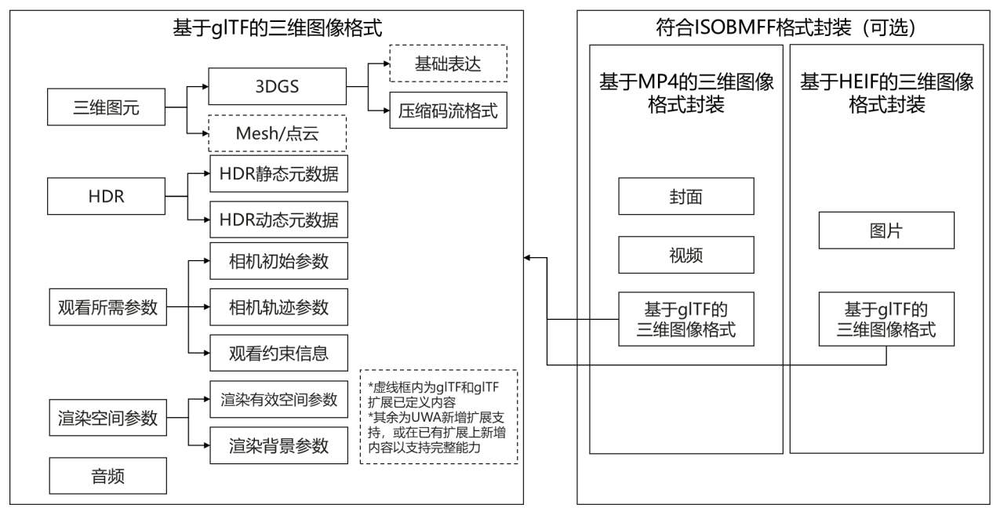
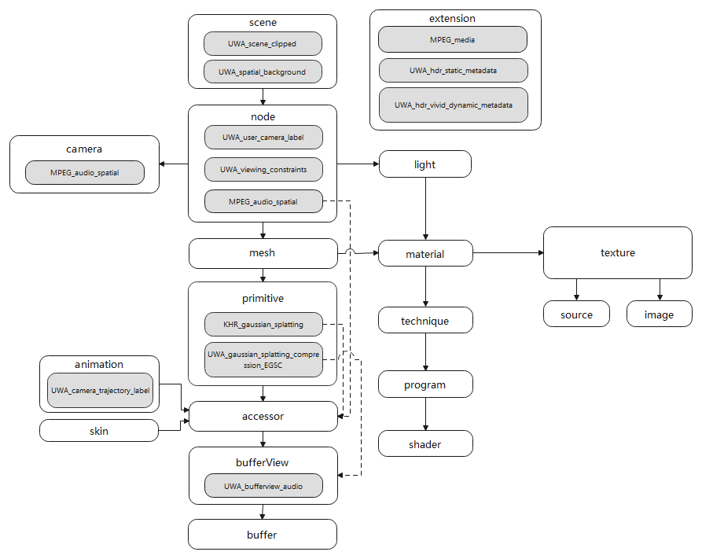
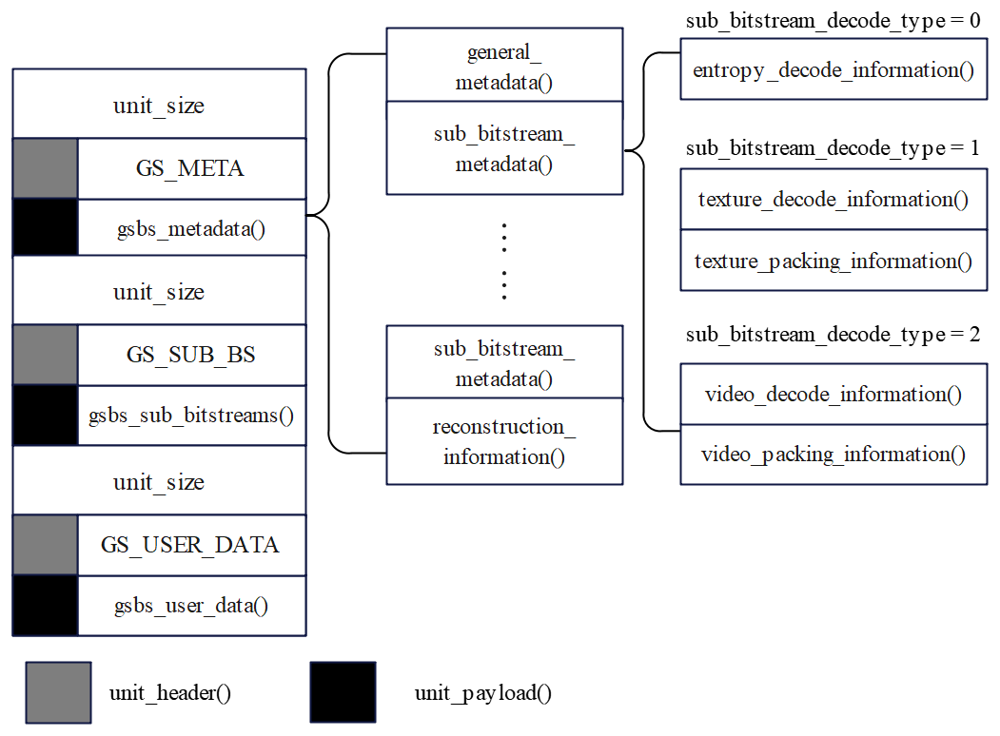
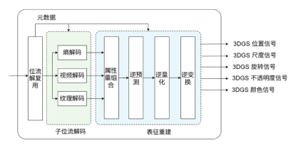
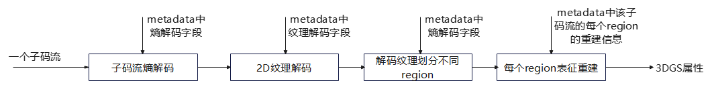
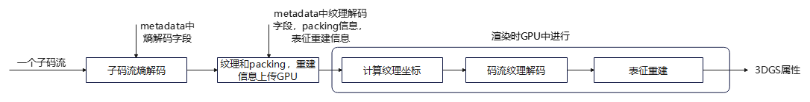
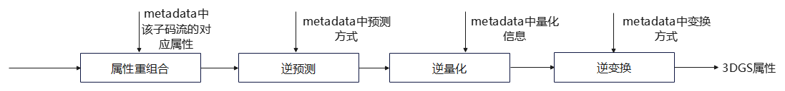
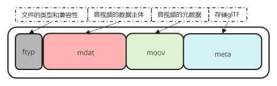
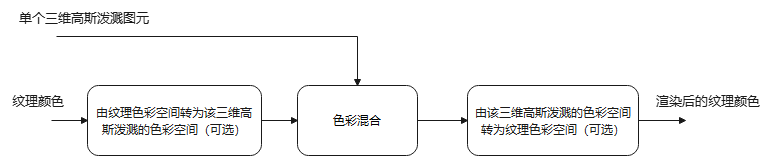

| ICS | 35.040 |
| --- | ------ |
| CCS | L71    |

世界超高清视频产业联盟团体标准

T/UWA 050—2026

支持六自由度交互的三维图像格式

Six Degrees of Freedom (6DoF) Interactive 3D Image Format

2026 - 05 - 22发布

2026 - 05 - 22实施

**世界超高清视频产业联盟  发布**

# 目次

- [前言](#前言)
- [引言](#引言)
- [1 范围](#1-范围)
- [2 规范性引用文件](#2-规范性引用文件)
- [3 术语和定义](#3-术语和定义)
- [4 缩略语](#4-缩略语)
- [5 符号与运算](#5-符号与运算)
  - [5.1 概述](#51-概述)
  - [5.2 算术运算符](#52-算术运算符)
  - [5.3 逻辑运算符](#53-逻辑运算符)
  - [5.4 关系运算符](#54-关系运算符)
  - [5.5 位运算符](#55-位运算符)
  - [5.6 赋值](#56-赋值)
  - [5.7 数学函数](#57-数学函数)
  - [5.8 结构关系符](#58-结构关系符)
  - [5.9 位流语法的描述方法](#59-位流语法的描述方法)
  - [5.10 函数](#510-函数)
  - [5.11 描述符](#511-描述符)
  - [5.12 保留、禁止和标记位](#512-保留禁止和标记位)
- [6 支持六自由度交互的三维图像格式框架](#6-支持六自由度交互的三维图像格式框架)
- [7 基于glTF的三维图像格式存储](#7-基于gltf的三维图像格式存储)
  - [7.1 概述](#71-概述)
  - [7.2 三维图元](#72-三维图元)
  - [7.3 HDR](#73-hdr)
  - [7.4 观看信息参数](#74-观看信息参数)
  - [7.5 音频](#75-音频)
  - [7.6 渲染空间参数](#76-渲染空间参数)
- [8 三维高斯泼溅压缩格式和解码](#8-三维高斯泼溅压缩格式和解码)
  - [8.1 概述](#81-概述)
  - [8.2 EGSC压缩格式和解码](#82-egsc压缩格式和解码)
- [9 基于ISOBMFF的三维图像格式封装](#9-基于isobmff的三维图像格式封装)
  - [9.1 概述](#91-概述)
  - [9.2 基于ISOBMFF封装glTF规范](#92-基于isobmff封装gltf规范)
  - [9.3 基于MP4的三维图像格式封装实例](#93-基于mp4的三维图像格式封装实例)
  - [9.4 基于HEIF的三维图像格式封装实例](#94-基于heif的三维图像格式封装实例)
- [附录A （规范性） 档次](#附录a-规范性-档次)
- [附录B （资料性） 三维高斯泼溅的HDR渲染参数使用推荐方案](#附录b-资料性-三维高斯泼溅的hdr渲染参数使用推荐方案)
- [参考文献](#参考文献)

# 前言

本文件按照GB/T 1.1—2020《标准化工作导则  第1部分：标准化文件的结构和起草规则》的规定起草。

请注意本文件的某些内容可能涉及专利。本文件的发布机构不承担识别专利的责任。

本文件由世界超高清视频产业联盟提出。

本文件由世界超高清视频产业联盟归口。

本文件起草单位：华为技术有限公司、中央广播电视总台、小红书科技有限公司、马栏山音视频实验室、维沃移动通信有限公司、浙江大学、北京字节跳动网络技术有限公司、咪咕文化科技有限公司、中国信息通信研究院、中国电子技术标准化研究院、京东集团股份有限公司、、凌云光技术股份有限公司、北京中视广信科技有限公司、杭州当虹科技股份有限公司、广州视源电子科技股份有限公司、苏州智聚芯联微电子有限公司、优酷信息技术(北京)有限公司、中国电信天翼数字生活科技有限公司、、深圳市其域创新科技有限公司、北京广安渲光科技有限公司。

本文件主要起草人：涂晨曦、蔡康颖、吴畏、任荟文、胡颖、马学睿、高立鑫、廖依伊、虞露、刘景松、毕蕾、高山、陈曦、翟云、陈仁伟、李婧欣、黄泰成、吴震宇、、熊伟、刘博文、孙剑、陈家兴、万锦山、陶炳俊、黎安伟、关宇昕、于登淼、陈柏林、李旭诚、奚溪、方伟、、赵开勇、颜青松、张志恒、方顺。

# 引言

本文件由世界超高清视频产业联盟制定。

本文件的发布机构提请注意，声明符合本文件时，可能涉及到5、6、7、8、9中如下13项与三维图像格式技术相关的专利的使用。专利名称如下：

- 202511233833.7 一种传输、渲染三维场景数据的方法及装置
- PCT/CN2025/133667 场景数据的编解码方法及相关装置
- PCT/CN2025/133665 场景数据的编解码方法及相关装置
- PCT/CN2025/133582 三维场景数据的编码方法、解码方法及相关装置
- 202511599336.9 三维数据的编码方法、解码方法、装置及系统
- 202511157272.7 三维场景数据封装和解封装方法、装置、设备和系统
- 202510777034.X 一种数据封装方法、读取方法及设备
- PCT/CN2025/133186 三维场景数据的处理方法及装置
- 202510089693.4 3DGS模型的编码方法、解码方法及相关装置
- CN202511585759.5 三维数据封装方法及相关产品
- CN202610024968.0 数据封装方法、数据渲染方法及相关产品
- CN202610363961.1 数据封装方法及相关产品
- 2025111685227 三维高斯数据展示方法、系统、介质、设备和程序产品。

本文件的发布机构对于该专利的真实性、有效性和范围无任何立场。

专利持有人已向本文件的发布机构保证，他愿意同任何申请人在合理且无歧视的条款和条件下，就专利授权许可进行谈判。该专利持有人的声明已在本文件的发布机构备案。相关信息可以通过以下联系方式获得：

| 专利权人      | 联系地址                        |
| --------- | --------------------------- |
| 华为技术有限公司  | 广东省深圳市龙岗区坂田华为总部办公楼          |
| 小红书科技有限公司 | 北京市朝阳区安定路5号中海国际中心           |
| 马栏山音频实验室  | 湖南省长沙市开福区月湖街道文创路6号马栏山创意中心B栋 |

联 系 人：高艳炫

通讯地址：北京市东城区安定门东大街1号 中国电子技术标准化研究院

邮政编码：100007

电    话：13683269839/01064102619

传    真：01084029217

请注意除上述专利外，本文件的某些内容仍可能涉及专利。本文件的发布机构不承担识别这些专利的责任。

支持六自由度交互的三维图像格式

# 1 范围

本文件规定了支持六自由度交互的三维图像的文件格式，包含基于glTF的三维图像格式存储、三维高斯泼溅压缩格式和解码、基于ISOBMFF的三维图像格式封装。

本文件适用于支持六自由度交互的三维图像拍摄与重建、存储、编辑与传输的使用场景。

# 2 规范性引用文件

下列文件中的内容通过文中的规范性引用而构成本文件必不可少的条款。其中，注日期的引用文件，仅该日期对应的版本适用于本文件；不注日期的引用文件，其最新版本（包括所有的修改单）适用于本文件。

GB/T 46269.1-2025 高动态范围（HDR）视频技术第1部分：元数据及适配

ISO/IEC 12113:2022 信息技术—运行时三维资产交付格式（Information technology — Runtime 3D asset delivery format — Khronos glTF™ 2.0）

ISO/IEC 14496-10 信息技术—视听对象的编码 第10部分：高级视频编码 （Information technology — Coding of audio-visual objects — Part 10: Advanced Video Coding）

ISO/IEC 14496-12 信息技术—视听对象编码 第12部分：ISO基本媒体文件格式（Information technology — Coding of audio-visual objects — Part 12: ISO base media file format）

ISO/IEC 14496-14 信息技术—视听对象编码 第14部分：MP4文件格式（Information technology — Coding of audio-visual objects — Part 14: MP4 file format）

ISO/IEC 23008-2  信息技术—异构环境中的高效率编码和媒体传送 第2部分:高效率视频编码（Information technology — High efficiency coding and media delivery in heterogeneous environments — Part 2: High efficiency video coding）

ISO/IEC 23008-12 信息技术— MPEG系统技术 第 12 部分：图像文件格式（Information technology — MPEG systems technologies — Part 12: Image File Format）

ISO/IEC 23090-3 信息技术—沉浸式媒体的编码表示 第3部分:通用视频编码（Information technology — Coded representation of immersive media — Part 3: Versatile video coding）

ISO/IEC 23090-14:2023 信息技术—沉浸式媒体的编码表示 第 14 部分：场景描述（Information technology — Coded representation of immersive media—Part 14: Scene description）

ITU-R BT.709-6 节目制作和国际节目交换中使用高清晰度电视标准的参数值 （Parameter values for the HDTV standards for production and international programme exchange）

ITU-R BT.1886 HDTV 工作室制作中的平板显示器的参考光电转换功能（Reference electro-optical transfer function for flat panel displays used in HDTV studio production）

ITU-R BT.2020-1 超高清电视系统节目制作和国际交换的参数数值（Parameter values for ultra-high definition television systems for production and international programme exchange）

ITU-R BT.2100-3 用于制作和国际节目交换的高动态范围电视图像参考值（Image parameter values for high dynamic range television for use in production and international programme exchange）

CIE1931标准色度系统（standard colorimetric system）

SMPTE ST.2084 高动态范围电光转换函数（High Dynamic Range Electro-Optical Transfer Function of Mastering Reference Displays）

Khronos, KHR_animation_pointer, ISO/IEC 12113:2022 Khronos glTF 2.0 扩展 https://github.com/KhronosGroup/glTF/tree/main/extensions/2.0/Khronos/KHR_animation_pointer

Khronos, KHR_gaussian_splatting, ISO/IEC 12113:2022 Khronos glTF 2.0 扩展[https://github.com/KhronosGroup/glTF/tree/main/extensions/2.0/Khronos/KHR_gaussian_splatting ](https://github.com/KhronosGroup/glTF/tree/main/extensions/2.0/Khronos/KHR_animation_pointer)

# 3 术语和定义

下列术语和定义适用于本文件。

- 3.1　 网格 mesh

由顶点、边、面组成的多边形几何结构，其通过连接顶点形成三角形/多边形面片。

**注**：用于表示一个完整的3D对象。

- 3.2　 点云 point cloud

三维空间中用于表征物体或场景的离散三维坐标点集合。

**注**：可用于表示一个完整的3D对象。

- 3.3　 图元 primitives

glTF规范中构建3D模型的基础单元。

**注**：通过键值对绑定顶点属性、索引数据、绘制模式与材质，完整定义单个几何体的渲染参数与数据引用规则。

- 3.4　 三维高斯泼溅 3D gaussian splatting

以参数化三维高斯基元集合表征三维场景几何形态与外观特征的技术。

**注**：实现高保真、实时性自由视角场景重建与视图合成的神经网络三维重建方法。

- 3.5　 图形库传输格式 glTF

由 Khronos Group 制定的、面向渲染引擎的开放式 3D 资产交换与传输标准格式。

**注：**以 JSON 为核心结构描述 3D 场景的层级、几何体、材质、动画、相机等核心要素，广泛适配 Web 渲染、AR/VR、3D 可视化等场景的 3D 内容高效加载与分发。

- 3.6　 属性 attributes

glTF中定义的顶点属性数据。

**注**：包含了"NORMAL"、"POSITION"、"TEXCOORD_0"、"TANGENT"、“COLOR_0”、“WEIGHTS_0”等，对应数据的类型、布局与取值范围可通过关联的访问器（accessor）查询。

- 3.7　 扩展 extension

glTF 规范提供的标准化功能扩展机制，用于在不修改核心规范的前提下，新增扩展功能。

- 3.8　 访存器 accessors

glTF中定义存储在缓冲区中的数据的类型和描述的单元。

**注**：通过引用缓冲视图（bufferView）指向二进制数据源，同时定义了数据的类型、数量等解析参数。

- 3.9　 缓冲视图 bufferView

glTF规范中对缓冲区（buffer）内一段二进制数据的标准化引用与结构描述，定义了目标数据段在缓冲区中的字节偏移量、字节长度、内存步长（stride）。

- 3.10　 HDR Vivid元数据 HDR Vivid metadata

描述视频或者图像处理过程中需要的关键信息和特征的数据。

来源：GB/T 46269.1-2025。

- 3.11　 色彩空间 color space

一个经过定义的、有序的范围或系统，用于表示和再现颜色，包括色域和传递函数两部分。

**注1：**色域定义了设备如何在特定的边界（色域）内，使用特定的组件（如sRGB中的红、绿、蓝）来解读和显示颜色，以确保在屏幕、打印机和相机等设备上进行一致的查看和编辑。

**注2：**传递函数定义了显示器如何将线性域的颜色转换为非线性域的颜色以适应人眼对光的感受特点。

# 4 缩略语

下列缩略语适用于本文件

3DGS：三维高斯泼溅 （3D Gaussian Splatting）

DOF：自由度 （Degree of Freedom）

HDR：高动态范围 （High Dynamic Range）

HEIF：高效图像文件格式 （High Efficiency Image File Format）

ISOBMFF：ISO基础媒体文件格式 （ISO Base Media File Format）

SH：球谐（Spherical Harmonic）

URI：统一资源标识符（Uniform Resource Identifier）

# 5 符号与运算

## 5.1 概述

本文件中使用的数学运算符和优先级参照C语言。但对整型除法和算术移位操作进行了特定定义。除特别说明外，约定编号和计数从0开始。

## 5.2 算术运算符

算术运算符定义见表1。

**表1　 算术运算符定义**

| 算术运算符                        | 定义                                              |
| ---------------------------- | ----------------------------------------------- |
| +                            | 加法运算                                            |
| -                            | 减法运算（二元运算符）或取反（一元前缀运算符）                         |
| ×                            | 乘法运算                                            |
| *a**b*            | 幂运算，表示*a*的*b*次幂。也可表示上标                          |
| /                            | 整除运算，沿向0的取值方向截断。例如，7/4和-7/-4截断至1，-7/4和7/-4截断至-1 |
| ÷                            | 除法运算，不做截断或四舍五入                                  |
| $\frac{a}{b}$                | 除法运算，不做截断或四舍五入                                  |
| $\sum_{i=a}^{b}{f(i)}$       | 自变量*i*取由*a*到*b*（含*b*）的所有整数值时，函数$f(i)$的累加和       |
| a % b                        | 模运算，*a*除以*b*的余数，其中*a*与*b*都是正整数                  |
| $\left\lfloor.\right\rfloor$ | 下取整                                             |

## 5.3 逻辑运算符

逻辑运算符定义见表2。

**表2　 逻辑运算符定义**

| 逻辑运算符          | 定义              |
| -------------- | --------------- |
| *a*  &&  *b*   | *a*和*b*之间的与逻辑运算 |
| *a*  \|\|  *b* | *a*和*b*之间的或逻辑运算 |
| !              | 逻辑非运算           |

## 5.4 关系运算符

关系运算符定义见表3。

**表3　 关系运算符定义**

| 关系运算符 | 定义    |
| ----- | ----- |
| >     | 大于    |
| >=    | 大于或等于 |
| <     | 小于    |
| <=    | 小于或等于 |
| ==    | 等于    |
| !=    | 不等于   |

## 5.5 位运算符

位运算符定义见表4。

**表4　 位运算符定义**

| 位运算符       | 定义                                     |
| ---------- | -------------------------------------- |
| &          | 与运算                                    |
| \|         | 或运算                                    |
| ~          | 取反运算                                   |
| *a* >> *b* | 将*a*以2的补码整数表示的形式向右移*b*位。仅当*b*取正数时定义此运算 |
| *a* << *b* | 将*a*以2的补码整数表示的形式向左移*b*位。仅当*b*取正数时定义此运算 |

## 5.6 赋值

赋值运算定义见表5。

**表5　 赋值运算定义**

| 赋值运算 | 定义                                                              |
| ---- | --------------------------------------------------------------- |
| =    | 赋值运算符                                                           |
| ++   | 递增，*x*++相当于*x* = *x* + 1。当用于数组下标时，在自加运算前先求变量值                   |
| --   | 递减，*x--*相当于*x* = *x* – 1。当用于数组下标时，在自减运算前先求变量值                   |
| +=   | 自加指定值，例如*x* += 3相当于*x* = x + 3，*x* += (-3)相当于*x* = *x* + (-3)   |
| -=   | 自减指定值，例如*x* -= 3相当于*x* = *x* - 3，*x* -= (-3)相当于*x* = *x* - (-3) |

## 5.7 数学函数

数学函数定义见公式（1）~公式（10）。

$\mathrm{Abs}\left(x\right)=\left\{\begin{aligned}\mathrm{x}, & \ \ x\ge0 \\ \mathrm{-x}, & \ \ x<0\end{aligned}\right.$ (1)

式中：

*x*——自变量。

$\mathrm{Floor}\left(x\right)=\left\lfloor x\right\rfloor$ (2)

式中：

*x*——自变量。

$\mathrm{Clip3}\left(\mathrm{i},\mathrm{j},\mathrm{x}\right)=\left\{\begin{aligned}\mathrm{i}, & \ \ x<i \\ \mathrm{j}, & \ \ x>j \\ \mathrm{x},\text{其他}\end{aligned}\right.$ (3)

式中：

*x*——自变量；

*i——*下界；

*j——*上界。

$\mathrm{Median}\left(\mathrm{x},\mathrm{y},\mathrm{z}\right)=x+y+z-\mathrm{Min}\left(\mathrm{x},\mathrm{Min}\left(\mathrm{y},\mathrm{z}\right)\right)-\mathrm{Max}\left(\mathrm{x},\mathrm{Max}\left(\mathrm{y},\mathrm{z}\right)\right)$ (4)

式中：

*x*——自变量；

*y——*自变量；

*z——*自变量。

$\mathrm{Min}\left(\mathrm{x},\mathrm{y}\right)=\left\{\begin{aligned}\mathrm{x}, & \ \ x\le y \\ \mathrm{y}, & \ \ x>y\end{aligned}\right.$ (5)

式中：

*x*——自变量；

*y——*自变量。

$\mathrm{Max}\left(\mathrm{x},\mathrm{y}\right)=\left\{\begin{aligned}\mathrm{x}, & \ \ x\ge y \\ \mathrm{y}, & \ \ x<y\end{aligned}\right.$ (6)

式中：

*x*——自变量；

*y——*自变量。

$\mathrm{Sign}\left(\mathrm{x}\right)=\left\{\begin{aligned}1, & \ \ x\ge0 \\ -1, & \ \ x<0\end{aligned}\right.$ (7)

式中：

*x*——自变量。

$\mathrm{Log}\left(\mathrm{x}\right)={\mathrm{log}}_{2}x$ (8)

式中：

*x*——自变量。

$\mathrm{Ln}\left(\mathrm{x}\right)={\mathrm{log}}_{e}x$ (9)

式中：

*x*——自变量；

*e*——自然对数的底，其值为2.718281828…。

$\mathrm{pow}\left(\mathrm{x},\mathrm{y}\right)={\mathrm{x}}^{\mathrm{y}}$ (10)

式中：

*x*——自变量；

*y*——自变量*。*

## 5.8 结构关系符

结构关系符定义见表6。

**表6　 结构关系符**

| 结构关系符 | 定义                                   |
| ----- | ------------------------------------ |
| ->    | 例如：*a*->*b*表示*a*是一个结构，*b*是*a*的一个成员变量 |

## 5.9 位流语法的描述方法

位流语法描述方法类似C语言。位流的语法元素使用粗体字表示，每个语法元素通过名字（用下划线分割的英文字母组，所有字母都是小写）、语法和语义来描述。语法表和正文中语法元素的值用常规字体表示。

某些情况下，可在语法表中应用从语法元素导出的其他变量值，这样的变量在语法表或正文中用带下划线的小写字母命名，或者用小写字母和大写字母混合命名。大写字母开头的变量用于解码当前以及相关的语法结构，也可用于解码后续的语法结构。小写字母开头的变量只在当前以及相关的语法结构内使用。

语法元素值的助记符和变量值的助记符与它们的值之间的关系在正文中说明。在某些情况下，二者等同使用。

位串的长度是4的整数倍时，可使用十六进制符号表示。十六进制的前缀是“0x”，例如“0x1a”表示位串“0001 1010”。

条件语句中0表示FALSE，非0表示TRUE。

语法表描述了所有符合本文件的位流语法的超集，附加的语法限制在相关条中说明。

表7给出了描述语法的伪代码例子。当语法元素出现时，表示从位流中读一个数据单元。

**表7　 语法描述的伪代码示例**

| 伪代码                                                                                                                          |
| ---------------------------------------------------------------------------------------------------------------------------- |
| /\*语句是一个语法元素的描述符，或者说明语法元素的存在、类型和数值，下面给出两个例子。*/                                                                               |
| syntax_element                                                                                                               |
| conditioning statement                                                                                                       |
|                                                                                                                              |
| /\*花括号括起来的语句组是复合语句，在功能上视作单个语句。*/                                                                                             |
| {                                                                                                                            |
| &nbsp;&nbsp;&nbsp;&nbsp;statement                                                                                            |
| &nbsp;&nbsp;&nbsp;&nbsp;…                                                                                                    |
| }                                                                                                                            |
|                                                                                                                              |
| /\*“while”语句测试condition是否为TRUE，如果为TRUE，则重复执行循环体，直到condition不为TRUE。*/                                                         |
| while (condition)                                                                                                            |
| &nbsp;&nbsp;&nbsp;&nbsp;statement                                                                                            |
|                                                                                                                              |
| /\*“do … while”语句先执行循环体一次，然后测试condition是否为TRUE，如果为TRUE，则重复执行循环体，直到condition不为TRUE。*/                                         |
| do                                                                                                                           |
| &nbsp;&nbsp;&nbsp;&nbsp;statement                                                                                            |
| while (condition)                                                                                                            |
|                                                                                                                              |
| /\*“if … else”语句首先测试condition，如果为TRUE，则执行primary语句，否则执行alternative语句。如果alternative语句不需要执行，结构的“else”部分和相关的alternative语句可忽略。*/ |
| if (condition)                                                                                                               |
| &nbsp;&nbsp;&nbsp;&nbsp;primary statement                                                                                    |
| else                                                                                                                         |
| &nbsp;&nbsp;&nbsp;&nbsp;alternative statement                                                                                |
|                                                                                                                              |
| /\*“for”语句首先执行initial语句，然后测试condition，如果conditon为TRUE，则重复执行primary语句和subsequent语句直到condition不为TRUE。*/                        |
| for (initial statement； condition； subsequent statement)                                                                     |
| &nbsp;&nbsp;&nbsp;&nbsp;primary statement                                                                                    |

解析过程和解码过程用文字和类似C语言的伪代码描述。

## 5.10 函数

### 5.10.1 next_start_code( )

在位流中寻找下一个起始码，将位流指针指向起始码前缀的第一个二进制位。函数定义应符合表8的规定。

**表8　 next_start_code函数的定义**

| 函数定义                                                                             | 描述符        |
| -------------------------------------------------------------------------------- | ---------- |
| next_start_code( ) {                                                             |            |
| &nbsp;&nbsp;&nbsp;&nbsp;stuffing_bit                                             | '1'        |
| &nbsp;&nbsp;&nbsp;&nbsp;while (! byte_aligned( ))                                |            |
| &nbsp;&nbsp;&nbsp;&nbsp;&nbsp;&nbsp;&nbsp;&nbsp;stuffing_bit                     | '0'        |
| &nbsp;&nbsp;&nbsp;&nbsp;while (next_bits(24) != '0000 0000 0000 0000 0000 0001') |            |
| &nbsp;&nbsp;&nbsp;&nbsp;&nbsp;&nbsp;&nbsp;&nbsp;stuffing_byte                    | '00000000' |
| }                                                                                |            |
| stuffing_byte应出现图像头之后和第一个片起始码之前。                                                 |            |

### 5.10.2 byte_aligned( )

如果位流的当前位置是字节对齐的，返回TRUE，否则返回FALSE。

### 5.10.3 read_bits(n)

返回位流的随后n个二进制位，MSB在前，同时位流指针前移n个二进制位。如果n等于0，则返回0，位流指针不前移。

## 5.11 描述符

描述符表示不同语法元素的解析过程，见表9。

**表9　 描述符**

| 描述符    | 说明                                                                            |
| ------ | ----------------------------------------------------------------------------- |
| b(8)   | 一个任意取值的字节。解析过程由函数read_bits(8)的返回值规定                                           |
| f(n)   | 取特定值的连续n个二进制位。解析过程由函数read_bits(n)的返回值规定                                       |
| r(n)   | 连续n个‘0’。解析过程由函数read_bits(n)的返回值规定                                             |
| u(n)   | n位无符号整数。在语法表中，如果n是“v”，其位数由其他语法元素值确定。解析过程由函数read_bits(n)的返回值规定，该返回值用高位在前的二进制表示 |
| i(n)   | n位有符号整数                                                                       |
| st(n)  | n个UTF-8格式字符                                                                   |
| fp(n)  | n位浮点数，n可以是16或者32                                                              |
| ur(64) | 使用两个32位无符号数val1和val2，变量的值为val1/val2                                           |
| ir(64) | 使用一个32位有符号数val1和一个32位无符号数val2，变量的值为val1/val2                                  |

## 5.12 保留、禁止和标记位

本文件定义的位流语法中，某些语法元素的值被标注为“保留”（reserved）或“禁止”（forbidden）。

“保留”定义了一些特定语法元素值用于将来对本文件的扩展。这些值不应出现在符合本文件的位流中。

“禁止”定义了一些特定语法元素值，这些值不应出现在符合本文件的位流中。

“标记位”（marker_bit）指该位的值应为‘1’。

位流中的“保留位”（reserved_bits）表明保留了一些语法单元用于将来对本文件的扩展，解码处理应忽略这些位。

# 6 支持六自由度交互的三维图像格式框架

本文件定义支持六自由度交互的三维图像的格式，包含基于glTF的三维图像格式和封装glTF三维图像格式的ISOBMFF文件格式。其中glTF存储既可作为独立格式使用，也可作为MP4或者HEIF封装中的一项内容被使用。支持六自由度交互的三维图像格式框架如图1所示。

**图1　 支持六自由度交互的三维图像格式框架**

使用glTF格式作为三维图像格式时，其格式应符合本文件第7章的规范，且符合ISO/IEC 12113:2022。glTF格式支持存储以下内容：

- a） 三维图元：支持3DGS、网格及点云的存储；
- b） HDR元数据扩展信息；
- c） 观看信息参数：包含相机初始参数、相机轨迹参数及观看约束信息；
- d） 音频数据；
- e） 渲染空间参数。

3DGS数据支持两种存储方式：一是采用glTF直接存储3DGS基础表达；二是采用glTF存储3DGS压缩码流格式，且压缩码流格式的内容应符合本文件第8章的规范。

本文件第9章定义基于ISOBMFF的封装三维图像文件格式规范，包括MP4文件格式和HEIF文件格式。

# 7 基于glTF的三维图像格式存储

## 7.1 概述

基于glTF存储三维图像格式，包含：三维图元，HDR元数据扩展，观看信息参数，音频和渲染空间参数，遵循ISO/IEC 12113:2022规范，整体结构如图2所示。本文件规定的glTF存储三维图像格式在传输和分享中可作为独立格式使用。

其中，三维图元存储在glTF中的meshes/primitive字段下，支持网格/点云等三维图元的表达，扩展支持存储3DGS数据的格式，其中3DGS基础表达符合KHR_gaussian_splatting的定义，3DGS压缩码流可以通过扩展字段存储，本标准支持UWA_gaussian_splatting_compression_EGSC扩展。

HDR元数据扩展存储在glTF中，新增扩展UWA_hdr_static_metadata支持存储HDR静态元数据和新增扩展UWA_hdr_vivid_dynamic_metadata支持存储HDR动态元数据。

观看信息参数包含相机初始参数，相机轨迹参数和观看约束信息，其中相机初始参数存储在glTF的nodes和cameras字段下，新增扩展UWA_user_camera_label存储观看相机标签；相机轨迹参数存储在glTF的animation字段下，新增扩展UWA_camera_trajectory_label存储相机轨迹标签；观看约束信息通过新增扩展UWA_viewing_constraints存储在glTF的nodes字段下。

音频存储在glTF中，支持存储音频特性描述（如声源特性、听者信息、音效信息等），和音频媒体资产描述（如声源类型、播放控制、与媒体轨道的关联关系等），新增音频缓冲视图描述扩展UWA_bufferview_audio。

渲染空间参数存储在glTF的scene字段下，新增扩展UWA_scene_clipped支持存储渲染有效空间参数和新增扩展UWA_spatial_background支持存储渲染背景参数。

**图2　 glTF存储三维图像格式**

## 7.2 三维图元

### 7.2.1 三维高斯泼溅

#### 7.2.1.1 概述

3DGS数据位于glTF格式中primitives字段下，描述了使用glTF存储3DGS的方法，包含：

a) 3DGS的属性组成；

b) 使用glTF存储3DGS的基础表达；

c) 使用glTF存储3DGS的压缩码流格式。

#### 7.2.1.2 三维高斯泼溅的属性

3DGS由多个高斯球组成，每个高斯球具有Position，Opacity，Scale，Rotation和球谐（SH）系数属性，如表10所示。

**表10　 三维高斯泼溅属性维度和数据类型**

| 3DGS属性                                       | 维度  | 数据类型    |
| -------------------------------------------- | --- | ------- |
| Position                                     | 3   | float32 |
| Opacity                                      | 1   | float32 |
| Scale                                        | 3   | float32 |
| Rotation                                     | 4   | float32 |
| SPHERICAL_HARMONICS_DEGREE_0_COEFFICIENT_0   | 3   | float32 |
| SPHERICAL_HARMONICS_DEGREE_ ℓ_COEFFICIENT_𝑛 | 3   | float32 |
| colorSpace                                   | 1   | string  |

Position：定义高斯分布在3D空间中的中心点坐标（x,y,z），决定了该高斯球在场景中的位置。

Opacity：控制高斯球的透明程度（范围0到1），0表示完全透明，1表示完全不透明；在混合多个高斯球时用于决定其贡献权重（alpha blending）。

Scale：定义高斯分布在三个轴上的缩放系数，控制高斯球形状的大小；

Rotation：用四元数（quaternion）表示高斯的方向，控制高斯球的朝向。

SPHERICAL_HARMONICS_DEGREE_0_COEFFICIENT_0: 球谐系数0阶的系数。

SPHERICAL_HARMONICS_DEGREE_ℓ_COEFFICIENT_𝑛: 球谐系数ℓ阶第𝑛 个分量的系数，记录高斯球在不同光照方向和视角下的颜色变化。

colorSpace：定义三维场景图元的色彩属性，包括色域和转换函数。

#### 7.2.1.3 glTF存储三维高斯泼溅基础表达

3DGS基础表达的存储符合Khronos glTF 2.0的KHR_gaussian_splatting扩展的定义，该扩展字段位于mesh.primitives字段下。

KHR_gaussian_splatting.colorSpace为支持3DGS色彩空间的字段。新增UWA_gaussian_splatting_wide_gamut_color用于扩展colorSpace属性的广色域色彩空间选项，扩展colorSpace属性的取值可以为“BT.2020-ITU”，“BT.2020-linear”，“BT.2100-PQ”，“BT.2100-HLG”，“Display-P3”。

取值为BT.2020-ITU时，使用ITU-R BT.2020定义的色域，使用ITU-R BT.1886定义的传递函数编码的非线性域颜色；

取值为BT.2020-linear时，使用ITU-R BT. 2020定义的色域，使用未经编码的线性域颜色；

取值为BT.2100-PQ时，使用ITU-R BT. 2100定义的色域，使用在SMPTE ST.2084定义的传递函数编码的非线性域颜色；

取值为BT.2100-HLG时，使用在ITU-R BT. 2100定义的色域，使用在ITU-R BT. 2100定义的传递函数编码的非线性域颜色；

取值为Display-P3时，使用在Display-P3中定义的色域和传递函数。

当存在处于不同色彩空间的3DGS需要混合渲染时，宜采用的渲染方案见附录B.2。

#### 7.2.1.4 glTF存储三维高斯泼溅压缩码流

##### 7.2.1.4.1 概述

基于glTF存储3DGS压缩码流包括存储3DGS压缩码流格式字段和语义，以及3DGS压缩码流的解码。

其中glTF可以支持通过扩展的形式接入各类标准编解码方案，本标准支持的编解码方案包括：Efficient Gaussian Splatting Codec (EGSC)。

##### 7.2.1.4.2 glTF存储三维高斯泼溅压缩码流格式字段和语义

UWA_gaussian_splatting_compression_EGSC扩展：用于在glTF中存储使用EGSC方案压缩3DGS码流的数据，其中码流格式见8.2.3，解码方法见8.2.6。

UWA_gaussian_splatting_compression_EGSC扩展依赖于KHR_gaussian_splatting扩展，位于primitives.KHR_gaussian_splatting.extensions中，如表11所示。其中，bufferView字段符合ISO/IEC 12113:2022中5.11的规定。

**表11　 glTF存储三维高斯泼溅压缩码流格式的字段**

| 定义                                                                                                                                                                                        | 描述符   |
| ----------------------------------------------------------------------------------------------------------------------------------------------------------------------------------------- | ----- |
| &nbsp;&nbsp;&nbsp;&nbsp; meshes{                                                                                                                                                          |       |
| &nbsp;&nbsp;&nbsp;&nbsp; &nbsp;&nbsp;&nbsp;&nbsp;primitives{                                                                                                                              |       |
| &nbsp;&nbsp;&nbsp;&nbsp; &nbsp;&nbsp;&nbsp;&nbsp;&nbsp;&nbsp;&nbsp;&nbsp;mode                                                                                                             | i(32) |
| &nbsp;&nbsp;&nbsp;&nbsp; &nbsp;&nbsp;&nbsp;&nbsp;&nbsp;&nbsp;&nbsp;&nbsp;attributes{                                                                                                      |       |
| &nbsp;&nbsp;&nbsp;&nbsp; &nbsp;&nbsp;&nbsp;&nbsp;&nbsp;&nbsp;&nbsp;&nbsp;&nbsp;&nbsp;&nbsp;&nbsp;POSITION                                                                                 | i(32) |
| &nbsp;&nbsp;&nbsp;&nbsp; &nbsp;&nbsp;&nbsp;&nbsp;&nbsp;&nbsp;&nbsp;&nbsp;&nbsp;&nbsp;&nbsp;&nbsp;COLOR_0                                                                                  | i(32) |
| &nbsp;&nbsp;&nbsp;&nbsp; &nbsp;&nbsp;&nbsp;&nbsp;&nbsp;&nbsp;&nbsp;&nbsp;&nbsp;&nbsp;&nbsp;&nbsp;KHR_gaussian_splatting:OPACITY                                                           | i(32) |
| &nbsp;&nbsp;&nbsp;&nbsp; &nbsp;&nbsp;&nbsp;&nbsp;&nbsp;&nbsp;&nbsp;&nbsp;&nbsp;&nbsp;&nbsp;&nbsp;KHR_gaussian_splatting:SCALE                                                             | i(32) |
| &nbsp;&nbsp;&nbsp;&nbsp; &nbsp;&nbsp;&nbsp;&nbsp;&nbsp;&nbsp;&nbsp;&nbsp;&nbsp;&nbsp;&nbsp;&nbsp;KHR_gaussian_splatting:ROTATION                                                          | i(32) |
| &nbsp;&nbsp;&nbsp;&nbsp; &nbsp;&nbsp;&nbsp;&nbsp;&nbsp;&nbsp;&nbsp;&nbsp;&nbsp;KHR_gaussian_splatting:SH_DEGREE_0_COEF_0                                                                  | i(32) |
| &nbsp;&nbsp;&nbsp;&nbsp; &nbsp;&nbsp;&nbsp;&nbsp;&nbsp;&nbsp;&nbsp;&nbsp;&nbsp;&nbsp;&nbsp;&nbsp;KHR_gaussian_splatting:SH_DEGREE_1_COEF_0                                                | i(32) |
| &nbsp;&nbsp;&nbsp;&nbsp; &nbsp;&nbsp;&nbsp;&nbsp;&nbsp;&nbsp;&nbsp;&nbsp;&nbsp;&nbsp;&nbsp;&nbsp;KHR_gaussian_splatting:SH_DEGREE_1_COEF_1                                                | i(32) |
| &nbsp;&nbsp;&nbsp;&nbsp; &nbsp;&nbsp;&nbsp;&nbsp;&nbsp;&nbsp;&nbsp;&nbsp;&nbsp;&nbsp;&nbsp;&nbsp;KHR_gaussian_splatting:SH_DEGREE_1_COEF_2                                                | i(32) |
| &nbsp;&nbsp;&nbsp;&nbsp; &nbsp;&nbsp;&nbsp;&nbsp;&nbsp;&nbsp;&nbsp;&nbsp;&nbsp;&nbsp;&nbsp;&nbsp;KHR_gaussian_splatting:SH_DEGREE_2_COEF_0                                                | i(32) |
| &nbsp;&nbsp;&nbsp;&nbsp; &nbsp;&nbsp;&nbsp;&nbsp;&nbsp;&nbsp;&nbsp;&nbsp;&nbsp;&nbsp;&nbsp;&nbsp;KHR_gaussian_splatting:SH_DEGREE_2_COEF_1                                                | i(32) |
| &nbsp;&nbsp;&nbsp;&nbsp; &nbsp;&nbsp;&nbsp;&nbsp;&nbsp;&nbsp;&nbsp;&nbsp;&nbsp;&nbsp;&nbsp;&nbsp;KHR_gaussian_splatting:SH_DEGREE_2_COEF_2                                                | i(32) |
| &nbsp;&nbsp;&nbsp;&nbsp; &nbsp;&nbsp;&nbsp;&nbsp;&nbsp;&nbsp;&nbsp;&nbsp;&nbsp;&nbsp;&nbsp;&nbsp;KHR_gaussian_splatting:SH_DEGREE_2_COEF_3                                                | i(32) |
| &nbsp;&nbsp;&nbsp;&nbsp; &nbsp;&nbsp;&nbsp;&nbsp;&nbsp;&nbsp;&nbsp;&nbsp;&nbsp;&nbsp;&nbsp;&nbsp;KHR_gaussian_splatting:SH_DEGREE_2_COEF_4                                                | i(32) |
| &nbsp;&nbsp;&nbsp;&nbsp; &nbsp;&nbsp;&nbsp;&nbsp;&nbsp;&nbsp;&nbsp;&nbsp;&nbsp;&nbsp;&nbsp;&nbsp;KHR_gaussian_splatting:SH_DEGREE_3_COEF_0                                                | i(32) |
| &nbsp;&nbsp;&nbsp;&nbsp; &nbsp;&nbsp;&nbsp;&nbsp;&nbsp;&nbsp;&nbsp;&nbsp;&nbsp;&nbsp;&nbsp;&nbsp;KHR_gaussian_splatting:SH_DEGREE_3_COEF_1                                                | i(32) |
| &nbsp;&nbsp;&nbsp;&nbsp; &nbsp;&nbsp;&nbsp;&nbsp;&nbsp;&nbsp;&nbsp;&nbsp;&nbsp;&nbsp;&nbsp;&nbsp;KHR_gaussian_splatting:SH_DEGREE_3_COEF_2                                                | i(32) |
| &nbsp;&nbsp;&nbsp;&nbsp; &nbsp;&nbsp;&nbsp;&nbsp;&nbsp;&nbsp;&nbsp;&nbsp;&nbsp;&nbsp;&nbsp;&nbsp;KHR_gaussian_splatting:SH_DEGREE_3_COEF_3                                                | i(32) |
| &nbsp;&nbsp;&nbsp;&nbsp; &nbsp;&nbsp;&nbsp;&nbsp;&nbsp;&nbsp;&nbsp;&nbsp;&nbsp;&nbsp;&nbsp;&nbsp;KHR_gaussian_splatting:SH_DEGREE_3_COEF_4                                                | i(32) |
| &nbsp;&nbsp;&nbsp;&nbsp; &nbsp;&nbsp;&nbsp;&nbsp;&nbsp;&nbsp;&nbsp;&nbsp;&nbsp;&nbsp;&nbsp;&nbsp;KHR_gaussian_splatting:SH_DEGREE_3_COEF_5                                                | i(32) |
| &nbsp;&nbsp;&nbsp;&nbsp; &nbsp;&nbsp;&nbsp;&nbsp;&nbsp;&nbsp;&nbsp;&nbsp;&nbsp;&nbsp;&nbsp;&nbsp;KHR_gaussian_splatting:SH_DEGREE_3_COEF_6                                                | i(32) |
| &nbsp;&nbsp;&nbsp;&nbsp; &nbsp;&nbsp;&nbsp;&nbsp;&nbsp;&nbsp;&nbsp;&nbsp;}                                                                                                                |       |
| &nbsp;&nbsp;&nbsp;&nbsp; &nbsp;&nbsp;&nbsp;&nbsp;&nbsp;&nbsp;&nbsp;&nbsp;extensions{                                                                                                      |       |
| &nbsp;&nbsp;&nbsp;&nbsp; &nbsp;&nbsp;&nbsp;&nbsp;&nbsp;&nbsp;&nbsp;&nbsp;&nbsp;&nbsp;&nbsp;&nbsp;KHR_gaussian_splatting{                                                                  |       |
| &nbsp;&nbsp;&nbsp;&nbsp; &nbsp;&nbsp;&nbsp;&nbsp;&nbsp;&nbsp;&nbsp;&nbsp;&nbsp;&nbsp;&nbsp;&nbsp;&nbsp;&nbsp;&nbsp;&nbsp;kernel                                                           | st(n) |
| &nbsp;&nbsp;&nbsp;&nbsp; &nbsp;&nbsp;&nbsp;&nbsp;&nbsp;&nbsp;&nbsp;&nbsp;&nbsp;&nbsp;&nbsp;&nbsp;&nbsp;&nbsp;&nbsp;&nbsp;colorSpace                                                       | st(n) |
| &nbsp;&nbsp;&nbsp;&nbsp; &nbsp;&nbsp;&nbsp;&nbsp;&nbsp;&nbsp;&nbsp;&nbsp;&nbsp;&nbsp;&nbsp;&nbsp;&nbsp;&nbsp;&nbsp;&nbsp;sortingMethod                                                    | st(n) |
| &nbsp;&nbsp;&nbsp;&nbsp; &nbsp;&nbsp;&nbsp;&nbsp;&nbsp;&nbsp;&nbsp;&nbsp;&nbsp;&nbsp;&nbsp;&nbsp;&nbsp;&nbsp;&nbsp;&nbsp;projection                                                       | st(n) |
| &nbsp;&nbsp;&nbsp;&nbsp; &nbsp;&nbsp;&nbsp;&nbsp;&nbsp;&nbsp;&nbsp;&nbsp;&nbsp;&nbsp;&nbsp;&nbsp;&nbsp;&nbsp;&nbsp;&nbsp;extensions{                                                      |       |
| &nbsp;&nbsp;&nbsp;&nbsp; &nbsp;&nbsp;&nbsp;&nbsp;&nbsp;&nbsp;&nbsp;&nbsp;&nbsp;&nbsp;&nbsp;&nbsp;&nbsp;&nbsp;&nbsp;&nbsp;&nbsp;&nbsp;&nbsp;&nbsp;UWA_gaussian_splatting_compression_EGSC{ |       |
| &nbsp;&nbsp;&nbsp;&nbsp; &nbsp;&nbsp;&nbsp;&nbsp;&nbsp;&nbsp;&nbsp;&nbsp;&nbsp;&nbsp;&nbsp;&nbsp;&nbsp;&nbsp;&nbsp;&nbsp;&nbsp;&nbsp;&nbsp;&nbsp;&nbsp;&nbsp;&nbsp;&nbsp;bufferView       | i(32) |
| &nbsp;&nbsp;&nbsp;&nbsp; &nbsp;&nbsp;&nbsp;&nbsp;&nbsp;&nbsp;&nbsp;&nbsp;&nbsp;&nbsp;&nbsp;&nbsp;&nbsp;&nbsp;&nbsp;&nbsp;&nbsp;&nbsp;&nbsp;&nbsp;}                                        |       |
| &nbsp;&nbsp;&nbsp;&nbsp; &nbsp;&nbsp;&nbsp;&nbsp;&nbsp;&nbsp;&nbsp;&nbsp;&nbsp;&nbsp;&nbsp;&nbsp;&nbsp;&nbsp;&nbsp;&nbsp;}                                                                |       |
| &nbsp;&nbsp;&nbsp;&nbsp; &nbsp;&nbsp;&nbsp;&nbsp;&nbsp;&nbsp;&nbsp;&nbsp;&nbsp;&nbsp;&nbsp;&nbsp;}                                                                                        |       |
| &nbsp;&nbsp;&nbsp;&nbsp; &nbsp;&nbsp;&nbsp;&nbsp;&nbsp;&nbsp;&nbsp;&nbsp;}                                                                                                                |       |
| &nbsp;&nbsp;&nbsp;&nbsp; &nbsp;&nbsp;&nbsp;&nbsp;}                                                                                                                                        |       |
| &nbsp;&nbsp;&nbsp;&nbsp; }                                                                                                                                                                |       |

##### 7.2.1.4.3 glTF存储三维高斯泼溅压缩码流格式解码

使用3DGS压缩码流格式进行解码的步骤如下：

a）识别UWA_gaussian_splatting_compression_EGSC字段，判断是否存在3DGS压缩码流；

b）解析扩展中的3DGS压缩数据；根据bufferView获取3DGS压缩数据，解析bufferView中对应的压缩码流数据的位置索引字段，即buffer，byteLength和byteOffset，获取全部压缩数据；

c）将3DGS压缩数据依据8.2.6的解码方式进行解码，得到解码数据。

### 7.2.2 网格/点云

应符合ISO/IEC 12113:2022中5.23的规定。

## 7.3 HDR

### 7.3.1 概述

HDR元数据属性在GB/T 46269.1-2025中定义，包含静态元数据、动态元数据。

根据glTF文件中的HDR元数据选择对3DGS作HDR或SDR渲染的推荐方案见附录B.1。

确定渲染视角的HDR元数据的推荐方案见附录B.3。

### 7.3.2 HDR静态元数据属性

HDR静态元数据定义如表12所示。

**表12　 HDR静态元数据属性维度与数据类型**

| HDR静态元数据属性                      | 维度  | 数据类型  |
| ------------------------------- | --- | ----- |
| display_primaries_x_0           | 1   | u(16) |
| display_primaries_y_0           | 1   | u(16) |
| display_primaries_x_1           | 1   | u(16) |
| display_primaries_y_1           | 1   | u(16) |
| display_primaries_x_2           | 1   | u(16) |
| display_primaries_y_2           | 1   | u(16) |
| white_point_x                   | 1   | u(16) |
| white_point_y                   | 1   | u(16) |
| max_display_mastering_luminance | 1   | u(16) |
| min_display_mastering_luminance | 1   | u(16) |
| max_content_light_level         | 1   | u(16) |
| max_picture_average_light_level | 1   | u(16) |

display_primaries_x_0：显示设备三基色中绿色的X坐标，该坐标在CIE1931 XYZ标准色度系统中定义。

display_primaries_y_0：显示设备三基色中绿色的Y坐标，该坐标在CIE1931 XYZ标准色度系统中定义。

display_primaries_x_1：显示设备三基色中蓝色的X坐标，该坐标在CIE1931 XYZ标准色度系统中定义。

display_primaries_y_1：显示设备三基色中蓝色的Y坐标，该坐标在CIE1931 XYZ标准色度系统中定义。

display_primaries_x_2：显示设备三基色中红色的X坐标，该坐标在CIE1931 XYZ标准色度系统中定义。

display_primaries_y_2：显示设备三基色中红色的Y坐标，该坐标在CIE1931 XYZ标准色度系统中定义。

white_point_x：表示归一化后的图像主监视器标准白光的色度x坐标。该坐标在CIE 1931标准中定义。

white_point_y：表示归一化后的图像主监视器标准白光的色度y坐标。该坐标在CIE 1931标准中定义。

max_display_mastering_luminance：显示设备最大显示亮度。以1cd/m² 为单位，范围从1cd/m² 到65535cd/m² 。

min_display_mastering_luminance：显示设备最小显示亮度。表示显示设备的最小显示亮度。以0.0001cd/m²为单位，范围从0.0001cd/m²到6.5535cd/m²。

max_content_light_level：表示显示内容的最大亮度。以1cd/m²为单位，范围从1cd/m²到65535cd/m²。

max_picture_average_light_level：显示内容最大图像平均亮度。表示显示内容的最大图像平均亮度。以1cd/m² 为 单位，范围从1cd/m² 到65535cd/m² 。

### 7.3.3 HDR动态元数据属性

HDR动态元数据在GB/T 46269.1-2025中定义。

### 7.3.4 HDR静态元数据扩展

UWA_hdr_static_metadata扩展，用于存储HDR静态元数据属性，符合ISO/IEC 12113:2022规范。通过glTF的扩展字段保存，如表13所示。

**表13　 glTF保存静态元数据的字段**

| 定义                                                                           | 描述符 |
| ---------------------------------------------------------------------------- | --- |
| {                                                                            |     |
| &nbsp;&nbsp;&nbsp;&nbsp;extensions {                                         |     |
| &nbsp;&nbsp;&nbsp;&nbsp;&nbsp;&nbsp;&nbsp;&nbsp;UWA_hdr_static_metadata {    |     |
| &nbsp;&nbsp;&nbsp;&nbsp;&nbsp;&nbsp;&nbsp;&nbsp;&nbsp;&nbsp;&nbsp;&nbsp;data |     |
| &nbsp;&nbsp;&nbsp;&nbsp;&nbsp;&nbsp;&nbsp;&nbsp;}                            |     |
| &nbsp;&nbsp;&nbsp;&nbsp;}                                                    |     |
| }                                                                            |     |
| UWA_hdr_static_metadata.data为数组字段，用于HDR静态元数据。该字段符合 ISO/IEC 12113:2022 规范。    |     |
| UWA_hdr_static_metadata.data 数组中可包含一组或多组HDR静态元数据，每个列表成员对应一组HDR静态元数据，如表14所示。  |     |

**表14　 glTF保存静态元数据的字段**

| 定义                                                      | 描述符   |
| ------------------------------------------------------- | ----- |
| {                                                       |       |
| &nbsp;&nbsp;&nbsp;&nbsp;display_primaries_x_0           | u(16) |
| &nbsp;&nbsp;&nbsp;&nbsp;display_primaries_y_0           | u(16) |
| &nbsp;&nbsp;&nbsp;&nbsp;display_primaries_x_1           | u(16) |
| &nbsp;&nbsp;&nbsp;&nbsp;display_primaries_y_1           | u(16) |
| &nbsp;&nbsp;&nbsp;&nbsp;display_primaries_x_2           | u(16) |
| &nbsp;&nbsp;&nbsp;&nbsp;display_primaries_y_2           | u(16) |
| &nbsp;&nbsp;&nbsp;&nbsp;white_point_x                   | u(16) |
| &nbsp;&nbsp;&nbsp;&nbsp;white_point_y                   | u(16) |
| &nbsp;&nbsp;&nbsp;&nbsp;max_display_mastering_luminance | u(16) |
| &nbsp;&nbsp;&nbsp;&nbsp;min_display_mastering_luminance | u(16) |
| &nbsp;&nbsp;&nbsp;&nbsp;max_content_light_level         | u(16) |
| &nbsp;&nbsp;&nbsp;&nbsp;max_picture_average_light_level | u(16) |
| }                                                       |       |

### 7.3.5 HDR动态元数据扩展

使用glTF字段的扩展字段UWA_hdr_vivid_dynamic_metadata扩展，用于存储HDR Vivid动态元数据属性，该字段符合ISO/IEC 12113:2022规范，如表15所示。

**表15　 glTF存储HDR动态元数据的字段**

| 定义                                                                                           | 描述符 |
| -------------------------------------------------------------------------------------------- | --- |
| {                                                                                            |     |
| &nbsp;&nbsp;&nbsp;&nbsp;extensions {                                                         |     |
| &nbsp;&nbsp;&nbsp;&nbsp;&nbsp;&nbsp;&nbsp;&nbsp;UWA_hdr_static_metadata {                    |     |
| &nbsp;&nbsp;&nbsp;&nbsp;&nbsp;&nbsp;&nbsp;&nbsp;&nbsp;&nbsp;&nbsp;&nbsp;……                   |     |
| &nbsp;&nbsp;&nbsp;&nbsp;&nbsp;&nbsp;&nbsp;&nbsp;}，                                           |     |
| &nbsp;&nbsp;&nbsp;&nbsp;&nbsp;&nbsp;&nbsp;&nbsp;UWA_hdr_vivid_dynamic_metadata {             |     |
| &nbsp;&nbsp;&nbsp;&nbsp;&nbsp;&nbsp;&nbsp;&nbsp;&nbsp;&nbsp;&nbsp;&nbsp;data                 |     |
| &nbsp;&nbsp;&nbsp;&nbsp;&nbsp;&nbsp;&nbsp;&nbsp;}                                            |     |
| &nbsp;&nbsp;&nbsp;&nbsp;}                                                                    |     |
| }                                                                                            |     |
| UWA_hdr_vivid_dynamic_metadata.data为数组字段，用于HDR Vivid动态元数据。该字段符合 ISO/IEC 12113:2022 规范。       |     |
| UWA_hdr_vivid_dynamic_metadata.data 数组中可包含一组或多组HDR Vivid动态元数据，每个列表成员对应一组HDR动态元数据，如表16和表17所示。 |     |

**表16　 glTF存储HDR动态元数据的字段**

| 定义                                          | 描述符   |
| ------------------------------------------- | ----- |
| {                                           |       |
| &nbsp;&nbsp;&nbsp;&nbsp;bufferView          | i(32) |
| &nbsp;&nbsp;&nbsp;&nbsp;staticMetadata      | i(32) |
| &nbsp;&nbsp;&nbsp;&nbsp;camera              | i(32) |
| &nbsp;&nbsp;&nbsp;&nbsp;rotation            | array |
| &nbsp;&nbsp;&nbsp;&nbsp;translation         | array |
| }                                           |       |
| **表17　 UWA_hdr_vivid_dynamic_metadata扩展定义** |       |

| 名称                                                        | 类型      | 默认值 | 用法  | 描述                                                                                      |
| --------------------------------------------------------- | ------- | --- | --- | --------------------------------------------------------------------------------------- |
| bufferView                                                | integer | N/A | 必选  | 其值指向bufferViews中的数据块，表示对buffer的特定数据段的引用，通过offset（偏移量）和byteLength（长度）标记其在buffer中的起始位置和范围 |
| staticMetadata                                            | integer | N/A | 必选  | 索引值指向HDR静态元数据扩展数组中与之关联的静态元数据                                                            |
| camera                                                    | integer | N/A | 可选  | 索引值指向camera字段中与之关联的相机内参                                                                 |
| rotation                                                  | array   | N/A | 必选  | 与HDR动态元数据关联的相机外参中旋转分量的四元数                                                               |
| translation                                               | array   | N/A | 必选  | 与HDR动态元数据关联的相机外参中平移分量的x,y,z分量                                                           |
| bufferView所指向数据块为所保存二进制文件中HDR Vivid动态元数据段落，其定义满足7.3.3节内容。 |         |     |     |                                                                                         |

## 7.4 观看信息参数

### 7.4.1 相机初始参数

#### 7.4.1.1 概述

相机参数包括相机的内参和相机的外参，用于在三维场景渲染过程中准确重建相机的位置、方向以及视野。

a）相机内参：透视投影相机的宽高比、相机视场角等；正交投影相机的水平半宽和垂直半高等；

b）相机外参：用户观看三维图像的相机位姿，包括相机的中心坐标，相机光轴的朝向。

相机内参的存储符合ISO/IEC 12113:2022中5.12的规定。

相机外参的存储符合ISO/IEC 12113:2022中5.17的规定。

#### 7.4.1.2 观看相机标签扩展

glTF 的nodes 字段可存储一个或多个相机参数，新增UWA_user_camera_label扩展用于指示每个相机节点的标签信息，包括：

- a) 相机类型参数：标识对应相机参数是否为观看相机参数。其中，观看相机指该相机节点的信息可被用于设置为观看或交互时的初始视角，用于实时浏览和交互式呈现场景；
- b) 推荐呈现设备：标识对应相机的推荐呈现设备。

UWA_user_camera_label扩展位于 nodes.extensions字段下，如表18所示。该扩展用于提供观看与呈现相关的提示性信息，可选择在加载与解析过程中使用或不使用该扩展，不影响资产的正确加载和基本显示。

**表18　 UWA_user_camera_label扩展的定义**

| 定义                                                      | 描述符     |
| ------------------------------------------------------- | ------- |
| extensions {                                            |         |
| &nbsp;&nbsp;&nbsp;&nbsp;UWA_user_camera_label{          |         |
| &nbsp;&nbsp;&nbsp;&nbsp;&nbsp;&nbsp;&nbsp;&nbsp;default | boolean |
| &nbsp;&nbsp;&nbsp;&nbsp;&nbsp;&nbsp;&nbsp;&nbsp;devices | array   |
| &nbsp;&nbsp;&nbsp;&nbsp;}                               |         |
| }                                                       |         |

其中，default和devices字段的定义如表19所示。

**表19　 UWA_user_camera_label扩展下的字段的定义**

| 名称      | 类型      | 默认值 | 用法  | 描述                                                                                                                     |
| ------- | ------- | --- | --- | ---------------------------------------------------------------------------------------------------------------------- |
| default | boolean | N/A | 可选  | 其值标识相机节点是否为观看相机。取值如下： true：相机节点是观看相机，其相机参数满足相机初始参数的要求 false：相机节点不是观看相机，其相机参数不满足相机初始参数的要求                         |
| devices | array   | N/A | 可选  | 其值标识相机节点的一个或多个推荐呈现设备。取值如下： “phone”：手机类移动设备 “hmd”：头戴式显示设备 “tablet”： 平板设备 “tv”： 电视或大屏显示设备 “pc”： 桌面或笔记本计算机 |

在extensionsUsed列表中声明UWA_user_camera_label扩展，如表20所示。

**表20　 extensionsUsed 列表中声明UWA_user_camera_label**

| 定义                                            | 描述符 |
| --------------------------------------------- | --- |
| extensionsUsed{                               |     |
| &nbsp;&nbsp;&nbsp;&nbsp;UWA_user_camera_label |     |
| }                                             |     |

### 7.4.2 相机轨迹参数

#### 7.4.2.1 概述

相机轨迹参数提供统一、可复现的相机运动描述，以支持在不同播放环境中实现一致的动态观看体验。其中相机轨迹用于描述相机在时间上的变化，包括相机的位姿变化，以及相机的内参变化。

上述相机轨迹参数可包含对应重建相机的采集轨迹，和经处理、规划或计算得到的非采集轨迹。包括：

- a) 相机外参（位姿）：相机在运动过程中，每一时间点的相机中心坐标和相机朝向；
- b) 相机内参：相机在运动过程中，每一时间点的相机视场角。

#### 7.4.2.2 相机轨迹内参扩展

相机轨迹内参的存储符合ISO/IEC 12113:2022中5.5的animations字段和Khronos glTF 2.0中KHR_animation_pointer扩展的定义，该扩展字段位于animations.channels.target字段下。

#### 7.4.2.3 相机轨迹外参

相机轨迹外参的存储符合ISO/IEC 12113:2022中5.5的规定。

#### 7.4.2.4 相机轨迹标签扩展

UWA_camera_trajectory_label 扩展，用于指示每组相机轨迹参数的标签信息，包括：

- a) 相机轨迹类型：标识对应相机轨迹的类型；
- b) 推荐呈现设备：标识对应相机轨迹的推荐呈现设备。

其中，相机轨迹类型：

- a) 采集轨迹：3DGS训练过程原始的相机采集轨迹信息，作为3DGS训练的输入视角；
- b) 处理轨迹：经处理、规划或计算得到的非采集的相机轨迹。

UWA_camera_trajectory_label扩展位于 animations.extensions字段下，如表21所示。该扩展用于提供观看与呈现相关的提示性信息，应用在加载和解析过程中。可选择性使用或不使用该扩展，并不影响资产的正确加载与基本显示。

**表21　 UWA_camera_trajectory_label扩展的定义**

| 定义                                                      | 描述符   |
| ------------------------------------------------------- | ----- |
| extensions {                                            |       |
| &nbsp;&nbsp;&nbsp;&nbsp;UWA_camera_trajectory_label {   |       |
| &nbsp;&nbsp;&nbsp;&nbsp;&nbsp;&nbsp;&nbsp;&nbsp;type    | st(n) |
| &nbsp;&nbsp;&nbsp;&nbsp;&nbsp;&nbsp;&nbsp;&nbsp;devices | array |
| &nbsp;&nbsp;&nbsp;&nbsp;}                               |       |
| }                                                       |       |

其中，type和devices字段如表22所示。

**表22　 UWA_camera_trajectory_label扩展下的字段的定义**

| 名称      | 类型     | 默认值 | 用法  | 描述                                                                                                                     |
| ------- | ------ | --- | --- | ---------------------------------------------------------------------------------------------------------------------- |
| type    | string | N/A | 可选  | 其值为枚举值， captured：表示采集轨迹参数。 processed：表示处理轨迹参数，即非采集的相机轨迹。如，基于采集轨迹计算或生成的轨迹参数                                       |
| devices | array  | N/A | 可选  | 其值标识相机节点的一个或多个推荐呈现设备。取值如下： “phone”：手机类移动设备 “hmd”：头戴式显示设备 “tablet”： 平板设备 “tv”： 电视或大屏显示设备 “pc”： 桌面或笔记本计算机 |

在extensionsUsed列表中声明UWA_camera_trajectory_label扩展，如表23所示。

**表23　 extensionsUsed 列表中声明UWA_camera_trajectory_label**

| 定义                                                  | 描述符 |
| --------------------------------------------------- | --- |
| extensionsUsed{                                     |     |
| &nbsp;&nbsp;&nbsp;&nbsp;UWA_camera_trajectory_label |     |
| }                                                   |     |

### 7.4.3 观看约束信息

#### 7.4.3.1 概述

观看约束信息用于描述用户观看三维场景的观看视角范围参数的约束，观看视角范围参数包括观看角度和观看距离。

观看角度约束用于确保用户的观看角度不超出3DGS的重建范围。当用户观看角度超出重建范围时，可能因3DGS数量不足或数据缺失而导致重建质量下降，产生边缘毛刺、缺面等现象，影响视觉体验。

观看距离约束用于限定用户与场景中物体之间的最小与最大距离，以防止观看位置过近或与场景模型重叠，和避免因距离过远而导致模型显示过小或细节不可辨识。

本文件新增扩展UWA_viewing_constraints支持存储观看约束信息。

#### 7.4.3.2 观看约束信息扩展

##### 7.4.3.2.1 概述

UWA_viewing_constraints 扩展，位于nodes字段下的extensions中，用于存储观看约束信息，该字段符合ISO/IEC 12113:2022规范，如表24所示。其中，modes 为数组字段，包括多种三维资产观看形式，通过modes.type字段来指定具体的观看形式。modes.type字符串，其取值包括"egocentricSixDof"，"allocentricSixDof"和"egocentricThreeDof"，分别对应“以自我为中心的六自由度观看形式”、“以对象为中心的六自由度观看形式”和“三自由度观看形式”。

**表24　 glTF存储观看约束信息的扩展字段 UWA_viewing_constraints**

| 定义                                                    | 描述符   |
| ----------------------------------------------------- | ----- |
| extensions {                                          |       |
| &nbsp;&nbsp;&nbsp;&nbsp;UWA_viewing_constraints {     |       |
| &nbsp;&nbsp;&nbsp;&nbsp;&nbsp;&nbsp;&nbsp;&nbsp;modes | array |
| &nbsp;&nbsp;&nbsp;&nbsp;}                             |       |
| }                                                     |       |

##### 7.4.3.2.2 以自我为中心的六自由度观看形式

以自我为中心的六自由度观看形式下，观察者位于三维场景或模型内部，以第一人称或沉浸式视角向外观察环境的观看方式。该观看形式的特征包括：

- a) 观察者处于场景内部；
- b) 视觉体验以沉浸感和空间一致性为主。

以自我为中心的六自由度观看形式的典型交互控制模型为第一人称控制模型。该模型模拟第一人称观察者的移动与视角旋转。

以自我为中心的六自由度观看形式对应的UWA_viewing_constraints.modes列表成员的定义如表25所示。

**表25　 以自我为中心的六自由度观看形式对应的modes列表成员**

| 定义                                                                             | 描述符   |
| ------------------------------------------------------------------------------ | ----- |
| {                                                                              |       |
| &nbsp;&nbsp;&nbsp;&nbsp;type                                                   | st(n) |
| &nbsp;&nbsp;&nbsp;&nbsp;egocentricSixDof {                                     |       |
| &nbsp;&nbsp;&nbsp;&nbsp;&nbsp;&nbsp;&nbsp;&nbsp;cameraBoundingBox {            |       |
| &nbsp;&nbsp;&nbsp;&nbsp;&nbsp;&nbsp;&nbsp;&nbsp;&nbsp;&nbsp;&nbsp;&nbsp;center | array |
| &nbsp;&nbsp;&nbsp;&nbsp;&nbsp;&nbsp;&nbsp;&nbsp;&nbsp;&nbsp;&nbsp;&nbsp;size   | array |
| &nbsp;&nbsp;&nbsp;&nbsp;&nbsp;&nbsp;&nbsp;&nbsp;}                              |       |
| &nbsp;&nbsp;&nbsp;&nbsp;}                                                      |       |
| }                                                                              |       |

其中，type：字符串，用于指定三维资产观看形式。以自我为中心的六自由度观看形式下，type取值 为 "egocentricSixDof"。该字段符合ISO/IEC 12113:2022中的定义。egocentricSixDof 结构体的定义如表26所示。

**表26　 UWA_viewing_constraints扩展的egocentricSixDof 结构体的定义**

| 名称                       | 类型    | 默认值 | 用法  | 描述                                         |
| ------------------------ | ----- | --- | --- | ------------------------------------------ |
| cameraBoundingBox.center | array | N/A | 可选  | 相机位置的包围盒中心在X、Y、Z轴的坐标。该包围盒限制了相机可以移动的范围      |
| cameraBoundingBox.size   | array | N/A | 可选  | 相机位置的包围盒在 X、Y、Z 三个轴方向上的边长。该包围盒限制了相机可以移动的范围 |

##### 7.4.3.2.3 以对象为中心的六自由度观看形式

以对象为中心的六自由度观看形式下，观察者位于三维模型或场景之外观察对象的观看方式。该观看形式的特征包括：

- a) 观察者处于模型外部；
- b) 视觉体验以整体感知与外观展示为主。

以对象为中心的六自由度观看形式下的典型交互控制模型为轨道球控制模型。该模型下，相机围绕三维对象或中心旋转及观看。

以对象为中心的六自由度观看形式对应的UWA_viewing_constraints.modes列表成员的定义如表27所示。

**表27　 以对象为中心的六自由度观看形式对应的modes列表成员**

| 定义                                                                             | 描述符   |
| ------------------------------------------------------------------------------ | ----- |
| {                                                                              |       |
| &nbsp;&nbsp;&nbsp;&nbsp;type                                                   | st(n) |
| &nbsp;&nbsp;&nbsp;&nbsp;allocentricSixDof {                                    |       |
| &nbsp;&nbsp;&nbsp;&nbsp;&nbsp;&nbsp;&nbsp;&nbsp;azimuthRange                   | array |
| &nbsp;&nbsp;&nbsp;&nbsp;&nbsp;&nbsp;&nbsp;&nbsp;polarRange                     | array |
| &nbsp;&nbsp;&nbsp;&nbsp;&nbsp;&nbsp;&nbsp;&nbsp;distanceRange                  | array |
| &nbsp;&nbsp;&nbsp;&nbsp;&nbsp;&nbsp;&nbsp;&nbsp;target                         | array |
| &nbsp;&nbsp;&nbsp;&nbsp;&nbsp;&nbsp;&nbsp;&nbsp;targetBoundingBox {            |       |
| &nbsp;&nbsp;&nbsp;&nbsp;&nbsp;&nbsp;&nbsp;&nbsp;&nbsp;&nbsp;&nbsp;&nbsp;center | array |
| &nbsp;&nbsp;&nbsp;&nbsp;&nbsp;&nbsp;&nbsp;&nbsp;&nbsp;&nbsp;&nbsp;&nbsp;size   | array |
| &nbsp;&nbsp;&nbsp;&nbsp;&nbsp;&nbsp;&nbsp;&nbsp;}                              |       |
| &nbsp;&nbsp;&nbsp;&nbsp;}                                                      |       |
| }                                                                              |       |

其中，type：字符串，用于指定三维资产观看形式。以对象为中心的六自由度观看形式下，type取值 为 "allocentricSixDof"。该字段符合ISO/IEC 12113:2022中的定义。allocentricSixDof 结构体的定义见表28。

**表28　 UWA_viewing_constraints扩展中，modes.allocentricSixDof结构体的定义**

| 名称                       | 类型    | 默认值                               | 用法  | 描述                                           |
| ------------------------ | ----- | --------------------------------- | --- | -------------------------------------------- |
| azimuthRange             | array | \[$\mathrm{-\pi}$,$\mathrm{\pi}$] | 可选  | 水平环绕的方位角范围限制，即用户在水平方向上可旋转的角度范围。其单位为弧度制       |
| polarRange               | array | \[$\mathrm{0}$,$\mathrm{\pi}$]    | 可选  | 垂直环绕的极角范围限制，即用户在竖直方向上可旋转的角度范围。其单位为弧度制        |
| distanceRange            | array | \[0, inf]                         | 可选  | 相机距离交互中心的距离范围限制                              |
| target                   | array | \[0, 0, 0]                        | 可选  | 交互中心在X、Y、Z轴的坐标                               |
| targetBoundingBox.center | array | N/A                               | 可选  | 交互中心的包围盒中心在X、Y、Z轴的坐标。该包围盒限制了交互中心可以移动的范围      |
| targetBoundingBox.size   | array | N/A                               | 可选  | 交互中心的包围盒在 X、Y、Z 三个轴方向上的边长。该包围盒限制了交互中心可以移动的范围 |
| 注：inf指代infinity无穷大       |       |                                   |     |                                              |

##### 7.4.3.2.4 三自由度观看形式

三自由度观看形式下，观察者位置固定，仅允许进行旋转观察的观看方式。该观看形式的特征包括：

- a) 观察者位置固定，不允许在三维场景内移动；仅能进行视角旋转，包括俯仰角、偏航角以及翻滚角；
- b) 视觉体验以方向感知为主，无法获得位置移动带来的透视变化。

三自由度观看形式对应的UWA_viewing_constraints.modes列表成员的定义见表29。

**表29　 三自由度观看形式对应的modes列表成员**

| 定义                                                         | 描述符   |
| ---------------------------------------------------------- | ----- |
| {                                                          |       |
| &nbsp;&nbsp;&nbsp;&nbsp;type                               | st(n) |
| &nbsp;&nbsp;&nbsp;&nbsp;egocentricThreeDof {               |       |
| &nbsp;&nbsp;&nbsp;&nbsp;&nbsp;&nbsp;&nbsp;&nbsp;pitchRange | array |
| &nbsp;&nbsp;&nbsp;&nbsp;&nbsp;&nbsp;&nbsp;&nbsp;yawRange   | array |
| &nbsp;&nbsp;&nbsp;&nbsp;&nbsp;&nbsp;&nbsp;&nbsp;rollRange  | array |
| &nbsp;&nbsp;&nbsp;&nbsp;}                                  |       |
| }                                                          |       |

其中，type：字符串，用于指定三维资产观看形式。三自由度观看形式下，type取值为"egocentricThreeDof"。该字段符合ISO/IEC 12113:2022中的定义。egocentricThreeDof 结构体的定义见表30。

**表30　 UWA_viewing_constraints扩展中，modes.egocentricThreeDof结构体的定义**

| 名称         | 类型    | 默认值                               | 用法  | 描述                                      |
| ---------- | ----- | --------------------------------- | --- | --------------------------------------- |
| pitchRange | array | \[$\mathrm{-\pi}$,$\mathrm{\pi}$] | 可选  | 俯仰角（上下旋转）的范围限制，即用户在竖直方向上可旋转的角度范围。单位为弧度制 |
| yawRange   | array | \[$\mathrm{-\pi}$,$\mathrm{\pi}$] | 可选  | 偏航角（左右旋转）的范围限制，即用户在水平方向上可旋转的角度范围。单位为弧度制 |
| rollRange  | array | \[$\mathrm{-\pi}$,$\mathrm{\pi}$] | 可选  | 翻滚角（绕视线方向旋转）的范围限制，即用户绕相机前向轴的旋转范围。单位为弧度制 |

在extensionsUsed列表中声明UWA_viewing_constraints扩展，如表31所示。

**表31　 extensionsUsed 列表中声明UWA_viewing_constraints**

| 定义                                              | 描述符 |
| ----------------------------------------------- | --- |
| extensionsUsed{                                 |     |
| &nbsp;&nbsp;&nbsp;&nbsp;UWA_viewing_constraints |     |
| }                                               |     |

## 7.5 音频

### 7.5.1 音频特性描述

本文件中的音频特性描述扩展包括两个部分，一是音频特性的整体描述，二是混响模型信息描述。

音频特性的整体描述应符合ISO/IEC 23090-14: 2023中5.4.1的规定。ISO/IEC 23090-14: 2023中的音频扩展为MPEG_audio_spatial，规定了声源特性信息、听者信息、混响参数信息的描述方式。

本文件规定的声源类型包括对象信号、高阶立体声场信号和立体声信号，其中对象信号、高阶立体声场信号type字段的取值见ISO/IEC 23090-14: 2023中表14，立体声信号type字段的取值为“Stereo”。

混响模型信息的描述包含在混响模型扩展UWA_audio_reverbModel中，主要包含混响模型名称、混响模型增益、房间冲击响应参数等。在glTF结构中，UWA_audio_reverbModel扩展应作为顶层扩展引入。

混响模型扩展UWA_audio_reverbModel的定义应符合表32的规定。

**表32　 UWA_audio_reverbModel扩展定义**

| 名称           | 类型    | 默认值 | 用法  | 描述     |
| ------------ | ----- | --- | --- | ------ |
| reverbModels | array | N/A | 必选  | 混响模型列表 |

表32中，混响模型列表reverbModels中每个列表成员reverbModel包含混响模型的相关参数信息，其定义应符合表33的规定。

**表33　 reverbModel扩展定义**

| 名称            | 类型      | 默认值   | 用法  | 描述                                            |
| ------------- | ------- | ----- | --- | --------------------------------------------- |
| name          | string  | N/A   | 必选  | 混响模型名称，名称可从混响模型注册列表中选择，或设定为"custom"，表示自定义混响模型 |
| reverbGain    | number  | 0     | 可选  | 混响模型增益参数，单位为dB。默认值为0dB                        |
| rirSampleRate | integer | 48000 | 可选  | 房间冲击响应的采样率，单位为Hz。默认值为48kHz                    |
| rirNumChs     | integer | N/A   | 可选  | 房间冲击响应的通道数                                    |
| rirLength     | integer | N/A   | 可选  | 房间冲击响应（RIR）长度（即采样点数）                          |
| rirAccessor   | integer | N/A   | 可选  | 房间冲击响应对应的accessor索引， 仅当name字段为"custom"时使用  |

### 7.5.2 音频媒体资产描述

本文件中音频媒体资产描述应符合ISO/IEC 23090-14: 2023的规定。ISO/IEC 23090-14: 2023中的媒体资产描述扩展为MPEG_media，见ISO/IEC 23090-14: 2023中5.2.1，规定了媒体资产的播放控制信息（如播放起始点、自动播放控制等）、媒体格式信息（MIME类型、编码器信息等）、媒体索引信息（如URI、轨道索引等）等。

符合ISO/IEC 14496-12规定的三维图像格式，获取媒体资源的存储位置不需要解析MPEG_media扩展alternatives列表成员中定义的uri字段（URI通常用于指向外部文件或线上资源）。

音频缓冲视图描述扩展UWA_bufferview_audio用于建立音频特性描述、音频媒体资产描述以及媒体资产存储的关联。

音频缓冲视图描述扩展UWA_bufferview_audio的定义应符合表34的规定。

**表34　 UWA_bufferview_audio扩展定义**

| 名称            | 类型      | 默认值 | 用法  | 描述                                                                                                                           |
| ------------- | ------- | --- | --- | ---------------------------------------------------------------------------------------------------------------------------- |
| isBitstream   | boolean | N/A | 必选  | 标记当前bufferView关联的buffer是否保存音频比特流。 若设置为true，则音频比特流存储在buffer中。 若设置为false，则音频比特流存储在ISOBMFF文件的轨道中，需要从MPEG_media扩展中查找轨道索引信息 |
| mediaId       | integer | N/A | 必选  | 媒体资源索引， 对应MPEG_media.media列表中的元素索引                                                                                        |
| alternativeId | integer | N/A | 可选  | 备选流索引。 对应MPEG_media.media.alternatives列表中的元素索引。                                                                           |
| trackId       | integer | N/A | 可选  | 轨道索引。 对应MPEG_media.media.alternative.tracks列表中的元素索引                                                                       |

UWA_bufferview_audio扩展应包含在glTF的bufferView层级，用来指向MPEG_media扩展中的媒体资源描述。

如果isBitstream字段为true，则音频码流保存在第一个glTF buffer，即buffers\[0]中，后续写入GLB文件的BIN chunk。bufferView指向buffers\[0]中音频码流的起始位置。与bufferView关联accessor的componentType应设置为5120（BYTE，字节类型），type应设置为SCALAR（标量类型），count应设置为码流数据长度（即字节数）。

如果isBitstream字段为false，则音频码流保存在ISOBMFF文件的轨道中，bufferView指向一个新的buffer，用来表示音频解码播放过程中的数据缓存buffer。与bufferView关联accessor的componentType应设置为5126（FLOAT，浮点类型），type应设置为SCALAR（标量类型），count应设置为解码缓存大小（缓存帧数×声道数×帧长）。

将MPEG_audio_spatial扩展中包含的声源信息与媒体资源数据建立关联的过程步骤如下

a）通过MPEG_audio_spatial扩展中sources列表成员的accessors字段，找到声源对应的accessor，通过accessor与bufferView的关联关系找到对应的bufferView；

b）解析bufferView中包含的音频缓冲视图描述扩展UWA_bufferview_audio；

若isBitstream字段为true，则音频码流保存在该bufferView对应的buffer中，存储起始位置和长度可以分别由bufferView扩展中的byteOffset和byteLength字段获得；

若isBitstream字段为false，则音频码流保存在ISOBMFF文件的轨道中，通过音频缓冲视图描述扩展UWA_bufferview_audio中的mediaId、alternativeId、trackId字段，可以找到对应的ISOBMFF轨道，即轨道索引为MPEG_media.media.alternative.tracks列表成员中的track字段；

c）媒体资源描述，如媒体类型信息mimeType、编解码配置信息Codecs等，可通过UWA_bufferview_audio扩展中的mediaId、alternativeId、trackId字段，查询MPEG_media扩展中的信息获得。

## 7.6 渲染空间参数

### 7.6.1 渲染有效空间参数

渲染有效空间参数用于定义渲染空间中的有效区域。在该区域内的数据被视为有效数据，参与渲染。位于该区域之外的数据被视为无效数据，可被裁剪或忽略，不参与渲染。

UWA_scene_clipped扩展位于scenes字段下的extensions中，如表35所示。

**表35　 glTF存储渲染有效空间参数的扩展字段UWA_scene_clipped**

| 定义                                                     | 描述符   |
| ------------------------------------------------------ | ----- |
| extensions {                                           |       |
| &nbsp;&nbsp;&nbsp;&nbsp;UWA_scene_clipped {            |       |
| &nbsp;&nbsp;&nbsp;&nbsp;&nbsp;&nbsp;&nbsp;&nbsp;shapes | array |
| &nbsp;&nbsp;&nbsp;&nbsp;}                              |       |
| }                                                      |       |

shapes 为数组字段，用于存储渲染有效空间参数，以描述裁剪所采用的几何体形状。该字段符合 ISO/IEC 12113:2022 规范。

shapes 数组中可包含一个或多个几何裁剪体描述，每个列表成员对应一种几何裁剪体,通过shapes.type字段指定具体的几何裁剪体形状，并通过shapes. clipMode指示裁剪体所定义的空间中，哪一部分被视为有效区域。shapes.type字符串，其取值包括"box"和"ellipsoid"，分别对应“长方体”和“椭球体”。shapes.clipMode字符串，其取值包括"inside"和"outside"，分别对应“裁剪体内部的空间被定义为有效区域，位于裁剪体外部的内容可被裁剪或忽略”和“裁剪体外部的空间被定义为有效区域，位于裁剪体内部的内容可被裁剪或忽略”。应用可通过指定shapes数组中的索引，选择其中一个或多个裁剪体进行组合，以构建所需的渲染有效空间。

长方体裁剪体对应的UWA_scene_clipped.shapes列表成员的定义见表36。

**表36　 长方体裁剪体对应的shapes列表成员**

| 定义                                                     | 描述符   |
| ------------------------------------------------------ | ----- |
| {                                                      |       |
| &nbsp;&nbsp;&nbsp;&nbsp;type                           | st(n) |
| &nbsp;&nbsp;&nbsp;&nbsp;clipMode                       | st(n) |
| &nbsp;&nbsp;&nbsp;&nbsp;box {                          |       |
| &nbsp;&nbsp;&nbsp;&nbsp;&nbsp;&nbsp;&nbsp;&nbsp;center | array |
| &nbsp;&nbsp;&nbsp;&nbsp;&nbsp;&nbsp;&nbsp;&nbsp;size   | array |
| &nbsp;&nbsp;&nbsp;&nbsp;}                              |       |
| }                                                      |       |

其中，type字段为字符串，用于指示裁剪体的几何类型。长方体裁剪体，type取值为 "box"。该字段符合ISO/IEC 12113:2022中的定义。box结构体的定义见表37。

**表37　 UWA_scene_clipped.shapes扩展下的box结构体**

| 名称     | 类型    | 默认值 | 用法  | 描述              |
| ------ | ----- | --- | --- | --------------- |
| center | array | N/A | 可选  | 长方体在X、Y、Z轴的中心坐标 |
| size   | array | N/A | 可选  | 长方体在X、Y、Z轴的边长   |

椭球体裁剪体对应的UWA_scene_clipped.shapes列表成员的定义见表38。

**表38　 椭球体裁剪体对应的shapes列表成员**

| 定义                                                       | 描述符   |
| -------------------------------------------------------- | ----- |
| {                                                        |       |
| &nbsp;&nbsp;&nbsp;&nbsp;type                             | st(n) |
| &nbsp;&nbsp;&nbsp;&nbsp;clipMode                         | st(n) |
| &nbsp;&nbsp;&nbsp;&nbsp;ellipsoid {                      |       |
| &nbsp;&nbsp;&nbsp;&nbsp;&nbsp;&nbsp;&nbsp;&nbsp;center   | array |
| &nbsp;&nbsp;&nbsp;&nbsp;&nbsp;&nbsp;&nbsp;&nbsp;scale    | array |
| &nbsp;&nbsp;&nbsp;&nbsp;&nbsp;&nbsp;&nbsp;&nbsp;rotation | array |
| &nbsp;&nbsp;&nbsp;&nbsp;}                                |       |
| }                                                        |       |

其中，type字段为字符串，用于指示裁剪体的几何类型。椭球裁剪体，type取值为 "ellipsoid"。该字段符合ISO/IEC 12113:2022中的定义。ellipsoid结构体的定义见表39。

**表39　 UWA_scene_clipped扩展下的ellipsoid结构体**

| 名称       | 类型    | 默认值          | 用法  | 描述                                        |
| -------- | ----- | ------------ | --- | ----------------------------------------- |
| center   | array | N/A          | 可选  | 椭球体在 X、Y、Z轴的中心坐标                          |
| scale    | array | N/A          | 可选  | 椭球体在局部正交坐标系下X、Y、Z轴方向上的半轴长度                |
| rotation | array | (0, 0, 0, 1) | 可选  | 椭球体相对其所属坐标系的旋转方向，采用单位四元数 (x, y, z, w) 的形式 |

### 7.6.2 渲染背景参数

渲染背景参数用于定义三维图元在未着色或未覆盖区域中的背景状态，为渲染系统提供一个明确、可解析的背景，以避免未定义区域出现不确定的视觉结果。

UWA_spatial_background扩展位于scenes字段下的extensions中，如表40所示。其定义的背景模式包括：

- a) 纯色背景：以单一颜色填充整个渲染背景区域；
- b) 二维图像背景：将单张二维图像映射为渲染背景；
- c) 全景图像背景：以全景图像作为环境包围三维场景，并通过球面映射进行背景渲染；
- d) 基于哈希的背景：以哈希字符串生成背景图像。

**表40　 glTF存储渲染背景参数的扩展字段 UWA_spatial_background**

| 定义                                                    | 描述符   |
| ----------------------------------------------------- | ----- |
| extensions {                                          |       |
| &nbsp;&nbsp;&nbsp;&nbsp;UWA_spatial_background {      |       |
| &nbsp;&nbsp;&nbsp;&nbsp;&nbsp;&nbsp;&nbsp;&nbsp;modes | st(n) |
| &nbsp;&nbsp;&nbsp;&nbsp;}                             |       |
| }                                                     |       |

其中，modes为数组字段，用于存储渲染背景参数，描述渲染背景的定义方式。该字段符合 ISO/IEC 12113:2022 规范。

modes数组中应包含一个或多个渲染背景模式描述，每个列表成员对应一种渲染背景定义方式。应用可通过指定modes数组中的索引值，选择并切换当前生效的渲染背景模式。

纯色背景对应的UWA_spatial_background.modes列表成员的定义见表41。

**表41　 纯色背景对应的UWA_spatial_background.modes列表成员的定义**

| 定义                                                         | 描述符   |
| ---------------------------------------------------------- | ----- |
| {                                                          |       |
| &nbsp;&nbsp;&nbsp;&nbsp;type                               | st(n) |
| &nbsp;&nbsp;&nbsp;&nbsp;color {                            |       |
| &nbsp;&nbsp;&nbsp;&nbsp;&nbsp;&nbsp;&nbsp;&nbsp;value      | array |
| &nbsp;&nbsp;&nbsp;&nbsp;&nbsp;&nbsp;&nbsp;&nbsp;colorSpace | st(n) |
| &nbsp;&nbsp;&nbsp;&nbsp;}                                  |       |
| }                                                          |       |

其中，type字段为字符串，用于指定渲染三维图元的渲染背景模式。纯色背景模式下，type取值为"color"。该字段符合ISO/IEC 12113:2022中的定义。color结构体的定义见表42。

**表42　 UWA_spatial_background扩展下的color结构体**

| 名称         | 类型     | 默认值                       | 用法  | 描述                                                                                                                                                                                                                                                                                                                                                                                                   |
| ---------- | ------ | ------------------------- | --- | ---------------------------------------------------------------------------------------------------------------------------------------------------------------------------------------------------------------------------------------------------------------------------------------------------------------------------------------------------------------------------------------------------- |
| value      | array  | (0, 0, 0)                 | 必选  | 纯色背景的 RGB 分量，每个分量为float类型，取值范围为 $\mathrm{[0, 1]}$                                                                                                                                                                                                                                                                                                                                                    |
| colorSpace | string | “srgb_rec709 _display” | 可选  | 纯色背景所在色彩空间，即所在色域和使用何种转换函数。 该字段的取值应为以下之一：“srgb_rec709_display”、“lin_rec709_display”、“BT.2020-ITU”、“BT.2020-linear”、“BT.2100-PQ”、“BT.2100-HLG”、“Display-P3”。 其中，“srgb_rec709_display” 和 “lin_rec709_display” 的定义应符合 Khronos Group 扩展 KHR_gaussian_splatting.colorSpace 字段中对应取值的规范；“BT.2020-ITU”、 “BT.2020-linear”、 “BT.2100-PQ”、 “BT.2100-HLG” 和 “Display-P3” 的定义应符合第 7.2.1.3 节的colorSpace的取值规范。 |

二维图像背景对应的UWA_spatial_background.modes列表成员的定义见表43。

**表43　 二维图像背景对应的UWA_spatial_background.modes列表成员的定义**

| 定义                                                        | 描述符   |
| --------------------------------------------------------- | ----- |
| {                                                         |       |
| &nbsp;&nbsp;&nbsp;&nbsp;type                              | st(n) |
| &nbsp;&nbsp;&nbsp;&nbsp;image {                           |       |
| &nbsp;&nbsp;&nbsp;&nbsp;&nbsp;&nbsp;&nbsp;&nbsp;source    | i(32) |
| &nbsp;&nbsp;&nbsp;&nbsp;&nbsp;&nbsp;&nbsp;&nbsp;rectangle | array |
| &nbsp;&nbsp;&nbsp;&nbsp;}                                 |       |
| }                                                         |       |

其中，type字段为字符串，用于指定渲染三维图元的渲染背景模式。二维图像背景模式下，type取值为"image"，该字段符合ISO/IEC 12113:2022中的定义。image结构体的定义见表44。

**表44　 UWA_spatial_background扩展下的image结构体**

| 名称        | 类型      | 默认值                  | 用法  | 描述                                                                                                                                                                                                               |
| --------- | ------- | -------------------- | --- | ---------------------------------------------------------------------------------------------------------------------------------------------------------------------------------------------------------------- |
| source    | integer | N/A                  | 必选  | 背景图像资源索引，其值指向images中对应的图像                                                                                                                                                                                        |
| rectangle | array   | (0.0, 0.0, 1.0, 1.0) | 可选  | 用于背景渲染的二维图像子区域，采用归一化坐标 (x, y, width, height) 表示，其中各分量取值范围为 \[0.0, 1.0]： x：子区域左下角在背景图像中的水平归一化位置； y：子区域左下角在背景图像中的垂直归一化位置； width：子区域宽度，占背景图像宽度的比例； height：子区域高度，占背景图像高度的比例； 若未指定该字段，则默认使用整张图像作为背景纹理。 |

全景图像背景对应的UWA_spatial_background.modes列表成员的定义见表45。

**表45　 全景图像背景对应的UWA_spatial_background.modes列表成员的定义**

| 定义                                                     | 描述符    |
| ------------------------------------------------------ | ------ |
| {                                                      |        |
| &nbsp;&nbsp;&nbsp;&nbsp;type                           | st(n)  |
| &nbsp;&nbsp;&nbsp;&nbsp;panorama {                     |        |
| &nbsp;&nbsp;&nbsp;&nbsp;&nbsp;&nbsp;&nbsp;&nbsp;source | i(32)  |
| &nbsp;&nbsp;&nbsp;&nbsp;&nbsp;&nbsp;&nbsp;&nbsp;center | fp(32) |
| &nbsp;&nbsp;&nbsp;&nbsp;&nbsp;&nbsp;&nbsp;&nbsp;radius | fp(32) |
| &nbsp;&nbsp;&nbsp;&nbsp;}                              |        |
| }                                                      |        |

其中，type字段为字符串，用于指定渲染三维图元的渲染背景模式。全景图像背景模式下，type取值为"panorama"，该字段符合ISO/IEC 12113:2022中的定义。panorama结构体的定义见表46。

**表46　 UWA_spatial_background扩展下的panorama结构体**

| 名称     | 类型      | 默认值       | 用法  | 描述                        |
| ------ | ------- | --------- | --- | ------------------------- |
| source | integer | N/A       | 必选  | 背景图像资源索引，其值指向images中对应的图像 |
| center | array   | (0, 0, 0) | 可选  | 全景背景图像的环绕中心坐标。            |
| radius | array   | N/A       | 必选  | 全景背景图像的环绕半径               |

基于哈希的背景对应的UWA_spatial_background.modes列表成员的定义见表47。

**表47　 基于哈希背景对应的UWA_spatial_background.modes列表成员的定义**

| 定义                                                       | 描述符   |
| -------------------------------------------------------- | ----- |
| {                                                        |       |
| &nbsp;&nbsp;&nbsp;&nbsp;type                             | st(n) |
| &nbsp;&nbsp;&nbsp;&nbsp;hash {                           |       |
| &nbsp;&nbsp;&nbsp;&nbsp;&nbsp;&nbsp;&nbsp;&nbsp;value    | st(n) |
| &nbsp;&nbsp;&nbsp;&nbsp;&nbsp;&nbsp;&nbsp;&nbsp;hashMode | st(n) |
| &nbsp;&nbsp;&nbsp;&nbsp;}                                |       |
| }                                                        |       |

其中，type字段为字符串，用于指定渲染三维图元的渲染背景模式。基于哈希的背景模式下，type取值为"hash"，该字段符合ISO/IEC 12113:2022中的定义。hash结构体的定义见表48。

**表48　 UWA_spatial_background扩展下的hash结构体**

| 名称       | 类型     | 默认值 | 用法  | 描述                                                                        |
| -------- | ------ | --- | --- | ------------------------------------------------------------------------- |
| value    | string | N/A | 必选  | 存储背景图像的哈希表示，以紧凑的字符串形式描述一张背景图像的视觉特征                                        |
| hashMode | string | N/A | 必选  | 指定哈希字符串所采用的哈希编码算法类型，包括： "blur"：采用BlurHash 编码 "thumb"：采用ThumbHash 编码 |

# 8 三维高斯泼溅压缩格式和解码

## 8.1 概述

本文件规定了3DGS压缩码流格式的语法、语义和解码过程，将3DGS压缩码流解码为3DGS信号，3DGS包含的属性符合7.2.1.2的定义。

本标准支持的编解码方案包括：Efficient Gaussian Splatting Codec (EGSC)。

## 8.2 EGSC压缩格式和解码

### 8.2.1 概述

EGSC的编解码方案规定了使用EGSC编码方案生成的3DGS压缩码流格式的语法和语义，以及将压缩码流格式解码为3DGS信号的过程。

EGSC压缩格式码流结构见8.2.2，EGSC压缩格式码流语法见8.2.3，EGSC压缩格式码流语义见8.2.4，EGSC压缩格式码流解码框架见8.2.5，EGSC压缩格式码流解码过程见8.2.6。

### 8.2.2 EGSC压缩格式码流结构

三维高斯泼溅EGSC码流结构如图3所示，包含多个单元（unit），每个单元包含unit_size，unit header 以及 unit payload，unit_size描述了单元大小，unit header描述了单元的类型，unit payload描述了单元的内容，单元语法见8.2.3.1。

比特流解析顺序：码流为面向字节的连续比特流，解析时从码流的第一个字节的最高有效位（MSB）开始，依次读取至该字节的最低有效位（LSB），随后接续下一个字节的 MSB，以此类推完成全码流的解析。

当unit type为0时，单元为3DGS码流的元数据，包含通用的元数据内容和每个子码流元数据和重建信息。其中通用的元数据内容包含高斯球数目，球谐函数阶数，子码流数目；每个子码流元数据根据子码流解码方式可包含熵解码所需信息，纹理解码和解包信息或者视频解码和解包信息；重建信息包含重建属性类型，逆量化，逆预测，逆变换所需的信息。

当unit type为1时，单元为3DGS码流的子码流。

当unit type为2时，单元为3DGS码流的用户自定义数据。

**图3　 三维高斯泼溅压缩码流结构**

### 8.2.3 语法

#### 8.2.3.1 基础单元语法

码流基础单元的语法要求应符合表49的规定。

**表49　 码流基础单元语法表**

| 定义                                                       | 描述符 |
| -------------------------------------------------------- | --- |
| unit(numBytesInUnit) {                                   |     |
| &nbsp;&nbsp;&nbsp;&nbsp;unit_header( )                   |     |
| &nbsp;&nbsp;&nbsp;&nbsp;unit_payload(numBytesInUnit - 4) |     |
| }                                                        |     |

码流基础单元头的语法要求应符合表50的规定。

**表50　 码流基础单元头语法表**

| 定义                                | 描述符   |
| --------------------------------- | ----- |
| unit_header( ) {                  |       |
| &nbsp;&nbsp;&nbsp;&nbsp;unit_type | u(4)  |
| &nbsp;&nbsp;&nbsp;&nbsp;reserved  | u(28) |
| }                                 |       |

码流基础单元内容的语法要求应符合表51的规定。

**表51　 码流基础单元内容语法表**

| 定义                                                                     | 描述符 |
| ---------------------------------------------------------------------- | --- |
| unit_payload( ) {                                                      |     |
| &nbsp;&nbsp;&nbsp;&nbsp;if(unit_type== 0)                              |     |
| &nbsp;&nbsp;&nbsp;&nbsp;&nbsp;&nbsp;&nbsp;&nbsp;gsbs_metadata()        |     |
| &nbsp;&nbsp;&nbsp;&nbsp;if(unit_type== 1)                              |     |
| &nbsp;&nbsp;&nbsp;&nbsp;&nbsp;&nbsp;&nbsp;&nbsp;gsbs_sub_bitstreams( ) |     |
| &nbsp;&nbsp;&nbsp;&nbsp;if(unit_type== 2)                              |     |
| &nbsp;&nbsp;&nbsp;&nbsp;&nbsp;&nbsp;&nbsp;&nbsp;gsbs_user_data ( )     |     |
| }                                                                      |     |

#### 8.2.3.2 元数据语法

##### 8.2.3.2.1 通用元数据语法

码流元数据内容的语法要求应符合表52的规定。

**表52　 码流元数据内容语法表**

| 定义                                                                                                                                                                                                                                  | 描述符    |
| ----------------------------------------------------------------------------------------------------------------------------------------------------------------------------------------------------------------------------------- | ------ |
| gsbs_metadata (numBytes){                                                                                                                                                                                                           |        |
| &nbsp;&nbsp;&nbsp;&nbsp;profile_idc                                                                                                                                                                                                 | u(8)   |
| &nbsp;&nbsp;&nbsp;&nbsp;gs_points_num                                                                                                                                                                                               | u(32)  |
| &nbsp;&nbsp;&nbsp;&nbsp;sub_bitstream_num                                                                                                                                                                                           | u(5)   |
| &nbsp;&nbsp;&nbsp;&nbsp;SH_degree                                                                                                                                                                                                   | u(3)   |
| &nbsp;&nbsp;&nbsp;&nbsp;for(i=0; i < 3; i++){                                                                                                                                                                                       |        |
| &nbsp;&nbsp;&nbsp;&nbsp;&nbsp;&nbsp;&nbsp;&nbsp;position_min_value\[i]                                                                                                                                                              | fp(32) |
| &nbsp;&nbsp;&nbsp;&nbsp;&nbsp;&nbsp;&nbsp;&nbsp;position_max_value\[i]                                                                                                                                                              | fp(32) |
| &nbsp;&nbsp;&nbsp;&nbsp;}                                                                                                                                                                                                           |        |
| &nbsp;&nbsp;&nbsp;&nbsp;gs_subset_num                                                                                                                                                                                               | u(8)   |
| &nbsp;&nbsp;&nbsp;&nbsp;for(i=0;i\<gs_subset_num;i++){                                                                                                                                                                              |        |
| &nbsp;&nbsp;&nbsp;&nbsp;&nbsp;&nbsp;&nbsp;&nbsp;sub_gs_points_num\[i]                                                                                                                                                               | u(32)  |
| &nbsp;&nbsp;&nbsp;&nbsp;}                                                                                                                                                                                                           |        |
| &nbsp;&nbsp;&nbsp;&nbsp;for(i=0; i < sub_bitstream_num; i++){                                                                                                                                                                       |        |
| &nbsp;&nbsp;&nbsp;&nbsp;&nbsp;&nbsp;&nbsp;&nbsp;sub_bitstream_size\[i]                                                                                                                                                              | u(32)  |
| &nbsp;&nbsp;&nbsp;&nbsp;&nbsp;&nbsp;&nbsp;&nbsp;gs_subset_id\[i]                                                                                                                                                                    | u(8)   |
| &nbsp;&nbsp;&nbsp;&nbsp;&nbsp;&nbsp;&nbsp;&nbsp;sub_bitstream_decode_type\[i]                                                                                                                                                       | u(8)   |
| &nbsp;&nbsp;&nbsp;&nbsp;&nbsp;&nbsp;&nbsp;&nbsp;if(sub_bitstream_decode_type\[i] == 0){                                                                                                                                             |        |
| &nbsp;&nbsp;&nbsp;&nbsp;&nbsp;&nbsp;&nbsp;&nbsp;&nbsp;&nbsp;&nbsp;&nbsp;entropy_decode_type\[i]                                                                                                                                     | u(8)   |
| &nbsp;&nbsp;&nbsp;&nbsp;&nbsp;&nbsp;&nbsp;&nbsp;&nbsp;&nbsp;&nbsp;&nbsp;attribute_type\[i]                                                                                                                                          | u(8)   |
| &nbsp;&nbsp;&nbsp;&nbsp;&nbsp;&nbsp;&nbsp;&nbsp;&nbsp;&nbsp;&nbsp;&nbsp;bitdepth\[i]                                                                                                                                                | u(8)   |
| &nbsp;&nbsp;&nbsp;&nbsp;&nbsp;&nbsp;&nbsp;&nbsp;&nbsp;&nbsp;&nbsp;&nbsp;byteshift\[i]                                                                                                                                               | u(8)   |
| &nbsp;&nbsp;&nbsp;&nbsp;&nbsp;&nbsp;&nbsp;&nbsp;}                                                                                                                                                                                   |        |
| &nbsp;&nbsp;&nbsp;&nbsp;&nbsp;&nbsp;&nbsp;&nbsp;else if (sub_bitstream_decode_type\[i] == 1){                                                                                                                                       |        |
| &nbsp;&nbsp;&nbsp;&nbsp;&nbsp;&nbsp;&nbsp;&nbsp;&nbsp;&nbsp;&nbsp;&nbsp;texture_decode_information\[i]()                                                                                                                            |        |
| &nbsp;&nbsp;&nbsp;&nbsp;&nbsp;&nbsp;&nbsp;&nbsp;&nbsp;&nbsp;&nbsp;&nbsp;texture_packing_information\[i]()                                                                                                                           |        |
| &nbsp;&nbsp;&nbsp;&nbsp;&nbsp;&nbsp;&nbsp;&nbsp;&nbsp;&nbsp;&nbsp;&nbsp;attribute_type\[i]                                                                                                                                          | u(8)   |
| &nbsp;&nbsp;&nbsp;&nbsp;&nbsp;&nbsp;&nbsp;&nbsp;}                                                                                                                                                                                   |        |
| &nbsp;&nbsp;&nbsp;&nbsp;&nbsp;&nbsp;&nbsp;&nbsp;else if (sub_bitstream_decode_type\[i] == 2){                                                                                                                                       |        |
| &nbsp;&nbsp;&nbsp;&nbsp;&nbsp;&nbsp;&nbsp;&nbsp;&nbsp;&nbsp;&nbsp;&nbsp;video_decode_information\[i]()                                                                                                                              |        |
| &nbsp;&nbsp;&nbsp;&nbsp;&nbsp;&nbsp;&nbsp;&nbsp;&nbsp;&nbsp;&nbsp;&nbsp;video_packing_information\[i]()                                                                                                                             |        |
| &nbsp;&nbsp;&nbsp;&nbsp;&nbsp;&nbsp;&nbsp;&nbsp;}                                                                                                                                                                                   |        |
| &nbsp;&nbsp;&nbsp;&nbsp;}                                                                                                                                                                                                           |        |
| &nbsp;&nbsp;&nbsp;&nbsp;for(i=0;i\<gs_subset_num;i++){                                                                                                                                                                              |        |
| &nbsp;&nbsp;&nbsp;&nbsp;&nbsp;&nbsp;&nbsp;&nbsp;reconstruction_count\[i]                                                                                                                                                            | u(8)   |
| &nbsp;&nbsp;&nbsp;&nbsp;&nbsp;&nbsp;&nbsp;&nbsp;for(j=0; j < reconstruction_count\[i]; j++){                                                                                                                                        |        |
| &nbsp;&nbsp;&nbsp;&nbsp;&nbsp;&nbsp;&nbsp;&nbsp;&nbsp;&nbsp;&nbsp;&nbsp;reconstruction_information\[i]\[j] ()                                                                                                                       |        |
| &nbsp;&nbsp;&nbsp;&nbsp;&nbsp;&nbsp;&nbsp;&nbsp;}                                                                                                                                                                                   |        |
| &nbsp;&nbsp;&nbsp;&nbsp;}                                                                                                                                                                                                           |        |
| &nbsp;&nbsp;&nbsp;&nbsp;byte_alignment()                                                                                                                                                                                            |        |
| }                                                                                                                                                                                                                                   |        |
| general_metadata()包含gs_points_num，sub_bitstream_num，SH_degree，position_min_value，position_max_value，gs_subset_num；sub_bitstream_metadata()包含sub_bitstream_size，gs_subset_id，sub_gs_points_num，sub_bitstream_decode_type和对应的解码和解包信息。 |        |

##### 8.2.3.2.2 纹理解码信息和解包信息语法

码流纹理解码信息的语法要求应符合表53的规定。

**表53　 码流纹理解码信息语法表**

| 定义                                                   | 描述符  |
| ---------------------------------------------------- | ---- |
| texture_decode_information (){                       |      |
| &nbsp;&nbsp;&nbsp;&nbsp;entropy_decode_type          | u(8) |
| &nbsp;&nbsp;&nbsp;&nbsp;packing_map_texture_codec_id | u(8) |
| }                                                    |      |

码流纹理解包信息的语法要求应符合表54的规定。

**表54　 码流纹理解包信息语法表**

| 定义                                                                          | 描述符   |
| --------------------------------------------------------------------------- | ----- |
| texture_packing_information(){                                              |       |
| &nbsp;&nbsp;&nbsp;&nbsp;packing_map_width                                   | u(16) |
| &nbsp;&nbsp;&nbsp;&nbsp;packing_map_height                                  | u(16) |
| &nbsp;&nbsp;&nbsp;&nbsp;region_width                                        | u(16) |
| &nbsp;&nbsp;&nbsp;&nbsp;region_height                                       | u(16) |
| &nbsp;&nbsp;&nbsp;&nbsp;packing_scanning_type                               | u(4)  |
| &nbsp;&nbsp;&nbsp;&nbsp;if(packing_scanning_type==1){                       |       |
| &nbsp;&nbsp;&nbsp;&nbsp;&nbsp;&nbsp;&nbsp;&nbsp;packing_scanning_block_size | u(8)  |
| &nbsp;&nbsp;&nbsp;&nbsp;}                                                   |       |
| &nbsp;&nbsp;&nbsp;&nbsp;packing_region_count_minus1                         | u(8)  |
| &nbsp;&nbsp;&nbsp;&nbsp;for(i=0;i<=packing_region_count_minus1;i++){        |       |
| &nbsp;&nbsp;&nbsp;&nbsp;&nbsp;&nbsp;&nbsp;&nbsp;region_top_left_x\[i]       | u(16) |
| &nbsp;&nbsp;&nbsp;&nbsp;&nbsp;&nbsp;&nbsp;&nbsp;region_top_left_y\[i]       | u(16) |
| &nbsp;&nbsp;&nbsp;&nbsp;}                                                   |       |
| &nbsp;&nbsp;&nbsp;&nbsp;texture_channel_num                                 | u(8)  |
| &nbsp;&nbsp;&nbsp;&nbsp;byteshift                                           | u(8)  |
| &nbsp;&nbsp;&nbsp;&nbsp;byte_alignment()                                    |       |
| }                                                                           |       |

##### 8.2.3.2.3 视频解码信息和解包信息语法

码流视频解码信息的语法要求应符合表55的规定。

**表55　 码流视频解码信息语法表**

| 定义                                                 | 描述符  |
| -------------------------------------------------- | ---- |
| video_decode_information (){                       |      |
| &nbsp;&nbsp;&nbsp;&nbsp;packing_map_video_codec_id | u(8) |
| }                                                  |      |

码流视频解包信息的语法要求应符合表56的规定。

**表56　 码流视频解包信息语法表**

| 定义                                                                           | 描述符   |
| ---------------------------------------------------------------------------- | ----- |
| video_packing_information (){                                                |       |
| &nbsp;&nbsp;&nbsp;&nbsp;packing_map_width                                    | u(16) |
| &nbsp;&nbsp;&nbsp;&nbsp;packing_map_height                                   | u(16) |
| &nbsp;&nbsp;&nbsp;&nbsp;region_width                                         | u(16) |
| &nbsp;&nbsp;&nbsp;&nbsp;region_height                                        | u(16) |
| &nbsp;&nbsp;&nbsp;&nbsp;packing_map_frame_num_minus1                         | u(16) |
| &nbsp;&nbsp;&nbsp;&nbsp;packing_scanning_type                                | u(4)  |
| &nbsp;&nbsp;&nbsp;&nbsp;if(packing_scanning_type==1){                        |       |
| &nbsp;&nbsp;&nbsp;&nbsp;&nbsp;&nbsp;&nbsp;&nbsp;packing_scanning_block_size  | u(8)  |
| &nbsp;&nbsp;&nbsp;&nbsp;}                                                    |       |
| &nbsp;&nbsp;&nbsp;&nbsp;packing_region_count_minus1                          | u(8)  |
| &nbsp;&nbsp;&nbsp;&nbsp;for(i=0;i<= packing_region_count_minus1;i++){        |       |
| &nbsp;&nbsp;&nbsp;&nbsp;&nbsp;&nbsp;&nbsp;&nbsp;region_frame_index\[i]       | u(8)  |
| &nbsp;&nbsp;&nbsp;&nbsp;&nbsp;&nbsp;&nbsp;&nbsp;region_top_left_x\[i]        | u(16) |
| &nbsp;&nbsp;&nbsp;&nbsp;&nbsp;&nbsp;&nbsp;&nbsp;region_top_left_y\[i]        | u(16) |
| &nbsp;&nbsp;&nbsp;&nbsp;&nbsp;&nbsp;&nbsp;&nbsp;attribute_type\[i]           | u(8)  |
| &nbsp;&nbsp;&nbsp;&nbsp;&nbsp;&nbsp;&nbsp;&nbsp;attribute_channel_offset\[i] | u(8)  |
| &nbsp;&nbsp;&nbsp;&nbsp;&nbsp;&nbsp;&nbsp;&nbsp;attribute_channel_num\[i]    | u(8)  |
| &nbsp;&nbsp;&nbsp;&nbsp;&nbsp;&nbsp;&nbsp;&nbsp;byteshift\[i]                | u(8)  |
| &nbsp;&nbsp;&nbsp;&nbsp;}                                                    |       |
| &nbsp;&nbsp;&nbsp;&nbsp;byte_alignment()                                     |       |
| }                                                                            |       |

##### 8.2.3.2.4 表征重建信息语法

码流表征重建信息的语法要求应符合表57的规定。

**表57　 码流表征重建信息语法表**

| 定义                                                                                                       | 描述符      |
| -------------------------------------------------------------------------------------------------------- | -------- |
| reconstruction_information (){                                                                           |          |
| &nbsp;&nbsp;&nbsp;&nbsp;attribute_type                                                                   | u(8)     |
| &nbsp;&nbsp;&nbsp;&nbsp;component                                                                        | u(8)     |
| &nbsp;&nbsp;&nbsp;&nbsp;quantization_type                                                                | u(4)     |
| &nbsp;&nbsp;&nbsp;&nbsp;quantization_bitdepth                                                            | u(8)     |
| &nbsp;&nbsp;&nbsp;&nbsp;prediction_type                                                                  | u(4)     |
| &nbsp;&nbsp;&nbsp;&nbsp;if(prediction_type ==1){                                                         |          |
| &nbsp;&nbsp;&nbsp;&nbsp;&nbsp;&nbsp;&nbsp;&nbsp;byteshift                                                | u(4)     |
| &nbsp;&nbsp;&nbsp;&nbsp;&nbsp;&nbsp;&nbsp;&nbsp;blocksize                                                | u(16)    |
| &nbsp;&nbsp;&nbsp;&nbsp;}                                                                                |          |
| &nbsp;&nbsp;&nbsp;&nbsp;if(prediction_type > 2){                                                         |          |
| &nbsp;&nbsp;&nbsp;&nbsp;&nbsp;&nbsp;&nbsp;&nbsp;prediction_reserved()                                    |          |
| &nbsp;&nbsp;&nbsp;&nbsp;}                                                                                |          |
| &nbsp;&nbsp;&nbsp;&nbsp;transformation_type                                                              | u(4)     |
| &nbsp;&nbsp;&nbsp;&nbsp;if (transformation_type == 3){                                                   |          |
| &nbsp;&nbsp;&nbsp;&nbsp;&nbsp;&nbsp;&nbsp;&nbsp;transformation_basis_num                                 | u(32)    |
| &nbsp;&nbsp;&nbsp;&nbsp;&nbsp;&nbsp;&nbsp;&nbsp;transformation_basis_dim                                 | u(32)    |
| &nbsp;&nbsp;&nbsp;&nbsp;&nbsp;&nbsp;&nbsp;&nbsp;for(i=0; i < transformation_basis_num; i++){             |          |
| &nbsp;&nbsp;&nbsp;&nbsp;&nbsp;&nbsp;&nbsp;&nbsp;&nbsp;&nbsp;&nbsp;&nbsp;transformation_basis_vector      | fp(32)×m |
| &nbsp;&nbsp;&nbsp;&nbsp;&nbsp;&nbsp;&nbsp;&nbsp;}                                                        |          |
| &nbsp;&nbsp;&nbsp;&nbsp;&nbsp;&nbsp;&nbsp;&nbsp;for(i=0; i\<transformation_basis_dim;i++){               |          |
| &nbsp;&nbsp;&nbsp;&nbsp;&nbsp;&nbsp;&nbsp;&nbsp;&nbsp;&nbsp;&nbsp;&nbsp;component_means\[i]              | fp(32)   |
| &nbsp;&nbsp;&nbsp;&nbsp;&nbsp;&nbsp;&nbsp;&nbsp;&nbsp;&nbsp;&nbsp;&nbsp;component_std\[i]                | fp(32)   |
| &nbsp;&nbsp;&nbsp;&nbsp;&nbsp;&nbsp;&nbsp;&nbsp;}                                                        |          |
| &nbsp;&nbsp;&nbsp;&nbsp;}                                                                                |          |
| &nbsp;&nbsp;&nbsp;&nbsp;if(transformation_type > 3){                                                     |          |
| &nbsp;&nbsp;&nbsp;&nbsp;&nbsp;&nbsp;&nbsp;&nbsp;transformation_reserved()                                |          |
| &nbsp;&nbsp;&nbsp;&nbsp;}                                                                                |          |
| &nbsp;&nbsp;&nbsp;&nbsp;if (quantization_type == 2){                                                     |          |
| &nbsp;&nbsp;&nbsp;&nbsp;&nbsp;&nbsp;&nbsp;&nbsp;quantization_min_value                                   | fp(32)×n |
| &nbsp;&nbsp;&nbsp;&nbsp;&nbsp;&nbsp;&nbsp;&nbsp;quantization_max_value                                   | fp(32)×n |
| &nbsp;&nbsp;&nbsp;&nbsp;}                                                                                |          |
| &nbsp;&nbsp;&nbsp;&nbsp;if(quantization_type == 3){                                                      |          |
| &nbsp;&nbsp;&nbsp;&nbsp;&nbsp;&nbsp;&nbsp;&nbsp;patch_num                                                | u(32)    |
| &nbsp;&nbsp;&nbsp;&nbsp;&nbsp;&nbsp;&nbsp;&nbsp;for(i=0; i < patch_num; i++){                            |          |
| &nbsp;&nbsp;&nbsp;&nbsp;&nbsp;&nbsp;&nbsp;&nbsp;&nbsp;&nbsp;&nbsp;&nbsp;patch_size\[i]                   | u(32)    |
| &nbsp;&nbsp;&nbsp;&nbsp;&nbsp;&nbsp;&nbsp;&nbsp;&nbsp;&nbsp;&nbsp;&nbsp;patch_quantization_min_value\[i] | fp(32)×n |
| &nbsp;&nbsp;&nbsp;&nbsp;&nbsp;&nbsp;&nbsp;&nbsp;&nbsp;&nbsp;&nbsp;&nbsp;patch_quantization_max_value\[i] | fp(32)×n |
| &nbsp;&nbsp;&nbsp;&nbsp;&nbsp;&nbsp;&nbsp;&nbsp;}                                                        |          |
| &nbsp;&nbsp;&nbsp;&nbsp;}                                                                                |          |
| &nbsp;&nbsp;&nbsp;&nbsp;byte_alignment()                                                                 |          |
| }                                                                                                        |          |
| 注：m为transformation_basis_dim，n为component                                                                 |          |

#### 8.2.3.3 子码流语法

子码流内容的语法要求应符合表58的规定。

**表58　 子码流语法表**

| 定义                                                                                                    | 描述符 |
| ----------------------------------------------------------------------------------------------------- | --- |
| gsbs_sub_bitstreams (numBytes){                                                                       |     |
| &nbsp;&nbsp;&nbsp;&nbsp;for(i=0; i < sub_bitstream_num; i++){                                         |     |
| &nbsp;&nbsp;&nbsp;&nbsp;&nbsp;&nbsp;&nbsp;&nbsp;gsbs_sub_bitstream_data\[i]( sub_bitstream_size \[i]) |     |
| &nbsp;&nbsp;&nbsp;&nbsp;}                                                                             |     |
| }                                                                                                     |     |

### 8.2.4 语义

#### 8.2.4.1 基础单元语义

unit_header()为3DGS压缩码流单元头，包含单元类型标识；

unit_payload()为3DGS压缩码流单元内容，根据单元类型存储不同数据；

unit_type为3DGS压缩码流单元类型，取值见表59。

**表59　 3DGS压缩码流单元类型表**

| unit_type | 定义           | 描述                                                        |
| --------- | ------------ | --------------------------------------------------------- |
| 0         | GS_META      | 对应3DGS元数据单元，载荷为3DGS元数据，包含高斯球数目，码流数目，球谐阶数等基础字段和每个子码流解码所需信息 |
| 1         | GS_SUB_BS    | 对应3DGS子码流单元，载荷为3DGS子码流。每个子码流为3DGS一个或多个属性数据编码后的码流          |
| 2         | GS_USER_DATA | 对应用户自定义单元，载荷为用户自定义数据，用户可对gs_user_data()进行自定义的处理           |
| 3-15      | GS_RSVD      | 保留                                                        |

gsbs_metadata()为3DGS压缩码流元数据单元；

gsbs_sub_bitstreams ()为3DGS压缩子码流单元；

gsbs_user_data ()为用户自定义数据单元；

numBytesInUnit为单元大小（以字节为单位），其值等于unit_size。

#### 8.2.4.2 元数据语义

##### 8.2.4.2.1 通用元数据语义

profile_idc，8bit，为档次标志，规定码流符合的档次，见附录A；

gs_points_num，32bit，3DGS高斯球的总数目；

sub_bitstream_num，5bit，子码流数目；

SH_degree，3 bit，3DGS球谐函数的最高阶数；

position_min_value, 32bit, 3DGS位置属性的最小值，包含x、y、z三个分量；

position_max_value, 32bit, 3DGS位置属性的最大值，包含x、y、z三个分量；

gs_subset_num，8bit，3DGS子集合的数目，每个子集合由3DGS模型的一部分数目高斯球构成；

sub_gs_points_num，32bit，3DGS子集合高斯球数目，取值小于等于gs_points_num；所有子集合的高斯球数目之和为gs_points_num；

sub_bitstream_size，32bit，3DGS子码流的大小；

gs_subset_id，8bit，子码流对应的3DGS子集合索引。每个3DGS子码流的索引指示子码流对应的3DGS子集合，具有相同索引的子码流在同一3DGS子集合内；

sub_bitstream_decode_type，8bit，3DGS每个子码流的解码方式；‘0’：对子码流进行熵解码，‘1’：对子码流进行2D纹理解码，‘2’：对子码流进行2D视频解码，‘3-255’，保留；

entropy_decode_type，8bit，熵编码的方式，‘0’：无熵编码，‘1’：zstd熵编码，‘2’：zlib熵编码， ‘3’～‘255’：保留；

attribute_type 8 bit，属性类型索引，取值见表60；

**表60　 属性索引表**

<table>
  <thead>
    <tr>
      <th>属性类型</th>
      <th>标识符</th>
      <th>说明</th>
    </tr>
  </thead>
  <tbody>
    <tr><td>0</td><td>POSITION</td><td>定义高斯分布在 3D 空间中的中心点坐标（x、y、z），决定了该高斯在场景中的位置。</td></tr>
    <tr><td>1</td><td>OPACITY</td><td>控制高斯的透明程度（范围为 0 到 1），0 表示完全透明，1 表示完全不透明；在混合多个高斯时用于决定其贡献权重（alpha blending）。</td></tr>
    <tr><td>2</td><td>SCALE</td><td>定义高斯分布在三个轴上的缩放系数，控制高斯椭球形状的大小。</td></tr>
    <tr><td>3</td><td>ROTATION</td><td>用四元数（quaternion）表示高斯的方向，控制高斯椭球的朝向。</td></tr>
    <tr><td>4</td><td>SPHERICAL_HARMONICS_DEGREE_0_COEFFICIENT_0</td><td rowspan="16"><strong>SPHERICAL_HARMONICS_DEGREE_ℓ_COEFFICIENT_n</strong>：存储球谐系数 ℓ 阶第 n 个分量的系数，能记录高斯在不同光照方向和视角下的颜色变化。</td></tr>
    <tr><td>5</td><td>SPHERICAL_HARMONICS_DEGREE_1_COEFFICIENT_0</td></tr>
    <tr><td>6</td><td>SPHERICAL_HARMONICS_DEGREE_1_COEFFICIENT_1</td></tr>
    <tr><td>7</td><td>SPHERICAL_HARMONICS_DEGREE_1_COEFFICIENT_2</td></tr>
    <tr><td>8</td><td>SPHERICAL_HARMONICS_DEGREE_2_COEFFICIENT_0</td></tr>
    <tr><td>9</td><td>SPHERICAL_HARMONICS_DEGREE_2_COEFFICIENT_1</td></tr>
    <tr><td>10</td><td>SPHERICAL_HARMONICS_DEGREE_2_COEFFICIENT_2</td></tr>
    <tr><td>11</td><td>SPHERICAL_HARMONICS_DEGREE_2_COEFFICIENT_3</td></tr>
    <tr><td>12</td><td>SPHERICAL_HARMONICS_DEGREE_2_COEFFICIENT_4</td></tr>
    <tr><td>13</td><td>SPHERICAL_HARMONICS_DEGREE_3_COEFFICIENT_0</td></tr>
    <tr><td>14</td><td>SPHERICAL_HARMONICS_DEGREE_3_COEFFICIENT_1</td></tr>
    <tr><td>15</td><td>SPHERICAL_HARMONICS_DEGREE_3_COEFFICIENT_2</td></tr>
    <tr><td>16</td><td>SPHERICAL_HARMONICS_DEGREE_3_COEFFICIENT_3</td></tr>
    <tr><td>17</td><td>SPHERICAL_HARMONICS_DEGREE_3_COEFFICIENT_4</td></tr>
    <tr><td>18</td><td>SPHERICAL_HARMONICS_DEGREE_3_COEFFICIENT_5</td></tr>
    <tr><td>19</td><td>SPHERICAL_HARMONICS_DEGREE_3_COEFFICIENT_6</td></tr>
    <tr><td>20</td><td>SPHERICAL_HARMONICS_DEGREE_1_AND_HIGHER</td><td>包含阶数高于 0 阶的所有球谐系数。通道顺序为 <strong>SPHERICAL_HARMONICS_DEGREE_1_COEFFICIENT_0 (xyz)、SPHERICAL_HARMONICS_DEGREE_1_COEFFICIENT_1 (xyz) … SPHERICAL_HARMONICS_DEGREE_3_COEFFICIENT_6 (xyz)</strong>。</td></tr>
    <tr><td>21</td><td>Importance</td><td>表示高斯单元的重要程度。</td></tr>
    <tr><td>22-255</td><td>保留</td><td>/</td></tr>
  </tbody>
</table>

bitdepth，8bit，属性量化值的位深；

byteshift，8bit，属性量化值的向右偏移位数，无偏移时为 0，有偏移时解码需要向左偏移对应位数进行恢复；

reconstruction_count，8bit，保存3DGS重建的数目；用于对3DGS每个子集合的每个属性进行重建；

reconstruction_information()，重建所需信息，见8.2.4.2.4；

texture_decode_information()，2D纹理解码所需信息，见8.2.4.2.2；

texture_packing_information()，2D纹理打包所需信息，区域数据（region）为整张纹理packing map中的一个矩形区域,对应3DGS的一个属性的纹理压缩数据或一个属性中一个或多个通道的纹理压缩数据，见8.2.4.2.2；

video_decode_information()，2D视频解码所需信息，见8.2.4.2.3；

video_packing_information()，2D视频打包所需信息，区域数据（region）为整张图像packing map中的一个矩形区域,对应3DGS的一个属性的图像压缩数据或一个属性中一个或多个通道的图像压缩数据，见8.2.4.2.3；

byte_alignment()函数的定义，如当前位置在字节的边界，则byte_alignment()函数返回‘1’，即位流中的下一位是一个字节的起始位，否则返回‘0’。

##### 8.2.4.2.2 纹理解码信息和解包信息语义

entropy_decode_type，8bit，熵编码的方式，‘0’：无熵编码，‘1’：zstd熵编码，‘2’：zlib熵编码，‘3’～‘255’：保留；

packing_map_texture_codec_id，8bit，packing map 使用的纹理解码器类型，取值见表61；

**表61　 纹理解码器类型表**

| packing_map_texture_codec_id | 对应解码器            | 对应解码器文档                                                               |
| ---------------------------- | ---------------- | --------------------------------------------------------------------- |
| 0                            | 未使用纹理解码器         |                                                                       |
| 1                            | ASTC解码器          | Khronos Adaptive Scalable Texture Compression (ASTC) Specification |
| 2                            | UASTC LDR 4x4解码器 | UASTC LDR 4x4 Texture Specification                                   |
| 3                            | ETC1S解码器         | ETC1S Texture Video Specification                                     |
| 4-255                        | 保留               |                                                                       |

packing_map_width，16bit，packing map 的宽度（以像素为单位）；

packing_map_height，16bit，packing map 的高度（以像素为单位）；

region_width，16bit，region的宽度（以像素为单位）；

region_height，16bit，region的高度（以像素为单位）；

packing_scanning_type，4bit， region的扫描方式；

packing_scanning_block_size, 8bit，分块扫描时的块大小；

packing_region_count_minus1，8bit，加一表示该子码流包含的 packing map 的区域数量；

region_top_left_x，16bit，region左上角在packing map上的横坐标；

region_top_left_y，16bit，region左上角在packing map上的纵坐标；

texture_channel_num，8bit，纹理包含的通道数量；

byteshift，8bit，纹理编码属性量化值的向右偏移位数，无偏移时为 0，有偏移时解码需要向左偏移对应位数进行恢复。

##### 8.2.4.2.3 视频解码信息和解包信息语义

packing_map_video_codec_id，8bit，packing map 使用的视频解码器类型，取值见表62。

**表62　 视频解码器类型表**

|                            |                      |                  |                                                   |
| -------------------------- | -------------------- | ---------------- | ------------------------------------------------- |
| packing_map_video_codec_id | 对应解码器                | 视频解码器标准          |                                                   |
|                            |                      | Name             | Profile                                           |
| 0                          | 未使用视频解码器             | /                | /                                                 |
| 1                          | AVC Progressive High | ISO/IEC 14496-10 | Progressive High as specified in ISO/IEC 14496-10 |
| 2                          | HEVC Main            | ISO/IEC 23008-2  | Main as specified in ISO/IEC 23008-2              |
| 3                          | HEVC Main 10         | ISO/IEC 23008-2  | Main 10 as specified in ISO/IEC 23008-2           |
| 4                          | VVC Main 10          | ISO/IEC 23090-3  | VVC Main 10 as specified in ISO/IEC 23090-3       |
| 5-255                      | 保留                   | /                | /                                                 |

packing_map_width，16bit，packing map的宽度（以像素为单位）；

packing_map_height，16bit，packing map的高度（以像素为单位）；

region_width，16bit，region的宽度（以像素为单位）；

region_height，16bit，region的高度（以像素为单位）；

packing_map_frame_num_minus1，16bit，加一表示packing map 的帧数；

packing_scanning_type，4bit，region的扫描方式；

packing_scanning_block_size, 8bit，分块扫描时的块大小；

packing_region_count_minus1，8bit，加一表示packing map 的区域数量；

region_frame_index，8bit，region 所在的 packing map 的帧索引；

region_top_left_x，16bit，region左上角在packing map上的横坐标；

region_top_left_y，16bit，region 左上角在packing map上的纵坐标；

attribute_type，8 bit，region对应的属性类型索引，取值见表60；

attribute_channel_num，8 bit, region数据的有效通道数；

attribute_channel_offset，8 bit, region数据对应所属属性的通道数的偏移；region数据对应属性的通道范围为\[attribute_channel_offset, attribute_channel_offset + attribute_channel_num - 1]；

byteshift，8bit, 视频packing_map 中每一 region所编属性量化值的向右偏移位数，无偏移时为 0，有偏移时解码需要向左偏移对应位数进行恢复。

##### 8.2.4.2.4 表征重建信息语义

attribute_type，8 bit，属性数据的类型标识，其取值见表60；

component，8bit，属性数据的通道数目；

quantization_type，4bit，属性数据的量化类型，‘0’：不量化，‘1’：均匀标量量化，‘2’：基于最小最大值的均匀量化，‘3’：分组均匀标量量化，‘4’ 高斯量化； ‘5’ 自适应量化； ‘6-15’ 保留；

quantization_bitdepth，8bit，属性数据的量化位深；

prediction_type，4bit，压缩数据的预测方案，‘0’：不预测，‘1’：分块差分预测，‘2-15’ 保留；

byteshift，4bit,属性预测时量化值的向右偏移位数，无偏移时为 0，有偏移时解码需要向左偏移对应位数进行恢复；

blocksize，16bit,属性预测时的分块大小，为0时表示未进行分块，不为0时其取值对应分块大小，支持分块预测；

transformation_type，4bit，属性数据的变换方案，‘0’：不变换，‘1’：欧拉角转四元数的变换； ‘2’：属性基于重要性变换；‘3’：属性PCA变换，‘4-15’ 保留；

transformation_basis_num，32bit，属性数据的变换基数目；

transformation_basis_dim，32bit，属性数据的变换基维度；

transformation_basis_vector，32bit，属性数据的变换基向量；

quantization_min_value，32bit，量化最小值；

quantization_max_value，32bit，量化最大值；

patch_num，32bit，分组量化时的块数目；

patch_size，32bit，分组量化时的块大小；

patch_quantization_min_value，32bit，每个块的量化最小值；

patch_quantization_max_value，32bit，每个块的量化最大值。

#### 8.2.4.3 子码流语义

gsbs_sub_bitstream_data为3DGS子码流压缩数据，包含视频、纹理或熵编码码流，其码流结构、语义以及解码过程由sub_bitstream_decode_type指定的编解码标准定义，可用符合对应标准的解码器进行解码。每个子码流数据为3DGS一个或多个属性信号的编码后的码流；其中当子码流解码方式为视频解码或纹理解码时，子码流数据包含每个区域编码后的数据，每个区域为依据视频打包所需信息或纹理打包所需信息对子码流进行划分得到。

### 8.2.5 EGSC压缩格式解码框架

EGSC解码流程见图4。首先解析3DGS压缩码流，获取元数据和每个子码流数据，每个子码流为3DGS一个或多个属性信号的编码后的码流；然后对每个子码流，依据元数据中子码流的解码方式进行对应的解码过程，得到每个子码流的解码结果，解码方式包含熵解码、纹理解码和解包、视频解码和解包三种方式。最后对子码流的解码结果进行表征重建，得到解码后的3DGS信号，3DGS包含的属性符合7.2.1.2的定义，表征重建包括属性重组合、逆预测、逆量化和逆变换。3DGS压缩格式在传输和分享中可作为独立格式使用。

**图4　 三维高斯泼溅压缩码流解码框架**

解码过程如下:

- a) 码流解复用

从3DGS码流中解析出后续解码所需的元数据以及子码流见8.2.6.1。

- 1\) 输入：码流

- 2\) 输出：子码流以及元数据

- b) 子码流解码

对每个子码流，从元数据中确定子码流解码方式，依据解码方式进行对应的子码流解码见8.2.6.2。

- 1\) 输入：子码流和元数据

- 2\) 输出：子码流解码结果

- c) 表征重建

从元数据中获取重建相关信息，对3DGS解码结果进行重建，并通过数据重组合得到属于同一高斯单元的属性见8.2.6.3。

- 1\) 输入：子码流解码结果，元数据
- 2\) 输出：3DGS 属性的解码重建结果

### 8.2.6 解码过程

#### 8.2.6.1 码流解复用过程

码流解复用是从 3DGS 码流单元中提取元数据与子码流，输入输出和流程如下：

- a) 输入：一个完整的 3DGS 码流，码流单元符合8.2.3.1定义；
- b) 输出：sub_bitstream_num个子码流gsbs_sub_bitstream_data和元数据gsbs_metadata，元数据结构符合8.2.3.2的定义，子码流结构符合8.2.3.3的定义。

输入的3DGS 码流由一系列单元（unit）组成。每个单元包含一个单元头（unit header）和对应的单元数据（unit payload）。单元头中包含字段是unit_type，用于标识单元的类型。

解码器首先从输入的码流中解析出单元，并根据单元头类型unit_type将其解复用为元数据或子码流。

——当unit_type为0时，对payload执行元数据解码，按照8.2.3.2元数据语法解析码流中的元数据信息，将解析后的所有元数据信息输出到解码器的缓冲区，供后续解码阶段使用。

——当unit_type为1时，对payload执行子码流解码，按照8.2.3.3子码流语法提取码流中的子码流数据，输出到解码器相应的子码流缓冲区中，在后续的解码阶段被进一步解码。

——当unit_type为2时，直接获取用户自定义数据，用户可对gs_user_data()进行自定义的处理。

#### 8.2.6.2 子码流解码过程

##### 8.2.6.2.1 通则

子码流解码基于 8.2.6.1解码得到的元数据，确定子码流的解码方式，并对每个子码流执行具体解码操作，得到子码流的解码结果，每个子码流对应3DGS一个子集合下一个或多个属性信号的编码后的码流。

a) 输入：待解码的子码流gsbs_sub_bitstream_data和元数据gsbs_metadata；

b) 输出：子码流解码结果sub_bitstream_decoded_data，其中每个 3DGS 单元属性数据应按整字节表示，超出属性有效位宽的高位比特均应为 0。

首先，解码器处理第i个子码流, i的范围为0..sub_bitstream_num-1，从元数据中gsbs_metadata解析第i个子码流对应的sub_bitstream_decode_type\[i]字段。

——当sub_bitstream_decode_type\[i]为0，解码器选择子码流直接熵解码过程，解码步骤遵循8.2.6.2.2的定义。

——当sub_bitstream_decode_type\[i]为1，解码器选择子码流纹理解码和解包过程，解码步骤遵循8.2.6.2.3的定义。

——当sub_bitstream_decode_type\[i]为2，解码器选择子码流视频解码和解包过程，解码步骤遵循8.2.6.2.4的定义。

##### 8.2.6.2.2 子码流熵解码过程

对子码流进行熵解码的步骤如下：

- a) 输入：待解码的子码流gsbs_sub_bitstream_data和元数据中的entropy_decode_type；
- b) 输出：子码流解码结果sub_bitstream_decoded_data。

首先，对选定的第i个为直接熵解码的子码流，从元数据中解析第i个子码流对应的entropy_decode_type字段。

——当entropy_decode_type等于0，进行如下步骤：

sub_bitstream_decoded_data[i] = gsbs_sub_bitstream_data[i]× (2 ^byteshift)

即跳过熵解码步骤，子码流中的数据经过 byteshift 位移后即为解码后的数据，用于后续的表征重建过程。

——当entropy_decode_type等于1，进行如下步骤：

sub_bitstream_decoded_data[i] = zstd_decoder (gsbs_sub_bitstream_data)[i]× (2 ^byteshift)

即调用zstd解码器，对子码流中的数据进行熵解码，获得解码后的数据。

——当entropy_decode_type等于2，进行如下步骤：

sub_bitstream_decoded_data[i] = zlib_decoder (gsbs_sub_bitstream_data)[i]× (2 ^byteshift)

即调用zlib解码器，对子码流中的数据进行熵解码，获得解码后的数据。

##### 8.2.6.2.3 子码流纹理解码和解包过程

对子码流进行纹理解码和解包的输入输出如下：

- a) 输入：待解码子码流gsbs_sub_bitstream_data和元数据中texture_decode_information和texture_packing_information；
- b) 输出：子码流解码结果sub_bitstream_decoded_data。

解码器可在渲染前完成纹理解码或者在渲染时进行纹理解码。当解码在渲染前完成纹理解码时，如图5所示，解码步骤如下：

**图5　 在渲染前纹理解码框架**

a）对选定为纹理解码和解包的子码流，从元数据中解析texture_decode_information字段。按照texture_decode_information中的entropy_decode_type进行熵解码，得到entropy_decoded_sub_bitstream，熵解码的方式同8.2.6.2.2中的解码方式；

b）从元数据中解析packing_map_texture_codec_id字段； 解码器根据packing_map_texture_codec_id获取对应的纹理解码器实例，将熵解码后的码流送入纹理解码器进行解码，纹理解码器输出解码后的数据；

1）当packing_map_texture_codec_id等于0，进行如下步骤：

texture_decoded_sub_bitstream = entropy_decoded_sub_bitstream

即跳过纹理解码步骤，子码流熵解码后的数据即为解码后的数据，用于后续的表征重建过程。

2）当packing_map_texture_codec_id等于1，进行如下步骤：

texture_decoded_sub_bitstream = ASTC_decoder (entropy_decoded_sub_bitstream)

即调用ASTC解码器，对子码流中的数据进行纹理解码，获得解码后的数据。

3）当packing_map_texture_codec_id等于2，进行如下步骤：

texture_decoded_sub_bitstream = UASTC_decoder (entropy_decoded_sub_bitstream)

即调用UASTC LDR 4x4 解码器，对子码流中的数据进行纹理解码，获得解码后的数据。

4）当packing_map_texture_codec_id等于3，进行如下步骤：

texture_decoded_sub_bitstream = ETC1S_decoder (entropy_decoded_sub_bitstream)

即调用ETC1S解码器，对子码流中的数据进行纹理解码，获得解码后的数据。

c）数据解包，依据元数据中的packing_information从解码后的数据texture_decoded_sub_bitstream中提取每个区域的数据, 进行如下步骤:

1）进行区域元数据解析：从元数据中读取纹理图片的长与宽（packing_map_width, packing_map_height），每个区域的长与宽（region_width, region_height），从每个 region 中提取数据的扫描顺序（packing_scanning_type）以及 region 的个数（packing_region_count_minus1）。

2）从每个region中解码出每个3DGS单元的解码结果，以下为第h个子码流第 n 个region 的解码步骤，h的范围为0..sub_bitstream_num-1，n的范围为0.. packing_region_count_minus1：

计算每个3DGS单元的属性数据的纹理坐标，其中i为第 i 个3DGS单元的属性数据，范围为0.. region_width× region_height -1， region_u\[i]和region_v\[i] 分别表示 region 中第 i 个3DGS单元的属性数据在纹理上的横坐标和纵坐标, region_u的范围为0..region_width-1, region_v的范围为0..region_height-1。

——若 packing_scanning_type 为0时进行逐行提取:

for(i=0; i< region_width× region_height; i++){

&nbsp;&nbsp;&nbsp;&nbsp;region_u\[i] = i % region_width + region_top_left_x\[n];

&nbsp;&nbsp;&nbsp;&nbsp;region_v\[i] = i / region_width + region_top_left_y\[n];

}

——若 packing_scanning_type 为1时进行分块逐行提取，其中packing_scanning_block_size为块大小:

block_num_x = region_width / packing_scanning_block_size;

for(i=0; i< region_width× region_height; i++){

&nbsp;&nbsp;&nbsp;&nbsp;block_idx = i / (packing_scanning_block_size × packing_scanning_block_size);

&nbsp;&nbsp;&nbsp;&nbsp;pixel_idx = i % (packing_scanning_block_size × packing_scanning_block_size);

&nbsp;&nbsp;&nbsp;&nbsp;block_u = block_idx % block_num_x;

&nbsp;&nbsp;&nbsp;&nbsp;block_v = block_idx / block_num_x;

&nbsp;&nbsp;&nbsp;&nbsp;region_u\[i] = block_u × packing_scanning_block_size + pixel_idx % packing_scanning_block_size;

&nbsp;&nbsp;&nbsp;&nbsp;region_v\[i] = block_v × packing_scanning_block_size+ pixel_idx / packing_scanning_block_size;

&nbsp;&nbsp;&nbsp;&nbsp;region_u\[i] = region_u\[i] + region_top_left_x\[n];

&nbsp;&nbsp;&nbsp;&nbsp;region_v\[i] = region_v\[i] + region_top_left_y\[n];

}

——若 packing_scanning_type 为2 时进行按照 2D 莫顿顺序提取，其中 2D 莫顿扫描顺序的横坐标和纵坐标数组为 morton_scanning_u, morton_scanning_v:

for(i=0; i< region_width× region_height; i++){

&nbsp;&nbsp;&nbsp;&nbsp;region_u\[i] = morton_scanning_u\[i] + region_top_left_x\[n];

&nbsp;&nbsp;&nbsp;&nbsp;region_v\[i] = morton_scanning_v\[i] + region_top_left_y\[n];

}

依据纹理坐标region_u和region_v将 region 中数据提取到子码流解码结果 sub_bitstream_decoded_data，其中decoded_data \[i]\[j] 为 region 中第i个单元第j通道的解码结果，texture_decoded_sub_bitstream \[u]\[v]\[d]为纹理坐标为u,v通道为d的纹理数据，u的范围为0..region_width-1, v的范围为0..region_height-1, d的范围为0.. texture_channel_num-1。得到每个 region的子码流解码结果数据用于8.2.6.3的区域重建。

提取过程如下：

for(i=0;i< region_width× region_height;i++){

&nbsp;&nbsp;&nbsp;&nbsp;for(j=0;j< texture_channel_num;j++){

&nbsp;&nbsp;&nbsp;&nbsp;&nbsp;&nbsp;&nbsp;&nbsp;sub_bitstream_decoded_data \[i]\[j] = texture_decoded_sub_bitstream\[region_u\[i]]\[ region_v\[i]]\[j] × (2 ^byteshift);

&nbsp;&nbsp;&nbsp;&nbsp;}

}

当解码器渲染时进行纹理解码时，如图6所示，解码步骤如下：

**图6　 渲染时纹理解码框架**

a）对选定为纹理解码和解包的子码流，从元数据中解析texture_decode_information字段。按照texture_decode_information中entropy_decode_type进行熵解码，得到entropy_decoded_sub_bitstream，熵解码的方式同8.2.6.2.2中的解码方式；

b）从元数据中解析packing_map_texture_codec_id，texture_packing_information和reconstruction_information，可上传GPU并使用GPU的解码能力。解码器根据packing_map_texture_codec_id获取对应的纹理解码器实例；

c）在渲染时，对渲染第h个子码流第i个3DGS单元的属性数据，计算该3DGS单元在第n个region的属性数据在纹理上的横坐标和纵坐标region_u\[i]和region_v\[i]，其中h的范围为0..sub_bitstream_num-1，i为第i个3DGS单元的属性数据，范围为0.. region_width× region_height -1， n的范围为0.. packing_region_count_minus1，region_u的范围为0..region_width-1, region_v的范围为0..region_height-1：

——若 packing_scanning_type 为 0 进行逐行提取:

region_u\[i] = i % region_width + region_top_left_x\[n];

region_v\[i] = i / region_width + region_top_left_y\[n];

——若 packing_scanning_type 为 1 进行分块逐行提取，packing_scanning_block_size 为块大小:

block_num_x = region_width / packing_scanning_block_size;

block_idx = i / (packing_scanning_block_size × packing_scanning_block_size);

pixel_idx = i % (packing_scanning_block_size × packing_scanning_block_size);

block_u = block_idx % block_num_x;

block_v = block_idx / block_num_x;

region_u\[i] = block_u × packing_scanning_block_size + pixel_idx % packing_scanning_block_size;

region_v\[i] = block_v × packing_scanning_block_size + pixel_idx / packing_scanning_block_size;

region_u\[i] = region_u\[i] + region_top_left_x\[n];

region_v\[i] = region_v\[i] + region_top_left_y\[n];

——若 packing_scanning_type 为 2 进行按照2D莫顿顺序提取，设2D莫顿扫描顺序的横坐标和纵坐标数组为 morton_scanning_u, morton_scanning_v:

region_u\[i] = morton_scanning_u\[i] + region_top_left_x\[n];

region_v\[i] = morton_scanning_v\[i] + region_top_left_y\[n];

d）依据纹理坐标region_u和region_v索引纹理，调用GPU硬件解码纹理对应区块，而后获取纹理解码结果，其中sub_bitstream_decoded_data \[i]\[j] 为 region 中第 i 个单元第 j 通道的解码结果，texture_data 为压缩纹理数据，由entropy_decoded_sub_bitstream的得到，texturedecode(texture_data, u, v, d) 表示对压缩纹理进行解码，并提取坐标为 u,v，通道为 d 的纹理值，u的范围为0..region_width-1, v的范围为0..region_height-1, d的范围为0.. texture_channel_num-1。提取过程如下：

for(j=0;j< texture_channel_num;j++){

&nbsp;&nbsp;&nbsp;&nbsp;sub_bitstream_decoded_data \[i]\[j] = texturedecode(texture_data, region_u\[i], region_v\[i], j) × (2 ^byteshift);

}

sub_bitstream_decoded_data \[i] 将依据 8.2.6.3 所述过程进一步完成重建。

##### 8.2.6.2.4 子码流视频解码和解包过程

对子码流进行视频解码和解包的步骤如下：

- a) 输入：待解码子码流gsbs_sub_bitstream_data和元数据中video_decode_information和video_packing_information;
- b) 输出：子码流解码结果sub_bitstream_decoded_data。

解码步骤如下：

a）从 video_decode_information 中解析packing_map_video_codec_id字段；解码器根据packing_map_video_codec_id获取对应的视频解码器实例，将码流送入视频解码器进行解码。

1）当packing_map_video_codec_id等于0，进行如下步骤：

video_decoded_sub_bitstream = gsbs_sub_bitstream_data

即跳过视频解码步骤，子码流中的数据即为解码后的数据，用于后续的表征重建过程。

2）当packing_map_video_codec_id等于1，进行如下步骤：

video_decoded_sub_bitstream = AVC_decoder (gsbs_sub_bitstream_data)

即调用AVC解码器，对子码流中的数据进行视频解码，获得解码后的数据。

3）当packing_map_video_codec_id等于2，进行如下步骤：

video_decoded_sub_bitstream = HEVC_main_decoder (gsbs_sub_bitstream_data)

即调用HEVC_main解码器，对子码流中的数据进行视频解码，获得解码后的数据。

4）当packing_map_video_codec_id等于3，进行如下步骤：

video_decoded_sub_bitstream = HEVC_main_10_decoder (gsbs_sub_bitstream_data)

即调用HEVC_main10解码器，对子码流中的数据进行视频解码，获得解码后的数据。

5）当packing_map_video_codec_id等于4，进行如下步骤：

video_decoded_sub_bitstream = VVC_main_10_decoder (gsbs_sub_bitstream_data)

即调用VVC_main_10解码器，对子码流中的数据进行视频解码，获得解码后的数据。

注：以上视频解码过程均解码为 YUV444P，解码后同一 packing map 中同一像素位置的所有属性值均属于同一 3DGS 单元。

b）数据解包，将包含了多个区域块的视频解码数据，根据元数据中的video_packing_information提取区域数据；

1）进行区域元数据解析：从元数据中读取视频的长与宽（packing_map_width, packing_map_height）视频的帧数（packing_map_frame_num_minus1），每个区域的长与宽（region_width, region_height），从每个 region 中提取数据的扫描顺序（packing_scanning_type）以及 region 的个数（packing_region_count_minus1）。

2）从每个region中解码出每个3DGS单元的解码结果，以下为第 n 个region 的解码步骤，n的范围为0.. packing_region_count_minus1：

计算每个3DGS单元的属性数据的坐标，其中i为第 i 个3DGS单元的属性数据，范围为0.. region_width× region_height -1， region_u\[i], region_v\[i]和region_frame_index分别表示 region 中第 i 个3DGS单元的属性数据在视频上的横坐标,纵坐标和帧索引, region_frame_index的范围为0.. packing_map_frame_num_minus1，region_u的范围为0..region_width-1, region_v的范围为0..region_height-1。提取过程如下：

——若 packing_scanning_type 为 0 进行逐行提取:

for(i=0; i< region_width× region_height; i++){

&nbsp;&nbsp;&nbsp;&nbsp;region_u\[i] = i % region_width + region_top_left_x\[n];

&nbsp;&nbsp;&nbsp;&nbsp;region_v\[i] = i / region_width + region_top_left_y\[n];

}

——若 packing_scanning_type 为1 进行分块逐行提取，packing_scanning_block_size 为块大小:

block_num_x = region_width / packing_scanning_block_size;

for(i=0; i< region_width× region_height; i++){

&nbsp;&nbsp;&nbsp;&nbsp;block_idx = i / (packing_scanning_block_size × packing_scanning_block_size);

&nbsp;&nbsp;&nbsp;&nbsp;pixel_idx = i % (packing_scanning_block_size × packing_scanning_block_size);

&nbsp;&nbsp;&nbsp;&nbsp;block_u = block_idx % block_num_x;

&nbsp;&nbsp;&nbsp;&nbsp;block_v = block_idx / block_num_x;

&nbsp;&nbsp;&nbsp;&nbsp;region_u\[i] = block_u × packing_scanning_block_size + pixel_idx%packing_scanning_block_size;

&nbsp;&nbsp;&nbsp;&nbsp;region_v\[i] = block_v × packing_scanning_block_size + pixel_idx / packing_scanning_block_size;

&nbsp;&nbsp;&nbsp;&nbsp;region_u\[i] = region_u\[i] + region_top_left_x \[n];

&nbsp;&nbsp;&nbsp;&nbsp;region_v\[i] = region_v\[i] + region_top_left_y \[n];

}

——若 packing_scanning_type 为 2 进行按照 2D 莫顿顺序提取，设 2D 莫顿扫描顺序的横坐标和纵坐标数组为 morton_scanning_u, morton_scanning_v:

for(i=0; i< region_width× region_height; i++){

&nbsp;&nbsp;&nbsp;&nbsp;region_u\[i] = morton_scanning_u\[i] + region_top_left_x\[n];

&nbsp;&nbsp;&nbsp;&nbsp;region_v\[i] = morton_scanning_v\[i] + region_top_left_y\[n];

}

依据坐标将 region 中数据提取到 region子码流解码结果，其中sub_bitstream_decoded_data \[i]\[j] 表示 region 中第i个单元第 j 通道的解码结果，video_decoded_sub_bitstream \[region_frame_index]\[u]\[v]\[d] 表示第 region_frame_index 帧坐标为 u,v 通道为 d 的视频解码数据，region_frame_index的范围为0.. packing_map_frame_num_minus1，u的范围为0..region_width-1, v的范围为0..region_height-1, d的范围为0..2，每个 region的 sub_bitstream_decoded_data 数据用于8.2.6.3的区域重建。提取过程如下：

for(i=0;i< region_width× region_height;i++){

&nbsp;&nbsp;&nbsp;&nbsp;for(j= attribute_channel_offset\[n];j< attribute_channel_offset\[n] + attribute_channel_num\[n];j++){

&nbsp;&nbsp;&nbsp;&nbsp;&nbsp;&nbsp;&nbsp;&nbsp;sub_bitstream_decoded_data \[i]\[j] = video_decoded_sub_bitstream \[region_frame_index \[n]]\[region_u\[i]]\[ region_v\[i]]\[j- attribute_channel_offset\[n]] × (2 ^byteshift\[n]);

&nbsp;&nbsp;&nbsp;&nbsp;}

}

#### 8.2.6.3 表征重建过程

##### 8.2.6.3.1 概述

3DGS属性数据的表征重建过程是将8.2.6.2解码后的子码流数据重建为完整的3DGS属性数据，3DGS属性数据类型符合7.2.1.2的定义。表征重建过程首先对得到的子码流进行属性重组合，然后对每个子集合的每个属性数据进行逆预测、逆量化和逆变换三个步骤，最后将3DGS子集合合并，重建为3DGS属性数据，输出结果直接用于后续 3DGS渲染，如图7所示。

- a) 输入：子码流解码结果sub_bitstream_decoded_data和元数据中reconstruction_information；
- b) 输出：重建的3DGS属性数据reconstructed_3dgs，符合7.2.1.2的定义。

**图7　 表征重建过程**

解码器处理第i个子码流, i的范围为0..sub_bitstream_num-1，从元数据中gsbs_metadata解析第i个子码流对应的sub_bitstream_decode_type\[i]字段。

表征重建的步骤如下：

——对每个子码流解码后的数据进行重组合，得到每个属性的数据。

predicted_data = reorganize(decoded_data)

——获取每个属性的重建信息reconstruction_information，对每个属性进行逆预测、逆量化和逆变换。其中对第i个子码流的第j个属性处理, j的范围为0.. reconstruction_count-1：

depredicted_data\[i]\[j] = depredict (predicted_data\[i]\[j], reconstruction_information\[i]\[j])

dequantized_data\[i]\[j] = dequantize (depredicted_data \[i]\[j], reconstruction_information\[i]\[j])

detransformed_data\[i]\[j] = detransform(dequantized_data \[i]\[j], reconstruction_information\[i]\[j])

——合并得到3DGS重建子集合，得到重建的3DGS属性数据reconstructed_3dgs，其中对第k个子集合进行处理，k的范围为0.. gs_subset_num-1：

reconstructed_3dgs\[attribute_type] = merge(reconstructed_3dgs\[attribute_type], detransformed_data\[k]\[attribute_type])

##### 8.2.6.3.2 属性重组合

###### 8.2.6.3.2.1 概述

属性重组合是将解码得到的数据重新组合，获得每个属性对应量化数据的过程。

###### 8.2.6.3.2.2 输入输出

输入：sub_bitstream_decoded_data (解码数据), metadata (元数据)；

输出： predicted_data\[gs_subset_id]\[attribute_type]\[gs_points_index]\[channel_index]（属性量化数据），其中gs_subset_id 为3DGS子集合索引序号， attribute_type 为 3DGS 的属性类型，gs_points_index 表示第 gs_points_index个高斯球，channel_index 表示第 channel_index 个通道。

###### 8.2.6.3.2.3 属性重组合步骤

对于3DGS属性重组合的具体步骤如下：

a）初始化所有属性

predicted_data\[gs_subset_id]\[attribute_type]\[gs_points_index]\[channel_index] = 0;

b）对第i个子码流进行重组合过程如下：

——当sub_bitstream_decode_type为0时，即对应获得的熵解码之后的子码流，过程如下：

attribute_channel_num = get_attribute_channel_num (attribute_type);

attribute_channel_offset = get_attribute_channel_offset (attribute_type);

for (gs_points_index =0;gs_points_index < sub_gs_points_num;gs_points_index ++){

&nbsp;&nbsp;&nbsp;&nbsp;for(k=0; k< attribute_channel_num; k++){

&nbsp;&nbsp;&nbsp;&nbsp;&nbsp;&nbsp;&nbsp;&nbsp;predicted_data\[gs_subset_id]\[attribute_type]\[gs_points_index]\[attribute_channel_offset+k] = sub_bitstream_decoded_data\[gs_points_index × attribute_channel_num+k];

&nbsp;&nbsp;&nbsp;&nbsp;}

}

——当sub_bitstream_decode_type为1时，即对应获得的纹理解码和解包之后的子码流，解码时按照 region 顺序重组，不同 region 对应属性的不同通道，对应关系为c= region_idx× texture_channel_num +texture_channel。其中 c 为属性通道，attribute_channel_offset 为 region对应的基础通道偏移，region_idx表示第region_idx个 region, texture_channel为数据所在的纹理通道，过程如下：

for (j=0; j< packing_region_count_minus1+1; j++){

&nbsp;&nbsp;&nbsp;&nbsp;attribute_channel_offset = 0;

&nbsp;&nbsp;&nbsp;&nbsp;for(k=0; k< texture_channel_num; k++){

&nbsp;&nbsp;&nbsp;&nbsp;&nbsp;&nbsp;&nbsp;&nbsp;for (gs_points_index =0;gs_points_index < sub_gs_points_num\[i]; gs_points_index ++){

&nbsp;&nbsp;&nbsp;&nbsp;&nbsp;&nbsp;&nbsp;&nbsp;&nbsp;&nbsp;&nbsp;&nbsp;predicted_data\[gs_subset_id\[i]]\[attribute_type]\[gs_points_index]\[attribute_channel_offset+k] += sub_bitstream_decoded_data\[i]\[j]\[gs_points_index]\[k];

&nbsp;&nbsp;&nbsp;&nbsp;&nbsp;&nbsp;&nbsp;&nbsp;}

&nbsp;&nbsp;&nbsp;&nbsp;&nbsp;&nbsp;&nbsp;&nbsp;attribute_channel_offset = attribute_channel_offset + texture_channel_num;

&nbsp;&nbsp;&nbsp;&nbsp;}

}

——当sub_bitstream_decode_type为2时，即对应获得的视频解码和解包之后的子码流，过程如下：

for (k=0; k< packing_region_count_minus1+1; k++){

&nbsp;&nbsp;&nbsp;&nbsp;frame_idx = region_frame_index\[k];

&nbsp;&nbsp;&nbsp;&nbsp;for(l=0; l< attribute_channel_num\[k]; l++){

&nbsp;&nbsp;&nbsp;&nbsp;&nbsp;&nbsp;&nbsp;&nbsp;for (gs_points_index = 0; gs_points_index < sub_gs_points_num\[i]; gs_points_index++){

&nbsp;&nbsp;&nbsp;&nbsp;&nbsp;&nbsp;&nbsp;&nbsp;&nbsp;&nbsp;&nbsp;&nbsp;predicted_data\[gs_subset_id\[i]]\[attribute_type]\[ gs_points_index]\[ attribute_channel_offset\[k]+l] += sub_bitstream_decoded_data\[frame_idx]\[k]\[gs_points_index]\[l];

&nbsp;&nbsp;&nbsp;&nbsp;&nbsp;&nbsp;&nbsp;&nbsp;}

&nbsp;&nbsp;&nbsp;&nbsp;}

}

##### 8.2.6.3.3 逆预测

###### 8.2.6.3.3.1 概述

对子码流数据执行逆预测，得到逆预测后的数据；

预测方式由元数据中的prediction_ type字段指定：

0：无预测，直接使用原始数据；

1：分块差分预测。

###### 8.2.6.3.3.2 输入输出

输入：predicted_data\[gs_points_index]\[channel_index] (预测数据), metadata(元数据)

输出：depredicted_data\[gs_points_index]\[channel_index] (逆预测数据)

###### 8.2.6.3.3.3 逆预测步骤

对于3DGS子集合gs_subset_id下，属性类型attribute_type的数据进行逆预测的具体步骤如下：

——当prediction_ type为0时，不进行逆预测，即：

depredicted_data = predicted_data

——当prediction_ type为1时，进行分块逆差分预测，即：

block_num = ceil(sub_gs_points_num÷ block_size)

然后对每一个块进行独立的逆差分预测

block_size_squared = block_size×block_size

for (i=0; i\<block_num; i++){

&nbsp;&nbsp;&nbsp;&nbsp;depredicted_data\[i× block_size_squared] = predicted_data \[i× block_size_squared];

&nbsp;&nbsp;&nbsp;&nbsp;msb_cum = predicted_data \[i× block_size_squared];

&nbsp;&nbsp;&nbsp;&nbsp;for(j=1; j\<block_size_squared && i× block_size_squared +j < sub_gs_points_num; j++){

&nbsp;&nbsp;&nbsp;&nbsp;&nbsp;&nbsp;&nbsp;&nbsp;msb = predicted_data \[i× block_size_squared +j] / (2^ byteshift);

&nbsp;&nbsp;&nbsp;&nbsp;&nbsp;&nbsp;&nbsp;&nbsp;lsb = predicted_data \[i× block_size_squared +j]%(2^ byteshift);

&nbsp;&nbsp;&nbsp;&nbsp;&nbsp;&nbsp;&nbsp;&nbsp;msb_cum = (msb_cum + msb)%256;

&nbsp;&nbsp;&nbsp;&nbsp;&nbsp;&nbsp;&nbsp;&nbsp;depredicted_data\[i× block_size_squared +j] = msb_cum × (2^ byteshift) + lsb;

&nbsp;&nbsp;&nbsp;&nbsp;}

}

其中block_size，byteshift均由8.2.3.2.4 的reconstruction_information获得。

##### 8.2.6.3.4 逆量化

###### 8.2.6.3.4.1 概述

对经量化编码的子码流数据执行逆量化，得到逆量化后的数据。量化方式由元数据中的quantization_type字段指定：

0：不量化，直接使用原始浮点数据；

1：均匀逆量化，使用最大值为1，最小值为0的固定范围进行最大最小值量化；

2：基于最大最小值均匀逆量化，从metadata中读取子码流的最大最小值；

3：分组逆量化，从metadata中读取子码流每组的最大最小值；

4：高斯逆量化；

5：自适应逆量化。

###### 8.2.6.3.4.2 输入输出

输入：depredicted_data \[gs_points_index]\[channel_index] (逆预测数据), metadata (元数据)；

输出：dequantized_data \[gs_points_index]\[channel_index] (逆量化数据)。

###### 8.2.6.3.4.3 逆量化步骤

对于3DGS子集合gs_subset_id下，属性类型attribute_type的量化数据逆量化的具体步骤如下：

——当quantization_type为0时，不进行逆量化，即：

dequantized_data = depredicted_data

——当quantization_type为1时，对每一个高斯球的每一个通道进行均匀逆量化，即：

min = 0;

max = 1;

for ( d=0; d< component;d++)

&nbsp;&nbsp;&nbsp;&nbsp;step = (max\[d] - min\[d]) ÷ ( (1 << quantization_bitdepth) - 1 );

for ( i=0; i < sub_gs_points_num; i++)

&nbsp;&nbsp;&nbsp;&nbsp;dequantized_data \[i]\[d] = min\[d] + depredicted_data\[i]\[d] × step ;

——当quantization_type为2时，对每一个高斯球的每一个通道进行基于最大最小值的均匀逆量化，即：

min = quantization_min_value;

max = quantization_max_value;

for ( d=0; d< component; d++)

&nbsp;&nbsp;&nbsp;&nbsp;step = (max\[d] - min\[d]) ÷ ( (1 << quantization_bitdepth) - 1 )

for ( i=0; i < sub_gs_points_num; i++)

&nbsp;&nbsp;&nbsp;&nbsp;dequantized_data \[i]\[d] = min\[d] + depredicted_data\[i]\[d] × step

——当quantization_type为3时，对每一个高斯球的每一个通道进行基于最大最小值的分组逆量化，即：

index = 0

for ( j=0; j < patch_num;j++)

&nbsp;&nbsp;&nbsp;&nbsp;start_index = index;

end_index = index + patch_size\[j];

index = index + patch_size\[j];

min = quantization_min_value\[j];

max = quantization_max_value\[j];

for ( d=0;d< component; d++)

&nbsp;&nbsp;&nbsp;&nbsp;step = (max\[d] - min\[d]) ÷ ( (1 << quantization_bitdepth) - 1 );

for ( i= start_index;i < min(end_index , sub_gs_points_num); i++)

&nbsp;&nbsp;&nbsp;&nbsp;dequantized_data \[i]\[d] = min\[d] + depredicted_data\[i]\[d] × step ;

##### 8.2.6.3.5 逆变换

###### 8.2.6.3.5.1 概述

对经逆量化的子码流数据执行逆变换，逆变换过程用于将变换域中的数据恢复为原始空间域数据。

变换方式由元数据中的transformation_type字段指定：

0：不变换，直接使用原始数据；

1：欧拉角转四元数的变换；

2：基于重要性变换，重要性（importance）作为子码流包含的数据类型的一种，attribute_type符合表60定义，解码过程和属性数据解码过程一致；

3：PCA变换。

###### 8.2.6.3.5.2 输入输出

输入：dequantized_data \[gs_points_index]\[channel_index] (逆量化数据), metadata (元数据)

输出：detransformed_data \[gs_points_index]\[channel_index] (逆变换数据)

###### 8.2.6.3.5.3 逆变换步骤

对于3DGS子集合gs_subset_id下，属性类型attribute_type的逆预测数据逆变换的具体步骤如下：

——当transformation_type为0时，不进行逆变换，即：

detransformed_data = dequantized_data;

——当transformation_type为1时，对每一个高斯球进行欧拉角转四元数的逆变换，即：

for ( i=0;i < gs_points_num;i++)

提取欧拉角（弧度）

euler_x\[i] = dequantized_data \[i]\[0];

euler_y\[i] = dequantized_data \[i]\[1];

euler_z\[i] = dequantized_data \[i]\[2];

根据旋转顺序转换为四元数

quaternion = euler_to_quaternion(euler_x, euler_y, euler_z);

存储四元数（w, x, y, z顺序）

detransformed_data\[i]\[0] = quaternion\[i].w;

detransformed_data\[i]\[1] = quaternion\[i].x;

detransformed_data\[i]\[2] = quaternion\[i].y;

detransformed_data\[i]\[3] = quaternion\[i].z;

——当transformation_type为2时，对每一个高斯球进行基于重要性的逆变换，即：

for ( i=0; i < gs_points_num; i++)

&nbsp;&nbsp;&nbsp;&nbsp;detransformed_data\[i] = dequantized_data \[i] ÷ importance\[i];

——当transformation_type为3时，对每一个高斯球进行基于PCA的逆变换，即：

for ( i=0;i < gs_points_num;i++)

&nbsp;&nbsp;&nbsp;&nbsp;for ( j=0;j < transformation_basis_dim;j++)

&nbsp;&nbsp;&nbsp;&nbsp;detransformed_data\[i]\[j] = 0;

for ( k=0; k \<component;k++)

&nbsp;&nbsp;&nbsp;&nbsp;detransformed_data \[i]\[j] += dequantized_data \[i]\[k] × transformation_basis_vector\[k]\[j];

detransformed_data\[i]\[j] = detransformed_data\[i]\[j] × component_std\[j] +component_means\[j];

其中，辅助函数：XYZ顺序欧拉角到四元数转换如下：

FUNCTION euler_to_quaternion (x, y, z)

qw = cos(x/2) × cos(y/2) ×cos(z/2) + sin(x/2) × sin(y/2) × sin(z/2);

qx = sin(x/2) × cos(y/2) × cos(z/2) - cos(x/2) × sin(y/2)× sin(z/2);

qy = cos(x/2) × sin(y/2) × cos(z/2) + sin(x/2) × cos(y/2) × sin(z/2);

qz = cos(x/2) × cos(y/2) × sin(z/2) - sin(x/2) × sin(y/2) × cos(z/2);

return quaternion (qw, qx, qy, qz)

最后合并得到3DGS重建子集合，得到重建的3DGS属性数据reconstructed_3dgs。

输入：detransformed_data (逆变换数据), metadata (元数据)

输出：reconstructed_3dgs (重组合后的3DGS数据)

对第k个子集合进行合并，k的范围为0.. gs_subset_num-1，过程如下：

reconstructed_3dgs\[attribute_type] = merge(reconstructed_3dgs\[attribute_type], detransformed_data\[gs_subset_id\[k]]\[attribute_type])

得到的reconstructed_3dgs 即为重建后的3DGS属性数据，符合7.2.1.2的定义，可用于3DGS的渲染。

# 9 基于ISOBMFF的三维图像格式封装

## 9.1 概述

基于ISOBMFF的三维图像格式封装的描述包含基于ISOBMFF封装glTF的规范，遵循ISOBMFF标准的MP4封装实例和HEIF封装实例，符合ISO/IEC 14496-12中的定义。

其中ISOBMFF为通用媒体容器格式标准，定义了在文件中存储视频、音频、字幕、元数据等各种媒体数据的通用规则和结构，glTF文件为第7章中定义的基于glTF存储三维图像格式。

本章包含以下内容：

a）基于ISOBMFF封装glTF的规范：定义了在ISOBMFF基础容器格式上封装glTF方案，见9.2；

b）MP4封装实例：定义了采用MP4格式封装视频，封面和glTF文件的方法，见9.3；

c）HEIF封装实例：定义了采用HEIF格式封装图片和glTF文件的方法，见9.4。

## 9.2 基于ISOBMFF封装glTF规范

### 9.2.1 概述

基于ISOBMFF封装glTF规范包含在ISOBMFF基础容器格式上封装glTF的格式要求和从 ISOBMFF中解封装获取 glTF文件的方法，符合ISO/IEC 14496-12中的定义，其中glTF文件为采用第 7章定义的基于 glTF 的三维图像存储格式。

ISOBMFF文件格式中包含ftyp，其声明了文件类型和brand，其中compatible_brands应包含glti，表明包含glTF数据；包含meta，用于存储glTF文件，其中glTF文件符合ISO/IEC 12113:2022中的定义。

### 9.2.2 基于ISOBMFF封装glTF格式要求

封装glTF格式包含brand为“glti”的标识，且符合ISO/IEC 23090-14中7.3“glti” brand的规定。

其中，‘iinf’中包含glTF格式文件的infe item，infe item包括JSON格式文件（.gltf），二进制文件（.bin）和GLB格式文件（.glb），其中JSON格式文件（.gltf），二进制文件（.bin）的文件类型符合ISO/IEC 23090-14中7.3的规定， GLB格式的文件（.glb）对应内容类型（content_type）为model/gltf-binary，对应原始二进制数据为完整的GLB格式文件内容。

当meta box中的hdlr box的handler_type 不为‘gltf’时，文件格式应符合本文件定义的约束条件：

a) 应包含‘iinf’ 且符合以下条件：

——‘iinf’中应包含glTF格式文件对应的全部infe item，每个infe item包含标识项号（item_ID）、内容类型（content_type）； 用于容纳glTF格式文件类型。

——‘iinf’中可包含非glTF格式文件对应的infe item。

其中，iinf的version应为0或者1；

infe的version应为2或者3；

JSON格式文件（.gltf）对应内容类型（content_type）为model/gltf+json；

二进制文件（.bin）对应内容类型（content_type）为application/gltf-buffer；

GLB格式文件（.glb）对应内容类型（content_type）为model/gltf-binary。

b）应包含‘grpl’ 且符合以下条件：

——‘grpl’中应包含glTF格式对应的分组box ‘gltf’，

——‘grpl’中可包含非glTF格式文件对应的分组box；

其中‘gltf’用于容纳glTF格式文件分组，可以包含group_id，num_entities_in_group和每个entity_id；每个entity_id分别对应infe item中的item_ID。

c）应包含‘iloc’ 且符合以下条件：

——‘iloc’ 应包含glTF格式每个文件对应的项，每项包含item_ID, extent_offset, extent_length，可包含construction_method；item_ID和1)中的item_ID项对应； extent_offset和extent_length来指示glTF格式每个item存储的偏移和长度。用于容纳glTF格式文件位置。

——‘iloc’中可包含非glTF格式文件对应的文件位置项；

其中，iloc的version可为0，1或者2，construction_method可以为0，1或者2，指示item项文件存储在file, idat或item中。

d）应包含glTF格式的每个item码流，其存储在格式文件（file, idat或item）中，和iloc中的construction_method对应，且该码流的起始位置和长度对应‘iloc’中的item_ID项的extent_offset, extent_length。

e）可包含‘iref’ 且符合以下条件：

——‘iref’ 的referenceType 应设置为'auxl'；

——当item包含引用primary item的gltf项时，‘iref’ 的ref_count应为1，to_item_id应为primary item的id。

### 9.2.3 获取glTF资产格式的过程

输入：符合 9.2.2中封装glTF格式文件结构；

输出：符合第7 章中的glTF格式的三维图像格式；

获取glTF资产格式的过程如下：

- a) 解析ftyp，查看支持的brand； brand包含‘glti’时进行后续处理，否则不进行后续处理；
- b) 解析meta，获取meta的hdlr；
- c) 当hdlr中的handler_type 为gltf时，获取glTF格式文件，获取过程符合ISO/IEC 23090-14中7.3的定义；
- d) 当hdlr中的handler_type 不为gltf时，依据9.2.2获取glTF格式文件，获取过程:

应获取grpl，且获取grpl中的‘gltf’ box，如存在grpl且grpl中存在‘gltf’box时：

解析glTF文件的流程如下：

&nbsp;&nbsp;&nbsp;&nbsp;1）从‘gltf’box的组中获取glTF格式文件分组，其中‘gltf’ box数据符合9.2.2 b)的规定；

&nbsp;&nbsp;&nbsp;&nbsp;2）依据‘gltf’box中的entity_id，从iinf中对应infe获取glTF格式文件类型；

&nbsp;&nbsp;&nbsp;&nbsp;3）从9.2.2 c) iloc中对应的item获取glTF格式文件位置extent_offset，extent_length，可获取construction_method；

&nbsp;&nbsp;&nbsp;&nbsp;4）依据3）中的文件位置，从码流中获取gltf文件的内容；

&nbsp;&nbsp;&nbsp;&nbsp;5）可从9.2.2 e) iref中获取glTF的referenceType和对应的primary item。

解析meta下非glTF文件对应项的流程如下：

&nbsp;&nbsp;&nbsp;&nbsp;1）从iinf中获取非glTF对应的其余infe类型；

&nbsp;&nbsp;&nbsp;&nbsp;2）从iloc中获取非glTF对应的其余item的位置extent_offset，extent_length，可获取construction_method；

&nbsp;&nbsp;&nbsp;&nbsp;3）依据2）中的文件位置从码流中获取全部文件的项目。

## 9.3 基于MP4的三维图像格式封装实例

### 9.3.1 概述

基于MP4的三维图像格式封装实例包含基于MP4文件格式规范封装视频，封面和glTF的方法，符合ISO/IEC 14496-14中的定义，其中MP4文件为ISOBMFF格式的一种封装实例。该格式封装结构如图8和表63所示。

MP4文件格式中包含ftyp，其声明了文件类型和brand，其中compatible_brands应包含isom， mp42等视频格式中的至少一种，表明文件格式中包含视频；且包含glti，表明包含glTF数据；

MP4文件格式包含mdat，用于存储视频的数据；

MP4文件格式包含moov，用于存储视频的数据描述信息；

MP4文件格式包含meta，用于存储glTF数据；其中glTF数据应采用GLB（glTF Binary）格式封装，GLB格式符合ISO/IEC 12113:2022的规定；即iinf中glTF格式文件对应的infe项，其content_type应为model/gltf-binary，对应原始二进制数据为完整的GLB格式文件内容。

**图8　 基于MP4的三维图像格式封装结构**

**表63　 基于MP4的三维图像格式封装结构表**

| Box的类型及结构                                                                                                           |                           |                            |
| ------------------------------------------------------------------------------------------------------------------- | ------------------------- | -------------------------- |
| File层级box标识符和全称                                                                                                     | File层级box的子box标识符和全称      | 上一层级box的子box标识符和全称         |
| ftyp (FileTypeBox)                                                                                               |                           |                            |
| moov (MovieBox)                                                                                                  | trak (TrackBox)        |                            |
|                                                                                                                     | trak (TrackBox)        |                            |
| mdat (MediaDataBox)                                                                                              |                           |                            |
| meta (MetaBox)                                                                                                   | hdlr (HandlerBox)      |                            |
|                                                                                                                     | grpl (GroupsListBox)   | gltf (glTFGroupBox)     |
|                                                                                                                     | iinf (ItemInfoBox)     | infe (ItemInfoEntryBox) |
|                                                                                                                     |                           | infe (ItemInfoEntryBox) |
|                                                                                                                     | iloc (ItemLocationBox) |                            |
|                                                                                                                     | idat (ItemDataBox)     |                            |
| 注：最左列为文件File层级box 定义，同一行内右侧列的 box 为其左侧列对应 box 的直接子 box，层级自左向右逐级嵌套。如： infe box为iinf box的子box，iinf box为meta box的子box。 |                           |                            |

### 9.3.2 封装视频

符合ISO/IEC 14496-14的规定。

### 9.3.3 封装封面

封面信息用于在不影响视频播放内容的前提下，为媒体文件提供封面图像显示功能，支持在播放器或媒体管理系统中展示视频的静态缩略图或封面图。

封装封面遵循 ISO/IEC 14496-12 国际标准定义的 ISOBMFF 基础文件结构，封面图像数据通过 covr box（CoverArtBox）完成封装存储。该 covr box 的层级嵌套为：以文件根层级（File 级）的顶层 moov box（MovieBox）为根节点，其直接子级为 udta box（UserDataBox）；udta box 的直接子级为 meta box（MetaBox）；meta box 的直接子级为 ilst box（ItemListBox）；covr box 为 ilst box 的直接子级 box。

其中covr box是 Cover Art 的容器，用于存储封面图像的相关信息，它包含一个或多个 data box，每个data box为一张封面图像。封面图像不参与视频的时间轴播放，但播放器或内容呈现系统可以通过它在播放前提供静态预览或缩略图，从而提升用户体验。data box中包含data_type，用于指定图像格式，其中PNG 对应 0x0E，JPEG 对应 0x0D，BMP 对应 0x1B；data_payload为封面图像的完整字节序列。

### 9.3.4 封装glTF三维图像格式

符合9.2.2的规定。

## 9.4 基于HEIF的三维图像格式封装实例

### 9.4.1 概述

基于HEIF的三维图像格式封装实例包含基于HEIF文件格式规范封装图片和glTF的方法，符合ISO/IEC 23008-12中的定义，其中HEIF文件为ISOBMFF格式的一种封装实例。

HEIF文件格式中包含ftyp，其声明了文件类型和brand，其中compatible_brands应包含mif1，heic等图片格式中的至少一种，表明文件格式中包含图片；且包含glti，表明包含glTF数据。

HEIF文件格式包含meta，用于存储图片文件和glTF数据。其中meta应符合以下规范：

a）meta的hdlr盒子中的handler_type应为'pict'；

b）meta的iinf盒子包含图片文件和glTF的数据项（infe）；其中glTF数据应采用GLB格式封装，GLB格式符合ISO/IEC 12113:2022的规定；即iinf中glTF格式文件对应的infe项，其content_type应为model/gltf-binary，对应原始二进制数据为完整的GLB格式文件内容。应包含一个或多个图片的数据项，用于封装三维图像格式对应的图片，图片数据项的类型取决于数据项对应图片的编码格式，比如将以HEVC编码的图片封装为数据项时，图片数据项的类型应为'hvc1'或'lhv1'。

### 9.4.2 封装图片

符合ISO/IEC 23008-12的规定。

### 9.4.3 封装glTF三维图像格式

符合9.2.2的规定。

# 附录A （规范性） 档次

## A.1 概述

档次提供了一种定义本文件的语法和语义的子集的手段。档次对码流进行了各种限制，同时规定了对某一特定码流解码所需要的解码器能力。档次是本文件规定的语法、语义及算法的子集。符合某个档次规定的解码器应完全支持该档次定义的子集。

本附录描述了不同档次所对应的各种限制。所有未被限定的语法元素和参数可以取任何本文件所允许的值。如果一个解码器能对某个档次所规定的语法元素的所有允许值正确解码，则称此解码器在这个档次和级别上符合本部分。如果一个码流中不存在某个档次所不允许的语法元素，并且其所含有的语法元素的值不超过此档次所允许的范围，则认为此码流在这个档次上符合本部分。

profile_idc定义了码流的档次和级别。

## A.2 档次

本部分定义的档次见表A.1。

**表A.1　 档次**

| profile_idc的值 | 档次                    | 描述                                    |
| ------------- | --------------------- | ------------------------------------- |
| 0             | 通用档次（general profile） | 对应使用通用档次工具压缩的码流，支持8.2.6中所有配置。         |
| 1             | 基础档次（Main profile）    | 对应使用基础档次工具压缩的码流，包含视频或者纹理解码配置约束        |
| 2             | 快速档次（Fast profile）    | 对应使用快速档次工具压缩的码流，仅包含8.2.6.2.2中规定的熵解码压缩 |
| 其他            | 保留                    | 保留                                    |

通用档次的码流中，profile_idc的值应为0，支持8.2.6中所有配置，所有字段取值限制都是在解码码流时规定的限制，无额外的约束条件。

基础档次的码流应满足以下条件：

——profile_idc的值应为1

——所有entropy_decode_type的值应为0或者1

——所有packing_map_texture_codec_id的值应为0或者1

——所有packing_map_video_codec_id的值应为0或者2

——所有transformation_type的值应为0，1或者2

快速档次的码流应满足以下条件：

——profile_idc的值应为2

——gs_subset_num的值应为1

——所有sub_bitstream_decode_type的值应为0

——所有entropy_decode_type的值应为1

——所有quantization_type的值应为2

——所有prediction_type的值应为0

——所有transformation_type的值应为0

# 附录B （资料性） 三维高斯泼溅的HDR渲染参数使用推荐方案

## B.1 三维高斯泼溅的HDR/SDR渲染选择推荐方案

使用glTF存储的3DGS文件中可能包括HDR元数据和色彩空间信息，为保证渲染结果的跨端一致性，宜在不同设备上采用一致的策略选择HDR/SDR渲染，选择方案见表B.1。

**表B.1　 三维高斯泼溅的HDR/SDR渲染选择推荐方案表**

| HDR元数据 | 色彩空间 | 策略                                                  |
| ------ | ---- | --------------------------------------------------- |
| 可获取    | 可获取  | 使用获取的HDR元数据和色彩空间做HDR渲染                              |
| 可获取    | 无法获取 | 默认使用ITU-R BT.709中定义的色域和sRGB传递函数做HDR渲染               |
| 不可获取   | 可获取  | 如果色彩空间使用ITU-R BT.709中定义的色域和sRGB传递函数则做SDR渲染，否则做HDR渲染 |
| 不可获取   | 无法获取 | 默认使用ITU-R BT.709中定义的色域和sRGB传递函数做SDR渲染               |

## B.2 三维高斯泼溅的混合色彩空间渲染推荐方案

考虑到实际应用场景中，可能出现来源不同的3DGS需要混合渲染到同一场景中的情况，因此在每个3DGS投影到二维平面上做色彩混合（alpha blending）之前，将其色彩空间与3DGS的色彩空间统一，以保证混合结果正确。实现方案如下：

a)  确认纹理色彩空间

将所有3DGS的色彩空间中色域范围最广的色彩空间作为纹理色彩空间，将所有3DGS统一渲染到该色彩空间。

b） 逐3DGS混合渲染

逐3DGS渲染投影、转换色彩空间，混合到纹理，每个3DGS图元的处理步骤如下图所示：

**图B.1　 三维高斯泼溅的混合色彩空间渲染流程**

图中虚线框为可选步骤，当3DGS的色彩空间与纹理色彩空间相同时，无需转换到3DGS色彩空间。

## B.3 三维高斯泼溅的HDR元数据相机参数使用推荐方案

由于拍摄场景不同视角的明暗特点存在差异，3DGS的重建过程中在不同视角获得的动态元数据存在差异，因此在存储动态元数据时应选择明暗特征有代表性的视角的动态元数据，同时记录每个视角的相机参数。在重建时，可根据当前渲染相机参数和动态元数据的相机参数计算插值权重，对记录的动态元数据进行插值计算得到当前渲染相机位置应使用的动态元数据，可使用相机之间的欧氏距离权重等方法来计算插值权重。

# 参考文献

\[1] Kerbl B, Kopanas G, Leimkühler T, et al. 3d gaussian splatting for real-time radiance field rendering\[J]. ACM Trans. Graph., 2023, 42(4): 139:1-139:14.

\[2] [https://www.khronos.org/files/gltf20-reference-guide.pdf](https://www.khronos.org/files/gltf20-reference-guide.pdf)

\[3] Display-P3 [https://registry.color.org/rgb-registry/displayp3](https://registry.color.org/rgb-registry/displayp3)

\[4] MORTON G M. A computer oriented geodetic data base and a new technique in file sequencing\[R]. Ottawa: IBM Ltd., 1966.

\[5] Khronos Adaptive Scalable Texture Compression (ASTC) Specification. https://registry.khronos.org/OpenGL/extensions/KHR/KHR_texture_compression_astc_hdr.txt Accessed: 2026-03-05. The Khronos Group. 2024.

\[6] UASTC LDR 4x4 Texture Specification. [https://github.com/BinomialLLC/basis_universal/wiki/UASTC-LDR-4x4-Texture-Specification](https://github.com/BinomialLLC/basis_universal/wiki/UASTC-LDR-4x4-Texture-Specification). Binomial LLC.

\[7] ETC1S Texture Video Specification. https://github.com/BinomialLLC/basis_universal/wiki/.basis-File-Format-and-ETC1S-Texture-Video-Specification. Binomial LLC.
